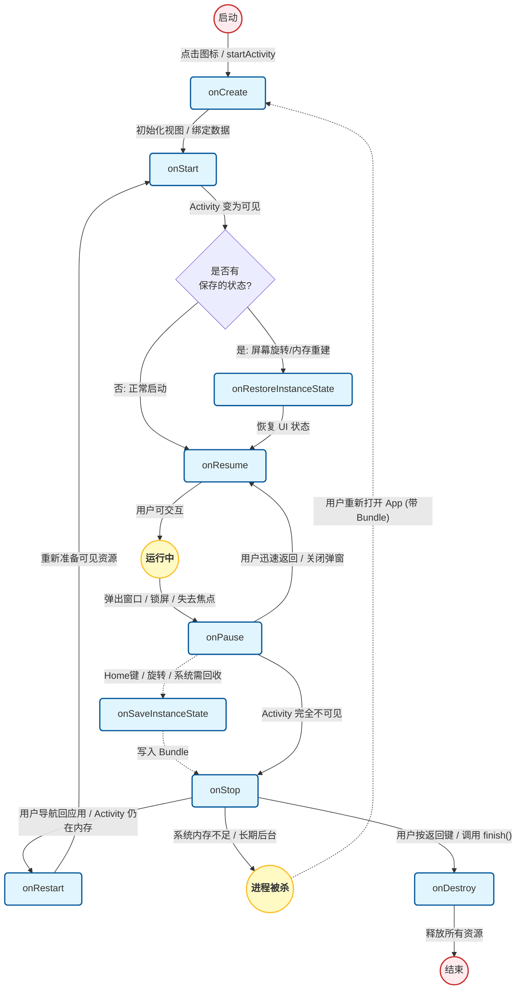
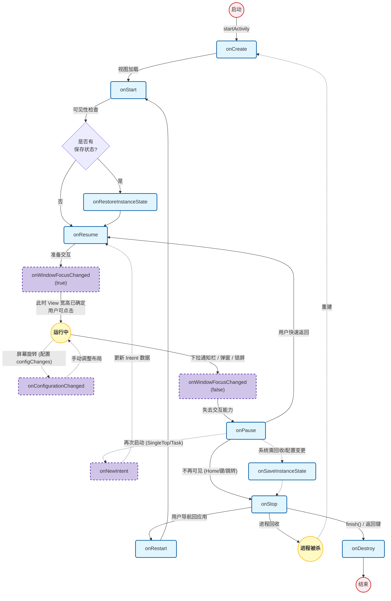

### Activity 常见的生命周期方法



Activity 生命周期方法常见的有 12 个：

1）`onCreate(Bundle savedInstanceState)`

+ **状态：**开始创建
+ **用途：**（在整个生命周期只需执行一次的操作）
  + 加载布局：`setContentView(R.layout.xxx)`；
  + 绑定控件：`findViewById` 或 `ViewBinding`；
  + 解析参数：读取 `Intent` 传参或 `savedInstanceState` 关键数据；
  + 初始化与配置：构建相关列表，构建 `ViewModel`，实例化 `Adapter` 并绑定给 `RecyclerView`，设置事件监听；
  + 订阅观察者：注册 LiveData 的回调，建立数据驱动链路。可能需要通过主动 get 数据触发首刷，防止没有回调。

2）`onStart()`

+ **状态：**不可见 -> 可见（在这个过程中执行，下面的“->”都是代表在过程中）

+ **用途：**

  + 刷新 UI：在看别人博客和 AI 查询时受到了误导，它们会介绍 `onStart()` 和 `onResume()` 生命周期会实现刷新 UI 的功能。首先我想强调，无论是传统模式还是现代模式，刷新 UI 的本质都是数据驱动的，而不是依赖生命周期去“轮询”。如果只在 `onStart()` 或 `onResume()` 主动拉取一次数据，那像股票这种每秒都在变的场景就无法实时刷新了。所以，生命周期的作用不是“去拉数据”，而是控制“什么时候允许数据推送到 UI 上”。
  
    在传统模式上，我们会在 `onStart()` 里注册回调，在 `onStop()` 里注销。为什么不在 `onCreate()` 里注册？因为传统回调没有生命周期感知。如果应用切到后台，回调依然触发，此时操作 UI（特别是 Fragment 事务或 `Dialog.show()`）会导致 Crash，且不可见时刷新 UI 也是浪费资源。因此，利用 `onStart()`/`onStop()` 确保只有界面可见时才响应回调。

    对于 `onResume()`，它更多兜底去做一些轻量级检查，它处理的是“可见但失去焦点”后恢复的场景，比如从分屏、系统弹窗或下拉栏返回。这时候适合做一些状态对齐，例如用户可能在系统设置里关了权限，回来时需要在 `onResume()` 里查一下并弹窗提示，防止状态不一致。

    而在现代模式下，会使用 LiveData 的方式，LiveData 的关键是把观察者绑定到 `LifecycleOwner`，我们可以在 `onCreate()` 里直接观察数据，不用担心 Crash 和浪费资源的问题，因为 LiveData 内部会自动感知生命周期，只有当页面处于 `onStart()` 或 `onResume()`（即可见状态）时，才会把数据分发给 UI 回调。

  + 注册广播：`registerReceiver(...)`，传统模式下，需在 `onStart()` 中调用 `registerReceiver()` 并在 `onStop()` 注销，确保只在页面可见时更新 UI，防止后台 Crash。而现代模式下，我们将广播封装为具备生命周期感知的 LiveData，ViewModel 将其暴露后，Activity 直接在 `onCreate()` 中订阅即可。系统会自动在页面可见时激活分发，不可见时自动挂起。

3）`onResume()`

- **状态：**可见 -> 可交互（获得焦点）
- **用途：**
  - 刷新 UI：已在上面解释。
  - 启动传感器：虽然开启传感器通常由点击事件触发，但是生命周期里也需要进行判断，比如用户接电话退出了应用，之后又回到应用，需要进行恢复（点击开启时可以设个 flag，走生命周期时进行判断）。至于为什么不放在 `onStart()`？因为 Android 7.0 分屏模式下，`onStart()` 是为了保证“可见即运行”（如相机预览，避免分屏时黑屏），而传感器（如震动）是高耗电且依赖交互的硬件，如果在分屏时用户操作另一侧应用，继续运行既无意义又费电，所以要放在 `onResume()` 里。总之具体案例具体分析。

4）`onPause()`

- **状态：**可交互 -> 不可交互（失去焦点）
- **用途：**
  - 释放相应资源：与 `onStart()` 相对应。
  - 保存轻量级数据：根据系统机制，只有 Activity A 的 `onPause()` 执行完，B 才能执行到 `onResume()`（只能有一个 Activity 处于前台），因此必须限制在极轻量操作（如存个视频进度或几行文字到 SharedPreferences），否则跳转会变卡。另外这些放 `onPause()` 里，是因为 `onStop()` 发生在 B 显示之后，如果跳转过程中应用崩溃或进程被杀，`onStop()` 根本没机会执行，所以能放 `onPause()` 里的尽量放在它里面。但需注意，生命周期里的操作仅仅是最后保底，最好结合实时同步的机制，以防触发 `onPause()` 之前发生闪退的情况。

5）`onStop()`

- **状态：**可见 -> 不可见
- **用途：**
  - 释放相应资源：与 `onResume()` 相对应。
  - 保存复杂数据：写数据库或者做网络请求，当然最好还是开个异步线程去存。这步为什么不放在 `onDestory()` 中，因为它是有可能不被执行的，在后台可能会直接被杀掉，而 `onStop()` 几乎可以保证执行的，所以复杂重要的数据，要放在 `onStop()` 进行保存。
  - 关闭动画。

6）`onDestroy()`

- **状态：**彻底销毁
- **用途：**
  - 移除 Handler。这里解释一下，为什么不把 `onDestory()` 的操作都放在 `onStop()` 中？因为 `onStop()` 仅仅代表 Activity 进入后台，这些东西逻辑还是会使用的。比如播放音乐的 Service，不能因为进入后台就进行销毁。只有当走到 `onDestory()` ，才说明该 Activity 彻底不使用了，为了避免内存泄漏，要全部释放掉。
  - 取消订阅：RxJava 的 `dispose()` 等。
  - 解绑 Service。

7）`onRestart()`

- **状态：**后台 -> 前台
- **用途：**
  - 很少使用。

8）`onSaveInstanceState(Bundle outState)`

+ **状态：**没有调用 `finish()` 的情况下（也就是不是用户主动关闭的情况下），且执行到了 `onStop()`。（`onStop()`  之后；[源码分析](https://github.com/yipianfengye/androidSource/blob/master/24%20onSaveInstanceState%E6%89%A7%E8%A1%8C%E6%97%B6%E6%9C%BA.md?plain=1)）
+ **用途：**
  + 系统会自动保存一些当前 Activity 的视图结构。
  + 一些临时的 UI 状态，不需持久化的。
  + 当进程被杀时，重新进入应用时，Bundle 中的数据还是存在的（它是由系统进程进行保管的）


9）`onRestoreInstanceState(Bundle savedInstanceState)`

+ **状态：**Bundle 不为空的情况下调用。（`onStart()` 和 `onResume()` 间）
+ **用途：**
  + 根据自动保存的视图结构，恢复部分 View 的状态，如输入框内容、列表滚动位置等；
  + 根据 Bundle 中的值，进行相应的 UI 恢复。另外 `onCreate()` 参数中也是有 Bundle 的，它俩的区别是 `onRestoreInstanceState()` 被调用时，`savedInstanceState` 一定非空，无需判空；`onCreate()` 正常启动时 `savedInstanceState` 可能为 null，需要判空。根据语义，恢复 Bundle 的操作更建议放在 `onRestoreInstanceState()` 中操作。


10）`onConfigurationChanged(Configuration newConfig)`

+ **状态**：当运行时发生配置变化，且该 Activity 在 Manifest 中通过 `android:configChanges` 声明自行处理这些变化时调用；否则系统会重建 Activity。
+ **用途：**
  + 当方向、夜间模式、语言、字体缩放等变化后，刷新 UI。

11）`onNewIntent(Intent intent)`

+ **状态：**SingleTop/SingleTask 模式下启动该 Activity，如果可以复用会进行调用。
+ **用途：**
  + 在一个已经存在的 Activity 里接收传参值，进行相应的逻辑处理。（必须更新 `intent` 通过  `setIntent(intent)`，否则之后 `getIntent()` 还是第一次启动时的那个）


12）`onWindowFocusChanged(boolean hasFocus)`

+ **状态：**Activity 的 Window 获得/失去焦点（和 `onResume()` 不同，比如 Activity 里弹 Dialog/DialogFragment、下拉通知栏）
+ **用途：**
  + 常用来做必须等窗口真正可交互才能做的事。比如用户看一个固定时长的广告，当失去焦点，就停止计时。
  + 是拿到某个 View 的最终宽高/坐标，因为它是在布局阶段（Measure/Layout/Draw）完成后触发的，可以拿到正确的值。




### 生命周期的状态切换

+ 当 Activity 启动时：`onCreate() -> onStart() -> onResume()`；
+ 当 Activity 退出时：`onPause() -> onStop() -> onDestory()`；
+ 当在 Activity 按下 Home 键：`onPause() -> onStop()`；
+ 当从后台重新回到应用时（点击桌面图标或最近任务），此时的 Activity 会经历：`onRestart() -> onStart() -> onResume()`；
+ 当关闭屏幕时：`onPause() -> onStop()`；
+ 当屏幕重新打开时：`onRestart() → onStart() → onResume()`；
+ 当下拉通知栏或上滑通知栏时：无生命周期变化；
+ 顶部悬浮通知时：无生命周期变化；
+ 当下拉通知栏，又从通知栏打开另一个应用时：`onPause() → onStop()`；
+ 当弹出一个透明的 Activity，例如四周透明的 Dialog（普通 Dialog 不会，因为它是依附于该 Activity 的，而不是独立的 Activity）：`onPause()`；
+ 进入分屏模式，以及退出分屏模式时（除非在 Manifest 进行了配置）：`onPause() -> onStop() -> onSaveInstanceState() -> onDestroy() -> onCreate() -> onStart() -> onRestoreInstanceState() -> onResume()`；
+ 在分屏中点击“另一侧”应用，当前应用的 Activity：`onPause()`；
+ 在分屏下，从“另一侧”应用点回到当前应用：`onResume()`；
+ Activity 切换：
  + Activity1：`onPause()`
  + Activity2：`onCreate() -> onStart() -> onResume()`
  + Activity1：`onStop()`
+ 屏幕旋转时：`onPause() -> onStop() -> onSaveInstanceState() -> onDestroy() -> onCreate() -> onStart() -> onRestoreInstanceState() -> onResume()`
+ SingleTop/SingleTask 模式下启动已存在的 Activity 时，不在栈顶的情况下，如果在前台 `onPause() -> onNewIntent() -> onResume()`；如果在后台 `onNewIntent() -> onRestart() -> onStart() -> onResume()`。

### Activity 的启动模式

+ Standard（标准模式；默认）

  每次启动都会新建一个实例，不管栈里有没有。

+ SingleTop（栈顶复用）

  如果目标 Activity 已经在栈顶，就复用，不会新建；否则新建一个。

  比如搜索页顶部有个“搜索”入口，重新输入时可以利用 `onNewIntent()` 传新参数，显示新内容。

+ SingleTask（栈内复用）

  会先检查是否存在该实例，如果存在则把该 Activity 之上的其他 Activity 全部出栈；不存在则新建该 Activity。

  比如点击主界面时。

+ SingleInstance（单实例）

  该 Activity 独占一个任务栈。启动时，如果该 Activity 不存在，则创建新的任务栈，然后再创建该 Activity 实例；如果已经存在，系统会把该任务栈移到前台，从而显示该 Activity。

  并且这个栈中只会有这一个 Activity，你再从这个 Activity 启动新的 ActivityB，ActivityB 不会进入这个独立栈，而是被放到原应用的任务栈中。
  
  比如跳转来电界面/闹钟响铃界面。

以上是常规用法，再讲一下两个属性，taskAffinity（每个 Activity 都有 taskAffinity 属性，如果没有显式的指明 taskAffinity，那么就等于 Application 指明的 taskAffinity，而如果 Application 也没有指明，那么该 taskAffinity 的值就等于应用的包名）、allowTaskReparenting（当按下 Home 键，应用再次被启动时，允许跳转到目标任务栈里），可以参考[《任务栈、SingleTask、taskAffinity、allowTaskReparenting》](https://www.jianshu.com/p/f5457382b8a1) + [《taskAffinity 和allowTaskReparenting的用途》](https://www.cnblogs.com/ywtk/p/4151609.html)，这篇文章讲的很详细。

在我实操里，这两个属性结合上 lanuchmode，行为比较混乱，不去纠结了，用的不多。就简单的例子讲一下：

```xml
<activity android:name=".ui.activity.demo.task.TaskA1Activity"/>
<activity android:name=".ui.activity.demo.task.TaskB1Activity"
    android:launchMode="singleTask"
    android:taskAffinity=".myNewTask"/>
```

上面这个，main -> A1 -> B1，观察最近任务，会出现两个 Task。

```xml
<activity
    android:name=".ui.activity.demo.task.TaskA1Activity"
    android:taskAffinity=".myNewTask"
    android:allowTaskReparenting="true"/>
```

而这个，main -> A1，然后按 Home 键，然后再次打开应用，会发现出现两个 Task，A1 去了 `.myNewTask`。

下面是另一个 Demo：

```xml
<activity android:name=".ui.activity.demo.task.TaskA1Activity"/>
<activity android:name=".ui.activity.demo.task.TaskA2Activity"
    android:launchMode="singleTask"/>
<activity android:name=".ui.activity.demo.task.TaskB1Activity"
    android:launchMode="singleTask"
    android:taskAffinity=".myNewTask"/>
```

+ 从 mainActivity 点击按钮启动了 TaskA1Activity
+ 从 TaskA1Activity 点击按钮启动了 TaskB1Activity（会出现在新的任务栈里；在手机上观察最近任务，会出现两个该应用）
+ TaskB1Activity 点击按钮启动了 TaskA2Activity
  - 前台 Task 1（应用名称）：main -> A1 -> A2
  - 后台 Task 2（myNewTask）：B1
+ 1）一直按 back 键：A2 -> A1 -> main -> B1
+ 2）如果先按 Home 键，然后点击该应用，一直按 back 键：A2 -> A1 -> main（按 Home 键后从桌面重新进入应用，会唤醒默认的主任务栈并将其底层的返回终点重置为桌面，从而切断了原本跨任务栈返回 B1 的临时链接）（根本原因应该是从桌面启动时，携带的 `FLAG_ACTIVITY_RESET_TASK_IF_NEEDED`，其特性切段了这里的链接）

另外在说一下这俩个字段有啥用处，大概就是比如，邮箱点链接临时打开浏览器的 Activity（带浏览器的 taskAffinity 和 allowTaskReparenting），之后点 Home 键，再次点击邮箱发现没有这个 Activity 了。

### Activity 的显示调用和隐式调用

#### 显示调用

明确指定组件信息（包名、类名）。如果一个 Intent 既有显式又有隐式，以显式调用为主。

1）同一应用进行跳转：

```java
// 从MainActivity跳转到DetailActivity
// 参数1：当前的上下文(Context，通常传this)
// 参数2：目标Activity的Class对象
Intent intent = new Intent(this, TargetActivity.class);

// 可以在Intent中携带数据
intent.putExtra("user_id", 1001); 
intent.putExtra("user_name", "张三");

startActivity(intent);
```

2）跨应用跳转：

```java
Intent intent = new Intent();
// 对方在Manifest中注册该组件时必须设置android:exported="true"
// 参数1是包名，参数2是完整的类名
intent.setClassName("com.tencent.mm", "com.tencent.mm.ui.TargetActivity");
```

3）非 Activity 环境下跳转 Activity：

但需注意，在 Android10 后，后台是无法启动 Activity 的（为了防止流氓软件）。

```java
Intent intent = new Intent(context, TargetActivity.class);

// 必须添加FLAG_ACTIVITY_NEW_TASK标志位
// 在Activity里不需要这个是因为，Activity自己就带任务栈；而Application这些虽然也是Context，但它们没有属于自己的任务栈
// 非Activity的Context上下文无任务栈，需用NEW_TASK强制寻栈或建栈（这个flag的语义大致如此）
intent.addFlags(Intent.FLAG_ACTIVITY_NEW_TASK);

// Service/Application中直接用this；非context的需要手动获得context
context.startActivity(intent);
```

#### 隐式调用

不明确指定组件，通过匹配 IntentFilter 中的规则启动。

整体匹配原则：

+ IntentFilter 的过滤信息包含 3 种：action、category、data。
+ 完全匹配：一个 Intent 必须同时匹配 action类别、category类别、data类别，才算完全匹配，才能成功启动目标 Activity。
+ 多组 Filter：一个 Activity 可以有多个 `<intent-filter>`，Intent 只要完全匹配其中任意一组即可启动该 Activity。

1） Action 的匹配规则

+ Action 是一个字符串（系统预定义或自定义）。
+ Intent 中**必须要有** action，且该 action 必须和过滤规则中的**其中一个** action 完全相同（字符串值完全一致，区分大小写）
+ 

2）Category 的匹配规则

+ Category 是一个字符串（系统预定义或自定义）
+ Intent 中可以**没有** category；但如果 Intent 中**有** category（哪怕有多个），那么 Intent 中的**每一个** category 都必须能在过滤规则中找到完全相同的项。
+ `tartActivity()` 隐式启动会默认给 Intent 加 `android.intent.category.DEFAULT`，所以 Activity 要接收这种启动，`intent-filter` 必须包含 `<category android:name="android.intent.category.DEFAULT" />`；如果你额外加了别的 category，filter 里也要同时声明这些 category 才能匹配。

3）Data 的匹配规则

+ Data 由两部分组成：mimeType（媒体类型，如 image/jpeg）和 URI（`<scheme>://<host>:<port>/[<path>|<pathPrefix>|<pathPattern>]`）。
  + Scheme：模式（如 http, file, content）。**无 scheme 则整个 URI 无效**。
  + Host：主机名（如 www.baidu.com）。**无 host 则整个 URI 无效**。
  + Port：端口号（如 80）。必须在 scheme 和 host 都有的情况下才有效。
  + Path：路径信息，有三种方式
    + path：完整路径信息；
    + pathPrefix：只要以这个前缀开头就行
    + pathPattern：正则表达式 （注意正则转义：`* 写成 \\*，\ 写成 \\\\`）。
+ 如果 Filter 中只指定了 mimeType（如 image/*），虽然没写 URI，但 **URI 有默认的 scheme：content 和 file**。Intent 的 URI 必须使用这两种 scheme 之一。
+ 必须调用 intent.setDataAndType(uri, type) 来同时设置；**绝对不能**先 setData() 再 setType()。因为看源码可知，这两个方法都会互斥地把对方的值清空（置为 null）
+ `<data scheme="file" host="www.baidu.com"/>` 和分成两个标签写 `<data scheme="file"/> <data host="www.baidu.com"/>` 效果完全等价。

另外


1. 
2. **应用入口标志**：<action android:name="android.intent.action.MAIN" /><category android:name="android.intent.category.LAUNCHER" />这两者**缺一不可**，共同标明这是一个入口 Activity，并且会出现在系统的应用图标列表中。


```java
// 隐式方式启动一个Activity
Intent intent = new Intent("com.ryg.charpter_1.c");
intent.addCategory("com.ryg.category.c");
intent.setDataAndType(Uri.parse("file://abc"), "text/plain");

// 获取PackageManager对象 (在Activity中直接调用getPackageManager())
// 它是应用包管理器，用来查询设备上安装了哪些应用以及它们的组件信息，比如寻找哪个Activity能接收你的Intent
PackageManager pm = getPackageManager();


// 方法一：使用PackageManager.resolveActivity (返回最佳匹配的一个)
// 第二个参数传入PackageManager.MATCH_DEFAULT_ONLY标志位
// 这样只匹配声明了<category android:name="android.intent.category.DEFAULT"/>的Activity
// 不含DEFAULT的Activity是无法接收隐式Intent的
ResolveInfo bestMatchInfo = pm.resolveActivity(intent, PackageManager.MATCH_DEFAULT_ONLY);
if (bestMatchInfo != null) {
    startActivity(intent);
} else {
    Log.e("IntentCheck", "未找到合适的 Activity，取消启动！");
}


// 方法二(最常用、代码最简洁)：使用 Intent.resolveActivity
// 底层其实就是调用了pm.resolveActivity(this, PackageManager.MATCH_DEFAULT_ONLY)
ComponentName componentName = intent.resolveActivity(pm);
if (componentName != null) {
    startActivity(intent);
} else {
    Log.e("IntentCheck", "未找到合适的 Activity，取消启动！");
}


// 方法三：使用 PackageManager.queryIntentActivities (返回所有匹配的列表)
// 与resolveActivity的区别是，它返回的是所有符合条件的Activity集合，而不是单个最佳匹配
List<ResolveInfo> resolveInfos = pm.queryIntentActivities(intent, PackageManager.MATCH_DEFAULT_ONLY);
if (resolveInfos != null && !resolveInfos.isEmpty()) {
    startActivity(intent);
} else {
    Log.e("IntentCheck", "未找到合适的 Activity，取消启动！");
}
```


#### Activity 的 Flags

Flags 也叫“标记位”，有很多。有的标记位可以设定 Activity  的启动模式，还有的标记位可以影响 Activity 的运行状态等。一般不需要去指定标记位，理解即可，解释几个常用的：

| Manifest launchMode | Intent Flags 等效写法                                 |
| ------------------- | ----------------------------------------------------- |
| standard            | 无（默认）                                            |
| singleTop           | FLAG_ACTIVITY_SINGLE_TOP                              |
| singleTask          | FLAG_ACTIVITY_NEW_TASK \| FLAG_ACTIVITY_CLEAR_TOP     |
| singleInstance      | FLAG_ACTIVITY_NEW_TASK \| FLAG_ACTIVITY_MULTIPLE_TASK |

还有像 `FLAG_ACTIVITY_EXCLUDE_FROM_RECENTS`，让该 Activity 所在的任务栈，不出现在最近任务里，用户无法从最近任务返回该应用。


###### DialogFragment 和通过 Activity 实现 Dialog

###### Jetpack 实现注册广播

###### 什么是内存泄漏

