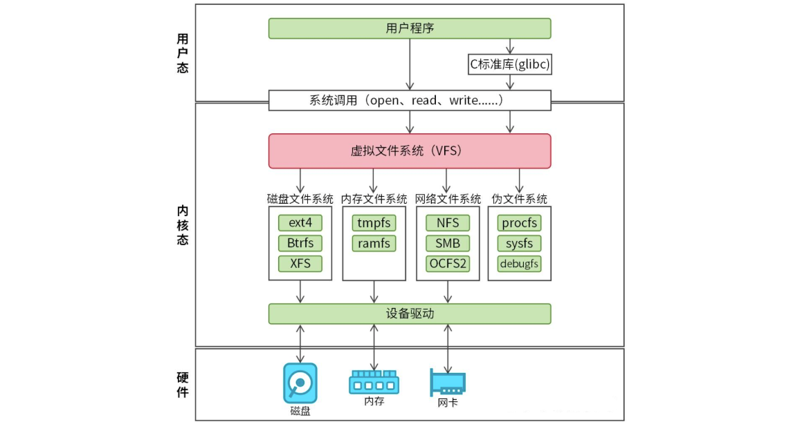

## Android 中的多进程模式

这里的多进程是指一个应用中存在多个进程的情况，不讨论两个应用之间的多进程情况。 

在 Android 中，除非是底层开发（通过 JNI 在 Native 层去 fork 一个新的进程），否则给四大组件配置 android:process 属性依然是实现多进程的唯一主流方式。

实现方式是在 Manifest 中进行声明：

```xml
<manifest xmlns:android="http://schemas.android.com/apk/res/xml/android"
    package="com.example.myapp">

    <!-- 1.默认主进程：进程名就是包名"com.example.myapp" -->
    <activity android:name=".MainActivity">
        <intent-filter>
            <action android:name="android.intent.action.MAIN" />
            <category android:name="android.intent.category.LAUNCHER" />
        </intent-filter>
    </activity>

    <!-- 2.私有进程：进程名为"com.example.myapp:web" 
         常用于WebView模块，隔离内存和崩溃风险 -->
    <activity
        android:name=".WebActivity"
        android:process=":web" />

    <!-- 3.全局进程：进程名为"com.example.helper"
         这种不以冒号开头的命名方式属于全局进程 -->
    <service
        android:name=".DownloadService"
        android:process="com.example.helper" />

</manifest>
```

这种全局进程配合 sharedUserId 使用，可让不同应用的组件运行在同一进程中，共享内存空间、静态变量和数据目录。但破坏了 Android 应用的沙箱隔离机制，一个 App 的漏洞可能危害到另一个 App。现在已过时。

而私有进程，是属于当前应用的，其他应用无法像全局进程那样直接直接访问。一般就是进行模块解耦，内存扩展，还有像常驻后台的操作（让某些后台 Service 在主进程退出后依然独立存活）。

我们可以通过 `adb shell ps | grep com.example.app`，来查询进程的相关信息。通过 `adb shell ps -A` 可以查看所有进程的信息。

另外需要注意，会造成很多问题，比如下面几个：

1）静态成员和单例模式完全失效

- 如果你在 A 进程修改了一个静态变量 Config.isDebug = true，在 B 进程中读取这个变量，它依然是初始值（比如 false）。
- 单例模式本质上也是基于静态变量。A 进程一个单例对象，B 进程一个单例对象，它们不是同一个实例，无法通过单例来共享数据。

这是因为 Android 的每一个进程都会被分配一个独立的虚拟机（VM），每个虚拟机都有自己独立的内存地址空间。

2）线程同步机制完全失效

+ 如果你在 A 进程对某个方法加了锁，B 进程依然可以同时访问这个方法（因为它是两个不同的虚拟机实例在跑）。

所有的同步锁（如 synchronized 关键字、ReentrantLock 等）都是基于 JVM 内部的对象锁或内存屏障，用范围仅限于当前的虚拟机（即当前进程）。

3）SharedPreferences 的可靠性下降

+ 如果 A 进程和 B 进程同时修改同一个 SP 文件，会导致数据覆盖或丢失。由于它不支持进程间同步，读到的数据也可能是旧的缓存数据。

4）Application 会多次创建

当一个组件运行在新的进程中时，系统需要为该进程启动一个新的虚拟机。启动虚拟机的过程包括：

1. 加载进程。
2. 创建该进程对应的 Application 实例。
3. 调用 Application.onCreate()。

所以一定要进行额外处理，如果不处理，会导致重复初始化（如 SDK、数据库、日志等），可能会导致严重问题（之前 Settings 应用里为了杜比音效开了一个进程，导致 Application 初始话了两回，从而导致里面的 SomeIp 注册了两回，导致不能使用）。需要在 Application 类中判断当前进程名，按需初始化：

```java
public class MyApplication extends Application {
    @Override
    public void onCreate() {
        super.onCreate();
        
        // 获取当前运行的进程名
        String processName = Application.getProcessName();
        
        if (getPackageName().equals(processName)) {
            // 这里是主进程
            // 初始化的常规SDK（如支付、地图等）
        } else if (processName.endsWith(":web")) {
            // 这里是web子进程
            // 仅初始化与网页渲染相关的逻辑，不要初始化主进程的库
        }
    }
}
```

为解决这些问题，就需要用到 IPC（进程间通信）的方式。

## IPC 基础概念介绍

IPC（Inter-Process Communication）指的是进程间通信，即在两个相互隔离的进程之间进行数据交换的过程。

虽然 Android 基于 Linux 内核，但它并未完全沿用 Linux 传统的通信方式（如命名管道、消息队列等），而是构建了一套以 Binder 为核心的通信体系。Binder 以其高效、安全的特性，成为了 Android 系统中最具代表性的 IPC 方案。此外，Android 也支持 Socket，常用于跨网络或设备内两个相对独立的进程间通信。

为什么需要多进程模式？

+ 突破内存限制：Android 系统对单个进程所能使用的内存是有上限的（例如某些机型限制为 256MB 或 512MB）。如果一个 App 业务非常复杂（如同时有大型游戏、高清视频、复杂的 WebView 等），单进程很容易触发 OOM（内存溢出）。开启多进程后，每个进程都能拥有独立的内存配额，从而变相增加了整个 App 可使用的总内存上限。
+ 隔离风险，提升稳定性：有些模块（如 WebView 渲染、第三方 SDK、容易内存泄漏的组件）稳定性较差，一旦崩溃会导致整个 App 闪退。将这些模块放在独立进程中，即便它们崩溃了，主进程依然可以正常运行，用户体验不会完全中断，主程序只需重启该子进程即可。
+ 独立生命周期 (保证后台存活)：主界面（UI 进程）在用户退出后容易被系统回收，但某些后台任务（如音乐播放、推送服务、下载任务）需要持续运行。将后台任务放在独立进程中，使其生命周期与 UI 进程脱离。即使 UI 进程因为占用内存过高被系统杀掉，后台任务进程仍有机会继续存活，保证业务连续性。

### Serializable 接口

Serializable 是 Java 提供的一个标记接口（接口内没有方法）。它的作用是告诉 JVM：这个类的对象是可以被序列化的。

+ 序列化（Serialization）是指将内存中的对象（具体来说是，对象的状态，类型信息和字段值）转换为字节流的过程，以便能够将该对象保存到文件、数据库，或者进行网络传输。

+ 反序列化（Deserialization）就是将字节流转换回对象的过程，以便构建原始对象。


在 Android 开发中，Serializable 主要用于以下三个地方：

+ Activity/Fragment 间的数据传递： 通过 Intent 或 Bundle 传递自定义对象。

  ```java
  Intent intent = new Intent(this, SecondActivity.class);
  User user = new User("Eric", 35);
  // user 必须实现 Serializable 或 Parcelable
  intent.putExtra("User", user);
  startActivity(intent);
  
  User user = (User) getIntent().getSerializableExtra("User");
  ```

+ 持久化存储：将对象保存到本地文件或数据库中。

+ 网络传输：可以用 Java 对象序列化的方式，但更流行的是 Json 序列化的方式。序列化方式不仅仅有 Java 对象序列化（Serializable），还有 Json 序列化、ProtoBuff 序列化等。

常规代码的实现：

第一步，实现 Serializable 接口。

```java
// Serializable是一个标记接口，没有任何方法，告诉JVM，该类的对象可以被序列化
public class Person implements Serializable {
    // 手动指定一个固定值，让系统不要自动计算，保证类的兼容
    private static final long serialVersionUID = 1L;
    private String name;
    private int age;

    // 省略构造方法、getters和setters
}
```

第二步，声明 ObjectOutputStream。

```java
// ObjectOutputStream：用于将对象转换为字节流，并写入到指定的输出流（如文件、网络流）中
// FileOutputStream：将数据写入到文件person.ser中，该文件保存序列化后的对象。
ObjectOutputStream out = new ObjectOutputStream(new FileOutputStream("person.ser"));
```

第三步，调用 ObjectOutputStream 的 writeObject 方法，将对象序列化并写入到输出流中。

```java
Person person = new Person("沉默王二", 18);
out.writeObject(person);
```

反序列化。反序列化出来的 newPerson 和原对象 Person内容一模一样，但它们在堆内存中的地址是不同的。

```java
ObjectInputStream in = new ObjectInputStream(new FileInputStream("person.ser"));
Person deserializedPerson = (Person) in.readObject();
System.out.println(deserializedPerson.getName()); // 输出: 沉默王二
System.out.println(deserializedPerson.getAge());  // 输出: 18
```

######  serialVersionUID

再说一下 `serialVersionUID` 的意义：

```java
public class User implements Serializable {
    private static final long serialVersionUID = 1L;
    
    private String name;
    private int age;
    private String email;  // 比如，新增字段
}
```

新增前：

```
User{name="张三", age=25}
serialVersionUID = 1L  ← 固定值
```

新增后：

```
serialVersionUID = 1L  ← 还是 1L，没变！
文件中的值: serialVersionUID = 1L  ← 匹配！
```

结果：

```java
User newUser = (User) in.readObject();
// name = "张三"  ✓
// age = 25      ✓
// email = null  ← 新字段为默认值，但程序没崩溃
```

如果不加：

```
系统重新计算：serialVersionUID = 9876543210L  ← 变了
文件中的值：serialVersionUID = 1234567890L  ← 旧版本
两者不匹配：InvalidClassException → 程序崩溃
```

这样做就是为了版本兼容（增删字段不影响），防止崩溃。

###### 为什么 int 不用序列化呢？

并不是 int 不用序列化，而是 int 本身就具备可序列化的属性，它是序列化过程中的最小原子单元，一个 int 在内存里永远固定占据 4 个字节（32位）。它的结构是透明的、标准的。JVM 根本不需要任何额外的“说明书”就可以直接把 int 转换成二进制。

###### 为啥不默认实现 Serializable 接口呢？多此一举？

+ 安全性：如果所有对象默认都是可序列化的，那么系统中的任何敏感信息（password）都可以轻而易举地被写到磁盘上或通过网络发送出去。通过让类实现 Serializable 接口，程序员实际上是在做一个显式声明：“我确认这个类的数据是可以被安全地导出并传输的。”
+ 技术可行性：并不是所有的 Java 对象都能被转换成字节流，比如 Thread、Socket 等（正常不会放在对象里）。
+ 性能：序列化涉及大量的反射（Reflection）操作，通过“按需开启”，降低性能影响。

### Parcelable 接口

Parcelable 是 Android 专属的序列化接口，专门用于在 Android 组件之间（如 Activity、Fragment、Service）高效传递对象。

当你在 Activity 之间传递数据或调用 AIDL 接口时，底层流程如下：

1. 用户态映射：进程 A 将对象通过 `writeToParcel` 写入一块内存缓冲区。
2. 内核拷贝：Binder 驱动将这块数据从进程 A 的内核缓冲区拷贝（或映射）到进程 B 的内核缓冲区。
3. 还原对象：进程 B 调用 `CREATOR.createFromParcel`，根据二进制流重新“拼装”出一个新的对象实例。

```
用户态(进程A): User对象 -> writeToParcel() -> Parcel数据
                    ↓
内核态:          Binder驱动拷贝/映射
                    ↓
用户态(进程B): Parcel数据 -> CREATOR.createFromParcel() -> 新User对象
```

Parcelable 的本质是**由开发者手动制定读写规则，直接在内存中进行二进制流的连续读写**。当你实现 Parcelable 接口时，你需要实现两个核心方法：

+ `writeToParcel`（序列化）：你告诉系统，哪些字段需要被保存，并按照什么顺序写入 `Parcel` 对象。
+ `CREATOR`（反序列化）：这是一个静态常量，系统通过它回调你的构造函数，按照完全一致的顺序从 `Parcel` 对象中读出字段。

其中，这个 `Parcel` 是 Java 层的一个包装类（Wapper，意思就是真正干活的代码和存储数据的地方都不在 Java 虚拟机里，而是在底层的 C++ 代码中），它的核心逻辑是在 C++ 环境中实现的。Java 中的 Parcel 对象持有一个指向 C++ 中 Parcel 对象的指针（mNativePtr），直接在 Native **内存**中通过指针移动（Position），将值按顺序写入到连续的内存空间里。相比之下，Serializable 使用的是 Java 虚拟机的反射机制，会在堆上产生大量临时对象（反射代码需要创 Method 对象、Field 对象），速度极慢。

| 维度         | Serializable                                                 | Parcelable                                   |
| ------------ | ------------------------------------------------------------ | -------------------------------------------- |
| **原理**     | 使用 Java 反射。                                             | 通过偏移量直接操作内存。                     |
| **中间产物** | 产生大量临时对象，加重 GC 负担。                             | 直接读写 Parcel 缓冲区，几乎不产生额外对象。 |
| **适用场景** | 持久化/网络。拥有 `serialVersionUID` 机制，对类结构的兼容性更强；而 Parcelable 完全依赖顺序，类结构如果发生变化，之前持久化的就无法使用了。 | Android 间组件传递。                         |

代码示例：

```java
public class User implements Parcelable {
    private String name;
    private int age;

    public User(String name, int age) {
        this.name = name;
        this.age = age;
    }


    // 反序列化构造函数，用于从Parcel中读取数据恢复出User对象
    // 顺序必须和写入时保持一致
    protected User(Parcel in) {
        name = in.readString();
        age = in.readInt();
    }

    // 将当前对象的字段写入到Parcel中
    // 写入顺序要与读取顺序一致，否则读取会出错或产生异常
    @Override
    public void writeToParcel(@NonNull Parcel dest, int flags) {  // flags用不到，它是和describeContents相关联的
        dest.writeString(name);
        dest.writeInt(age);
    }

    // 不太用，不用管，返回不同的值是为了处理文件描述符
    @Override
    public int describeContents() {
        return 0;
    }

    // CREATOR是系统用来构建Parcelable对象的工具
    public static final Creator<User2> CREATOR = new Creator<User2>() {
        // 从Parcel创建对象，调用上面的构造函数
        @Override
        public User createFromParcel(Parcel in) {
            return new User(in);
        }

        @Override
        public User[] newArray(int size) {
            return new User[size];
        }
    };
}
```

```java
Intent intent = new Intent(this, SecondActivity.class);
User user = new User("Eric", 35);
intent.putExtra("User", user);
startActivity(intent);
```

```java
User user = getIntent().getParcelableExtra("User");
```

在 Kotlin 中，实现 Parcelable 变得极其简单。只需要使用 `@Parcelize` 注解，编译器会自动帮你生成上述复杂的样板代码。

```kotlin
@Parcelize
class User(val name: String, val age: Int) : Parcelable
```

###### Parcelable 处理嵌套对象

这里会涉及类加载器的知识点，额外说一下。

在 Java/Android 中，每一个类都是由 ClassLoader 加载的。Android 中主要有两种常用的 ClassLoader：

+ BootClassLoader：负责加载 Android 系统框架层（Framework）的类（如 String、Integer、ArrayList 等）。
+ PathClassLoader：负责加载你自己的 App 里的类（如你写的 User、Book 等）。

Parcel 是 Android 系统库的类，它是由 BootClassLoader 加载的，你如果调用 `in.readParcelable(null)` 系统默认会使用 BootClassLoader 去尝试寻找类，这样就会找不到。`User {Book book}` 这种为什么不需要呢？因为 User 类和 Book 类都在你的 App 源码里，当虚拟机加载 User 类时，默认使用的就是你的 App 类加载器。另外像 `gson.fromJson(jsonString, User.class)` 底层其实也是要 `getClassLoader()` 的，帮你简化了一点。

```java
// 错误写法
protected User(Parcel in) {
    name = in.readString(); // String是系统类，没问题
    // 传入null，readParcelable会使用BootClassLoader
    book = in.readParcelable(null); 
}

// 正确写法
protected User(Parcel in) {
    name = in.readString();
    // 明确告诉Parcel，使用加载Book类的那个类加载器
    book = in.readParcelable(Book.class.getClassLoader());
}
```

### Binder

###### 内存映射（mmap）

首先说一下它是什么：mmap（memory map）是 Linux 提供的一种内存映射机制，它将文件或设备映射到进程的虚拟地址空间，使得对文件的操作可以像操作内存一样通过指针读写来完成。

一般提到 mmap 我们都是指的磁盘文件系统的映射逻辑。传统读写需要内核态与用户态之间的数据拷贝，而 mmap 让用户空间直接访问内核页缓存中的页，省去了拷贝开销。

+ 传统 I/O 的 2 次拷贝：磁盘 $\rightarrow$ 内核缓冲区 $\rightarrow$ 用户缓冲区。
+ mmap I/O 的 1 次拷贝：数据从磁盘读到内核页缓存后，因为用户虚拟地址已经映射到这里了，进程可以直接读。数据不需要再从内核拷贝到用户空间。

mmap 分为两种：

+ 文件映射：它将虚拟内存连接到磁盘上的一个真实文件或内核设备文件。它调用时必须先 `open()` 一个文件，把它的 `fd` 传给 `mmap`。刚开始只分配虚拟地址。只有当你真正读取这段内存时，底层才会触发缺页异常（Page Fault），把磁盘文件内容加载到内核的页缓存（Page Cache）中。你对这段内存的改动，内核会在合适的时候异步刷回磁盘文件。
+ 匿名映射：这种形式的 `mmap` 背后没有对应的真实文件。它纯粹是为了向操作系统申请一块干净的、全零的物理内存。调用时传入的 `fd` 参数为 `-1`，并在标志位中指定 `MAP_ANONYMOUS`。它不涉及任何磁盘 I/O。当触发缺页中断时，内核直接在物理内存（RAM）里分一个干净的页面给它。

```c
// 获得文件描述符
int fd = open("/dev/binder", O_RDWR);
// 传入fd进行文件映射
void* mapped = mmap(NULL, 1016 * 1024, PROT_READ, MAP_PRIVATE, fd, 0);
```

另外还有一个核心标志位：

| 组合形式                        | 背后有无文件 | 修改是否影响文件/其他进程                                    | 典型核心用途                                                 |
| ------------------------------- | ------------ | ------------------------------------------------------------ | ------------------------------------------------------------ |
| **共享文件映射（MAP_SHARED）**  | 有           | 是（修改同步到磁盘，别人可见）                               | 传统的跨进程共享内存，用来高效传输大量文件数据。             |
| **私有文件映射（MAP_PRIVATE）** | 有           | 否（写时复制，把数据复制一份到该进程的独立私有内存里，不会同步回磁盘文件，其他进程看不到你的修改） | 加载动态链接库（`.so` 文件），多个 App 共享同一个 `.so` 文件的代码段，但各自的全局变量互不干扰。 |
| **共享匿名映射（MAP_SHARED）**  | 无           | 是（无文件，但父子进程间数据共享）                           | 因为没有文件 FD，它通常只能用于父子进程之间（父进程 `mmap` 后 `fork()` 出子进程，子进程天然继承父进程的 VMA 映射表） |
| **私有匿名映射（MAP_PRIVATE）** | 无           | 否（完全独立的纯内存空间）                                   | 常规的内存分配，如 `malloc` 申请大内存，或者进程的堆、栈区域 |


----

上面介绍完了常说的磁盘文件系统的 mmap，下面介绍 binder_mmap。


首先 Linux 也有多态的概念，为特定的文件描述符（fd）提供了“专属实现”。在 Linux 内核里，mmap 系统调用其实是一个空壳子，整个过程其实是这样的：

+ 用户态：进程调用标准库的 mmap。

+ 系统调用层：VFS（Virtual File System，虚拟文件系统，它的工作就是根据 fd 找到对应的驱动）接收到请求。

  + 场景 A：`open("/text")`，VFS 发现 `/text` 位于磁盘分区上，由 ext4 驱动管辖。VFS 为这个 fd 关联了 ext4_file_operations。当你调 mmap 时，内核执行的是 ext4_file_mmap。

  + 场景 B：`open("/dev/binder")`，VFS 发现 `/dev/binder` 是一个字符设备，由 binder 驱动管辖。VFS 为这个 fd 关联了 binder_fops。当你调 mmap 时，内核执行的是 binder_mmap。

    

+ 识别设备：内核查看你传入的 binder_fd（文件描述符），发现它指向的是 `/dev/binder` 这个字符设备。

+ 分发请求：内核查找到 Binder 驱动注册的 file_operations 结构体。

  ```c
  // 在Linux内核开发中，每个驱动程序都会定义一张“功能清单”。
  // 对于Binder驱动来说，它的清单大概长这样：
  static const struct file_operations binder_fops = {
      .owner = THIS_MODULE,
      .open = binder_open,     // 当你open("/dev/binder")时执行这个
      .mmap = binder_mmap,     // 当你对 binder_fd执行mmap时执行这个
      .unlocked_ioctl = binder_ioctl, // 当你执行ioctl时执行这个
      // ... 其他操作
  };
  ```

+ 执行实现：内核发现 Binder 驱动在这个结构体里注册了 `.mmap = binder_mmap`，于是就跳转到 Binder 驱动内部执行 binder_mmap 函数。

---

什么是驱动？

上面提到的 `/dev/binder` 就是一个驱动程序（准确地说是驱动程序在用户空间的一个“入口”）。驱动程序（Device Driver）是连接操作系统内核与设备之间的“翻译官”。它的作用是，对于硬件（如硬盘、显卡、键盘）只懂电信号和寄存器指令；对于应用程序（如微信、游戏）只懂高级语言指令，驱动就是负责把应用程序的请求转换成硬件能懂的操作，反之亦然。比如 `/dev/tty` 串口、`/dev/fb0` 显卡。

通常驱动是为了操控硬件，但 Binder 是一个“虚拟设备驱动”，它没有对应的实体硬件。Android 把它写成驱动，主要是为了合法”进入内核空间（驱动程序运行在系统的内核空间，拥有最高权限，可以操作内存、硬件和 CPU 核心；普通的 App 运行在用户空间，不能直接碰硬件）。进程 A 无法直接访问进程 B 的内存，是 Linux 的安全机制，为了进程隔离。要打破这种隔离，必须找一个“中间人”。这个中间人必须有权限访问所有进程的内存。在系统中，只有内核有这个权限。所以把 Binder 写成驱动，就能名正言顺地运行在内核空间，帮两个进程搬运数据。

---

binder_mmap 和常说的磁盘文件系统的 mmap 有什么区别呢？比如从进程 A 发送数据到进程 B，三种方式的过程：

1）传统 IPC 方式（如 Socket、管道、消息队列）（核心逻辑：内核作为中转站，数据在用户态和内核态之间搬运两次）

- 第一步（拷贝）：进程 A 调用 write()。内核通过 copy_from_user 将数据从进程 A 的用户空间拷贝到内核缓存区。
- 第二步（中转）：内核通知进程 B。
- 第三步（拷贝）：进程 B 调用 read()。内核通过 copy_to_user 将数据从内核缓存区拷贝到 进程 B 的用户空间。
- 拷贝次数：2 次。
- 媒介：内核内存（通常是临时申请的 buffer）。
- 缺点：大数据量传输时，CPU 忙于搬运数据，效率低下。

2）标准文件 mmap 方式（用于读写磁盘文件）（核心逻辑：通过页表映射，让用户空间直接看到内核的页缓存）

- 准备阶段：进程 B 对文件 fd 调用 mmap。内核建立用户虚拟地址到内核页缓存（Page Cache）的映射。
- 第一步（拷贝/IO）：内核将数据从磁盘读取到内核页缓存（这是由磁盘驱动完成的一次 DMA/拷贝）。
- 第二步（无拷贝读取）：由于建立了映射，进程 B 此时可以直接通过指针读取数据。不需要执行 read()，也就没有了从内核到用户空间的拷贝。
- 拷贝次数：1 次（从磁盘到内核内存）。
- 媒介：磁盘 + 内核 Page Cache。
- 特点：主要解决了文件 I/O 的性能问题。但在两个进程间通信时，它通常需要一个真实的文件作为媒介。

3）Binder mmap 方式（Android 高效 IPC）（核心逻辑：内核通过“双重映射”，让发送方的拷贝动作直接把数据送到接收方的家门口）

- 准备阶段（关键）：
  1. 接收进程 B 打开 /dev/binder 并调用 mmap。
  2. Binder 驱动申请物理内存页。
  3. 双重映射：驱动将这块物理内存同时映射到进程 B 的用户空间和内核虚拟空间。
- 第一步（拷贝）：发送进程 A 调用 ioctl 发送数据。内核通过 copy_from_user 将数据从进程 A 的用户空间直接拷贝到内核里的那段映射虚拟地址。
- 第二步（无拷贝接收）：由于这块内核内存和进程 B 的用户空间映射的是同一物理页，数据刚刚拷贝进去，进程 B 立即就能在自己的用户空间看到了。
- 拷贝次数：1 次（从进程 A 用户空间到内核/进程 B 共享区）。
- 媒介：物理内存（RAM）。
- 优点：不需要磁盘参与，实现了内存级别的高速跨进程传输。

其实也就是，binder_mmap 和磁盘没有任何关系。

+ 标准 mmap：虚拟内存 $\rightarrow$ 物理内存 $\rightarrow$ 磁盘文件。

+ Binder mmap：虚拟内存 $\rightarrow$ 物理内存 $\rightarrow$ 没了（纯内存，没有磁盘文件）。


---

为什么不直接用共享内存的方式？这样不就实现 0 次拷贝吗？

最大的问题是安全性上，如果两个进程共享一块内存且都有写权限，一个进程崩溃或恶意修改数据，可能会直接导致另一个进程也挂掉。而 mmap 这种方式，接收方是只读的。


- 1. 进程间，用户空间的数据不可共享，所以用户空间 = 不可共享空间
  2. 进程间，内核空间的数据可共享，所以内核空间 = 可共享空间


Binder 通信涉及四个核心角色：

+ Client（客户端）：服务的请求方（如你的 App）。
+ Server（服务端）：服务的提供方（如系统服务 ActivityManagerService）。
+ Service Manager（目录服务）：管理所有的实名 Server。Server 需要先在它这里“注册”，Client 才能根据名字“查询”到 Server。类似于路由器。
+ Binder Driver（驱动）：是运行在 Android 内核空间的一种虚拟设备驱动，充当了 Client 进程、Server 进程和 Service Manager 之间跨进程通信的桥梁。在底层，它通过 mmap 技术在内核空间中创建接收缓存区并进行地址映射，实现了高效的“一次数据拷贝”。同时，Binder 驱动负责持有每个 Server 进程在内核中的 Binder 实体，并向 Client 进程分发对应的 Binder 引用。整个通信过程中的线程控制，则由 Binder 驱动自身动态管理的 Binder 线程池来统一调度和实现。


这 个 S t u b 就 是 一 个 B i n d e r 类 ， 当 客 户 端 和 服 务 端 都 位 于 同 一 个进 程 时， 方 法 调 用 不 会 走 跨 进 程 的 t r a n s a c t 过 程 ，而当两者位于不同进程时，方法调用需要走transact 过程，这个逻辑由Stub 的内部代理 类Proxy来完成。


asInterface：用于将服务端的Binder 对象转换成客户端所需的AIDL 接又类型的对象，这种转换过 程是区分进程的，如果客户端和服务端位于同一进程，那么此方法返回的就是服务端的Stub 对 象 本 身 ， 否 则 返回 的 是 系 统 封 装 后 的 S t u b , p r o x y 对 象 。


 当 客 户 端 发 起 远 程 请 求 时 ， 由于 当 前 线 程 会 被 挂 起 直 至 服 务 端 进 程 返 回数据，所以如果一个远程方法是很耗时的，那么不能在UI线程中发起此远程请求; 其次， 由于服务端的Binder 方法运行在Binder 的线程池中，所以Binder 方法不管是否耗时都应 该采 用 同 步 的 方 式 去 实 现 ， 因 为 它 已 经 运 行 在 一 个 线 程 中 了


从上述分析过程来看，我们完全可以不提供AIDL 文件即可实现Binder，之所以提供 AIDL 文件，是为了方便系统为我们生成代码。系统根据AIDL文件生成Java文件的格式 是固定的，我们可以抛开AIDL 文件直接写一个Binder出来，接下来我们就介绍如何手动 写一个Binder


AIDL 文 件 并 不 是 实 现 B i n d e r 的 必 需 品 。 是 否 手 动实 现 B i n d e r 没有本质区别，二者的工作原理完全 一样，AIDL 文件的本质是系统为我们提供了一种快速实现 B i n d e r 的 工 具 ， 仅 此 而已 。


## Android中的 IPC 方式

### 使用 Bundle

### 使用文件共享

### 使用 Messenger（过时）

### 使用 AIDL

### 使用 ContentProvider

### 使用 Socket

## Binder 连接迟

## 选用合适的 IPC 方式


