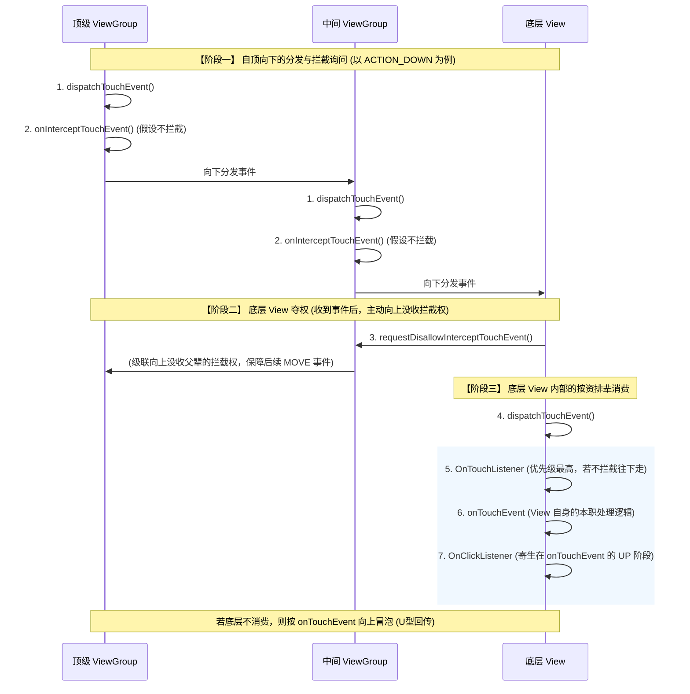
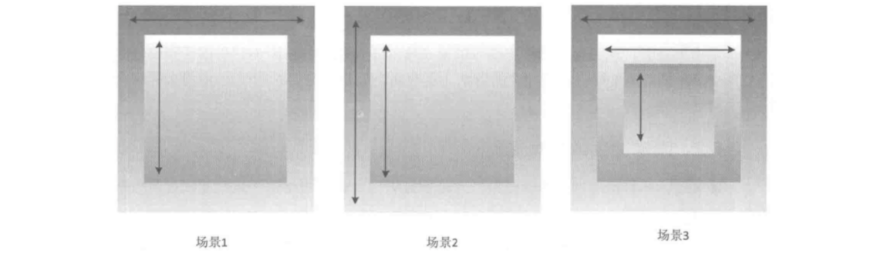

### View 的基础知识

View 是 Android 里绝大多数 UI 控件的基类（Activity、Fragment、Dialog 这些不是）。 很多时候仅仅使用系统提供的控件是不能满足需求的，因此我们就需要能够根据需求进行新控件的逻辑更改。

```
android.view.View
├─ android.view.ViewGroup  // 布局容器
│  ├─ android.widget.FrameLayout
│  │  ├─ androidx.fragment.app.FragmentContainerView
│  │  └─ android.widget.ScrollView
│  ├─ android.widget.LinearLayout
│  ├─ android.widget.RelativeLayout
│  ├─ androidx.constraintlayout.widget.ConstraintLayout
│  ├─ androidx.recyclerview.widget.RecyclerView
│  └─ android.widget.HorizontalScrollView
│
├─ android.widget.TextView
│  ├─ android.widget.Button
│  ├─ android.widget.EditText
│  ├─ android.widget.CheckBox
│  ├─ android.widget.RadioButton
│  └─ android.widget.Switch
│
├─ android.widget.ImageView
├─ android.widget.ProgressBar
│  └─ android.widget.SeekBar
│
├─ android.view.SurfaceView
├─ android.view.TextureView
└─ android.webkit.WebView
```

#### View 的位置参数

```java
// 布局边界
int left = v.getLeft();     // View左边缘距父容器左边缘的距离
int top = v.getTop();       // View上边缘距父容器上边缘的距离
int right = v.getRight();   // View右边缘距父容器左边缘的距离
int bottom = v.getBottom(); // View下边缘距父容器上边缘的距离

// 自身尺寸
int standardWidth = v.getWidth();   // 等同于v.getRight() - v.getLeft()
int standardHeight = v.getHeight(); // 等同于v.getBottom() - v.getTop()

// 视觉位置
float tx = v.getTranslationX();  // View的“整体”相对于原始布局位置的偏移距离
float ty = v.getTranslationY();
float x = v.getX();  // View当前左上角在父容器中的真实视觉坐标点，等同于v.getLeft() + v.getTranslationX()
float y = v.getY();
float sx = v.getScrollX();  // View的“内容”相对于原始布局位置的偏移距离（向右偏为负）
float sy = v.getScrollY();

// 屏幕绝对位置
int[] location = new int[2];
// 获取在屏幕上的绝对坐标 (最常用)
v.getLocationOnScreen(location);
int absoluteScreenX = location[0]; // 距离屏幕最左边的绝对距离
int absoluteScreenY = location[1]; // 距离屏幕最顶部的绝对距离
// 获取在当前窗口（Window）内的绝对坐标（普通Activity下，结果与上面一致；在Dialog时，为距离当前悬浮窗边缘的距离）
v.getLocationInWindow(location); 
int absoluteWindowX = location[0];
int absoluteWindowY = location[1];

// 注意，获取坐标和尺寸时，可能需要调用post()，以确保View已完成布局
```

#### View 的一些辅助类

##### 1）MotionEvent

MotionEvent 是封装触摸交互信息的对象，交互过程中会不断生成多个实例，通过 View 事件分发机制在视图树中逐层流转，构成了从按下（Down）到抬起（Up）的完整连续事件流。

这个类里常用的如下：

+ `event.getActionMasked()`：可以获取当前的动作类型。最基础的几种有，ACTION_DOWN、ACTION_MOVE、ACTION_UP、ACTION_CANCEL
+ `getX()/getY()`：获取用户**手指按下**的那个点相对当前 View 的坐标。
+ `getRawX()/getRawY()`：获取用户**手指按下**的那个点在整个屏幕上的坐标。

```java
// onTouchEvent用来处理分发到这个View的触摸事件，下面“View的事件分发机制”会详细介绍
@Override 
public boolean onTouchEvent(MotionEvent event) { 
    // 是否调用取决于需求。若只做额外补充（如旁听事件）则必须调用以保留系统原生的点击、按压效果；若要彻底接管交互则不调用，这样的话要注意执行特别多额外的操作，要小心
    super.onTouchEvent(event);
  
    switch (event.getActionMasked()) { 
        case MotionEvent.ACTION_DOWN:
            // 手指按下
            break;
        case MotionEvent.ACTION_MOVE: 
            // 手指移动，比如可以更新UI
            break;
        case MotionEvent.ACTION_UP: 
            // 手指抬起，比如可以执行performClick();
            // 一般和ACTION_CANCEL共用同一套清理逻辑
        case MotionEvent.ACTION_CANCEL:
            // 手势取消，本次手势被系统打断，后续不会再收到MOVE/UP
            break;
    } 
    return true; 
}
```

##### 2）TouchSlop

TouchSlop 是系统能够识别为滑动操作的最小移动距离（像素值）。它是一个设备相关的常量，在不同设备上有所不同。当手指在屏幕上滑动时，如果两次移动事件之间的位移距离小于 TouchSlop 值，系统将不会判定为滑动操作。这是为了过滤掉手指轻微颤抖或微小移动带来的误判，提升用户体验。

```java
mTouchSlop = ViewConfiguration.get(context).getScaledTouchSlop();

@Override
public boolean onTouchEvent(MotionEvent event) {
    switch (event.getActionMasked()) {
        case MotionEvent.ACTION_DOWN:
            downX = event.getX();
            downY = event.getY();
        case MotionEvent.ACTION_MOVE: {
            float dx = event.getX() - downX;
            float dy = event.getY() - downY;
            if (Math.abs(dx) > mTouchSlop || Math.abs(dy) > mTouchSlop) {
                // ...
            }
        }
}
```

##### 3）VelocityTracker

VelocityTracker 可以追踪手指滑动的速度。公式：`速度 = (终点 - 起点) / 时间段`。如果逆着坐标轴滑动速度为负。

```java
public class VelocityView extends View {
    private VelocityTracker mVelocityTracker = null;
    private int mMaxVelocity;

    public VelocityView(Context context) {
        super(context);
        // 获取系统允许的最大滑动速度
        mMaxVelocity = ViewConfiguration.get(context).getScaledMaximumFlingVelocity();
    }

    @Override
    public boolean onTouchEvent(MotionEvent event) {
        int action = event.getActionMasked();

        switch (action) {
            case MotionEvent.ACTION_DOWN:
                if (mVelocityTracker == null) {
                    // 获取实例，该类用来跟踪触摸滑动的速度
                    mVelocityTracker = VelocityTracker.obtain();
                } else {
                    // 重置，清除之前的历史轨迹
                    mVelocityTracker.clear();
                }
                // 将按下事件添加进去
                mVelocityTracker.addMovement(event);
                break;

            case MotionEvent.ACTION_MOVE:
                // 持续添加移动事件
                mVelocityTracker.addMovement(event);
                break;

            case MotionEvent.ACTION_UP:
            case MotionEvent.ACTION_CANCEL:
                // 计算速度：参数1000表示以“像素/秒”为单位（1是“像素/毫秒”）
                // 第二个参数是最大速度限制，避免数值过大溢出
                mVelocityTracker.computeCurrentVelocity(1000, mMaxVelocity);

                // 获取X和Y方向的速度
                float xVelocity = mVelocityTracker.getXVelocity();
                float yVelocity = mVelocityTracker.getYVelocity();

                Log.d("Velocity", "当前水平速度: " + xVelocity + " px/s");

                // 逻辑处理：例如速度大于 500 则判断为“快速滑动”
                if (Math.abs(xVelocity) > 500) {
                    ...
                }

                // 必须回收
                if (mVelocityTracker != null) {
                    mVelocityTracker.recycle();
                    mVelocityTracker = null;
                }
                break;
        }
        return true;
    }
}
```

另外，还有个问题，为什么是 `obtain()` 而不是 `new`？

这是 Android 里的**对象池**机制，以减少 GC（垃圾回收）压力，防止掉帧。触摸事件是非常高频的，如果用 `new`，每次用户开始滑动，你都要创建一个新对象；滑动结束，对象被废弃等待 GC 回收。这种频繁的“创建-销毁”会产生大量的内存碎片，触发系统频繁进行 GC。 GC 执行时会抢占 CPU 资源，可能会导致掉帧。使用 `obtain()` 的话，系统预先准备好一个“池子”，你需要用时，从池子里拿一个现成的；用完了，通过 `recycle()` 还回去。

##### 4）GestureDetector

GestureDetector 用来进行手势检测，它和 `onTouchEvent()` 是紧紧相关的，`onTouchEvent()` 负责接收屏幕上最原始的、杂乱无章的数据（坐标、按下、抬起）；而 GestureDetector 负责把这些数据加工成有意义的“手势”（单击、双击、长按）。

优先利用 GestureDetector 识别手势以简化开发；`onTouchEvent()` 适合用于处理更底层的原始触控交互，或者仅仅旁听事件做些额外处理。

```java
public class MyGestureView extends View {

    private GestureDetector mDetector;

    public MyGestureView(Context context) {
        super(context);
        init(context);
    }

    private void init(Context context) {
        // 定义监听器逻辑
        GestureDetector.SimpleOnGestureListener listener = new GestureDetector.SimpleOnGestureListener() {
            
            @Override
            public boolean onDown(MotionEvent e) {
                // 必须返回true，否则后续手势（如长按、滑动）将无法接收
                return true; 
            }

            @Override
            public void onLongPress(MotionEvent e) {
                Log.d("Gesture", "触发了：长按");
            }

            @Override
            public boolean onDoubleTap(MotionEvent e) {
                Log.d("Gesture", "触发了：双击");
                return true;
            }

            @Override
            public boolean onFling(MotionEvent e1, MotionEvent e2, float velocityX, float velocityY) {
                // 这里的velocityX/Y就是由内部的VelocityTracker计算出来的
                Log.d("Gesture", "触发了：快速滑动，速度为：" + velocityX);
                return true;
            }

            @Override
            public boolean onScroll(MotionEvent e1, MotionEvent e2, float distanceX, float distanceY) {
                // e1是起点，e2是当前点
                Log.d("Gesture", "正在滚动...");
                return true;
            }
        };

        // 初始化检测器
        mDetector = new GestureDetector(context, listener);
    }

    @Override
    public boolean onTouchEvent(MotionEvent event) {
        // 将触摸事件委托给GestureDetector处理
        return mDetector.onTouchEvent(event);
    }
}
```

### View 的移动

##### 1）`scrollTo()` / `scrollBy()`

只能滑动 View 里面的“内容”，为不是 View 本身。“内容”是什么？

+ 对于 ViewGroup，它的内容就是它所包含的所有子 View。
+ 对于普通 View，它的内容就是它在 onDraw() 方法里画出来的东西（文字、图片、背景等），像 TextView，它的内容就是“文字”，调用 `scrollBy()`，控件的位置不变，但里面的字会跑出控件的边界。

根本上来说所谓“内容”，其实就是 Canvas 画布。当你调用 `scrollBy()` 时，系统本质上是在 `draw()` 的时候执行了 `canvas.translate(-mScrollX, -mScrollY)`。

也就是说 `view.getLeft()`、`view.getX()`、`view.getTranslationX()` 的值完全不会改变，只有 `view.getScrollX()`（View 的内容相对 View 自己左上角 X 方向的偏移量）和 `view.getScrollY()` 的值变了。

另外要说明，`scrollTo()` / `scrollBy()` 完全没有改变任何 View 的大小和在父布局里的相对位置，仅仅触发了 `invalidate()`（重绘）。也就是在 draw 阶段把画布 Canvas 整体进行平移 100，不会触发 `requestLayout()`。

```java
// 绝对滑动，将内容滑动到坐标 (100, 100) 的位置
mView.scrollTo(100, 100);

// 相对滑动，在当前基础上，内容再向左滑动10px，向上滑动10px
// 向左/上滑传正值，向右/下滑传负值
mView.scrollBy(10, 10);
```

##### 2）改变布局参数（LayoutParams）

这种方式比较暴力，只适用于真正需要改变 UI 布局结构的场景。因为修改 LayoutParams 会触发 `requestLayout()`，这意味着系统需要对整个视图树进行重新测量（Measure）（因为它会顺着视图树向上传递，导致很多无关的 View 也跟着重新计算）和重新布局（Layout），非常消耗性能。

```java
// 获取View的LayoutParams（假设它的父容器支持Margin）
ViewGroup.MarginLayoutParams params = (ViewGroup.MarginLayoutParams) mView.getLayoutParams();
params.leftMargin += 100;
mView.setLayoutParams(params); 
```

### View 的滑动

##### 1）使用 Scroller

上面用到的 `scrollBy` 是瞬间完成的，如果要实现平滑滑动要用到 Scroller。Scroller 本身不移动 View，它只是一个“数值生成器”。你给它起始点、滑动距离和时间，它会根据动画曲线，算出在每一毫秒时，View 应该滚动到的具体的坐标。

```java
public class MyScrollView extends View {
    // 初始化OverScroller，比起Scroller更智能，能支持边缘回弹效果、惯性滑动效果
    private OverScroller mScroller;

    public MyScrollView(Context context) {
        super(context);
        mScroller = new OverScroller(context);
    }

    // 外部通过调用改方法开始平滑滚动
    public void smoothScrollTo(int destX, int destY) {
        int scrollX = getScrollX(); // 当前位置
        int deltaX = destX - scrollX; // 需要移动的距离
        
        // 这步只是记录了起始点、目标点和时长（参数：起始点X, 起始点Y, 偏移X, 偏移Y, 持续时间）
        // 这步只是记录参数，并不会真的开始动
        mScroller.startScroll(scrollX, 0, deltaX, 0, 1000);
        
        // 通知系统重新绘制View，系统会调用View的draw()方法，在draw()的过程中，系统会自动触发computeScroll()
        invalidate(); 
    }

    // 系统在绘制View时（draw过程）会反复调用这个方法
    @Override
    public void computeScroll() {
        // 判断动画是否结束，同时也计算了此帧的目标currX和currY（根据系统现在的时间，初始化时定的时间）
        // Scroller内部有一个复杂的数学公式，会计算出让滑动很平滑的currX
        if (mScroller.computeScrollOffset()) {
            // 最终调用scrollTo，绘制此帧的位置
            scrollTo(mScroller.getCurrX(), mScroller.getCurrY());
            
            // 再次触发重绘，形成循环，直到computeScrollOffset返回false
            // computeScroll()是在View的draw()过程中被系统调用的，而draw()毫无疑问是在UI线程执行的，所以不需要使用postInvalidate()
            // postInvalidate()本质是向主线程的消息队列发送一个重绘消息，需经过Handler的分发与排队后执行。它相比直接刷新多了调度开销，主要价值在于支持子线程跨线程调用
            invalidate(); 
        }
    }
}
```

##### 2）使用动画

简单介绍几个动画的实现方式，具体动画的内容会在第五章讲。

```java
// 简单View动效（从当前值到目标值）用mView.animate()；需要精确控制、组合编排或动画自定义属性时用ObjectAnimator；需要真实物理感应SpringAnimation
mView.animate()
     .translationX(100f) // 目标值,向右平移 100px
     .setDuration(1000)  // 动画总时长，1000毫秒，渐进完成
     .start();           // 引擎启动，底层自动按时间进度更新translationX
```

```java
ObjectAnimator.ofFloat(targetView, "translationX", 0f, 100f) 
    // targetView：要移动的View本身
    // "translationX"：要修改的属性名字
    // 0f, 100f：将这个属性的值在1000ms内，平滑地从0变到100
    .setDuration(1000)
    .start();
```

```java
// 创建一个数值动画发生器，啥也不干，只是在1000ms内跑进度
ValueAnimator animator = ValueAnimator.ofFloat(0f, 1f); 
animator.setDuration(1000); 

// 监听这个动画“时间流逝”的每一帧（大约16ms回调一次）
animator.addUpdateListener(new ValueAnimator.AnimatorUpdateListener() {
    @Override
    public void onAnimationUpdate(ValueAnimator animation) {
        // 获取当前动画执行的进度百分比
        float fraction = animation.getAnimatedFraction();
        
        // 算出当前应该滑动到的坐标 = 起点坐标 +（总距离 * 当前进度百分比）
        int currentScrollX = startX + (int) (deltaX * fraction);
        
        // 手动调用scrollTo，移动View的内容
        mButton1.scrollTo(currentScrollX, 0); 
    }
});

animator.start();
```

有几个问题：

+ 上面这两个滑动的方式，会触发 `requestLayout()` 吗？

  并不涉及布局参数的变更，所以不会触发。

+ 上面这两个滑动的方式，点击事件会跟着平移吗？

  主要取决于内部实现的方式，上面的例子，Scroller 内部通过 `scrollTo()`，那么点击位置不会随内容平移，还在远处；属性动画内部通过 translationX，点击位置会随视图实时平移。当然，它们内部实现的方式都是可以改变的。

  所以也可以看出，点击事件是用于跟随 View 的，而不是其“内容”。

+ Scroller 和动画实现的方式有什么区别呢？

  二者本质均是随时间变化的数值轨迹计算。一个区别在于：Scroller 需手动通过 `invalidate() -> computeScroll() -> 偏移设置` 的重绘被动驱动；属性动画则利用 Choreographer 信号主动驱动引擎自动更新。虽驱动入口不同，但最终执行均会对齐 VSYNC 信号，视觉平滑度是一致的。

  Scroller 的优势在于能配合 VelocityTracker 利用 `fling()` 模拟真实的惯性与回弹，比较适合用来处理长内容容器，ScrollView 内部就是通过 Scroller 实现的。而属性动画则更适合路径确定的纯视觉位移，实现简单且无需处理复杂的物理模拟逻辑。

##### 3）使用延时策略 （Handler + postDelayed）

整体的逻辑是，利用 `Handler.sendEmptyMessageDelayed()` 形成一个循环发消息的机制。每次收到消息滑动一点点，再发一条延时消息。但因为系统对消息队列调度的不可控性，这种方式的帧率不够平滑，不推荐该方案。

### View 的事件分发机制

事件分发是指用户触摸屏幕产生 MotionEvent 后，系统将该事件沿视图树自顶向下传递、拦截，并最终确定由哪个 View 消费处理的决策流转机制，其核心逻辑是解决由哪个 View 来响应和处理特定触摸行为的问题。

##### 1）核心方法

```java
// 整体逻辑大概像下面的伪代码
public boolean dispatchTouchEvent(MotionEvent ev) {
    boolean consume = false;
    if (onInterceptTouchEvent(ev)) { // 1.是否拦截
        consume = onTouchEvent(ev);  // 2.拦截则自己处理
    } else {
        consume = child.dispatchTouchEvent(ev); // 3.不拦截则分发给子View
    }
    return consume;
}
```

+ `dispatchTouchEvent(MotionEvent ev)`：分发入口。只要事件传到了当前 View/ViewGroup，该方法一定会被调用。它负责根据内部逻辑和返回值，决定是把事件继续往下传，还是交给自己处理。返回 true 表示事件被消费（被自己或者子 View），终止分发；false 表示未消费。
+ `onInterceptTouchEvent(MotionEvent ev)`：拦截检查。仅存在于 ViewGroup 中，默认返回 false（不拦截），如果返回 true，则表示“这个事件我要了”，事件停止向下传递，转交给自己的 onTouchEvent 处理。
+ `onTouchEvent(MotionEvent ev)`：真正处理逻辑的地方。根据事件序列进行相应的逻辑处理（事件序列指从手指接触屏幕 ACTION_DOWN 开始，到手指离开屏幕 ACTION_UP 或 ACTION_CANCEL 结束，这一连串连续触发的 MotionEvent 集合）。

##### 2）传递链

事件传递的层级顺序：

+ 传递链（由外向内）：Activity -> Window -> DecorView -> ViewGroup -> View。

  Activity 最先接到屏幕被触摸的消息，它把任务交给 Window（窗口），Window 交给 DecorView（根布局），DecorView 根据触摸的坐标，一层层往下找，看是哪个 ViewGroup 里的哪个 View 被点到了。父容器可以通过 onInterceptTouchEvent 拦截任务，自己干；如果不拦截，就一直传到最底层的子 View。

+ 回传链（由内向外）：View -> ViewGroup -> DecorView -> Window -> Activity。

  最底层的子 View 拿到事件，先试着调用 onTouchEvent 处理，如果它处理不了（返回 false），传给父 ViewGroup。如果父 ViewGroup 也处理不了（onTouchEvent 返回 false），就继续往上传。如果层层都处理不了，最后就传回给 Activity，Activity 是最后的兜底。如果回传链一直传到了 Activity，而 Activity 的 onTouchEvent 也返回了 false，那么这系统会自动丢弃它，不会报错，也不会做任何处理

模拟下传递的链路，首先事件传递上，最后只能是普通 View，不可能 View -> View

```
（当然ViewGroup属于View，这是另一码事）
Activity -> ViewGroup -> View
Activity -> ViewGroup -> ViewGroup -> ViewGroup -> View
（只需要了解这三者之间的传递关系即可，因为Window和DecorView主要是起到”中转站“的作用）
```

1）Activity（事件入口）

```java
public boolean dispatchTouchEvent(MotionEvent ev) {
    // 1.尝试向下传给根布局 (ViewGroup A)
    if (viewGroupA.dispatchTouchEvent(ev)) {
        return true; // 子树里有人消费了，Activity任务完成
    }
    // 2.如果下面没人收，Activity亲自收尾
    return this.onTouchEvent(ev);
}

public boolean onTouchEvent(MotionEvent ev) {
    // Activity兜底，无论返回true还是false都结束了
    return false; 
}
```

2）ViewGroup A（中间层）

```java
public boolean dispatchTouchEvent(MotionEvent ev) {
    boolean consume = false;
    
    // 1.拦截检查（默认为false）
    if (!onInterceptTouchEvent(ev)) {
        // 2.不拦截，传给子View（ViewGroup B）
        consume = viewGroupB.dispatchTouchEvent(ev);
    }
    
    // 3.如果拦截了，或者子View返回false（没人要）
    if (!consume) {
        consume = this.onTouchEvent(ev); // 自己尝试消费
    }
    
    return consume; // 向上反馈给Activity
}
```

3）ViewGroup B（中间层）

```java
// 同样的操作
public boolean dispatchTouchEvent(MotionEvent ev) {
    boolean consume = false;
    
    if (!onInterceptTouchEvent(ev)) {
        consume = view.dispatchTouchEvent(ev);
    }
    
    if (!consume) {
        consume = this.onTouchEvent(ev);
    }
    
    return consume;
}
```

4）View (底层，事件终点)

```java
public boolean dispatchTouchEvent(MotionEvent ev) {
    // View没有子节点，直接问自己的onTouchEvent
    return this.onTouchEvent(ev);
}

public boolean onTouchEvent(MotionEvent ev) {
    if (可点击 && 逻辑处理成功) {
        return true; // 告诉上级：我消费了
    }
    return false; // 告诉上级：我不消费
}
```

##### 3）监听器

当一个事件决定由某个 View 自己处理时，它的内部汇报流程为 `外部监听 -> 内部处理 -> 结果回调`，主要涉及三个方法：

+ OnTouchListener：供用户可以在不改动 View 源码的情况下截断流程，或做其他逻辑处理。
+ OnTouchEvent：是 View 自身的处理器，处理事件序列。
+ OnClickListener：提供一个回调接口，供 View 调用。

```java
public class View {
    private OnTouchListener mOnTouchListener;
    private OnClickListener mOnClickListener;

    public boolean dispatchTouchEvent(MotionEvent ev) {
        boolean consume = false;
        
        if (!onInterceptTouchEvent(ev)) {
            consume = child.dispatchTouchEvent(ev);
        }
        
        if (!consume) {
            // 1.外部监听器
            if (mOnTouchListener != null && mOnTouchListener.onTouch(this, ev)) {
                return true; // 用户在外部拦截了，直接结束
            }
            // 2.内部处理函数
            consume = this.onTouchEvent(ev);
        }
        
        return consume;
    }

    public boolean onTouchEvent(MotionEvent event) {
        switch (event.getAction()) {
            case MotionEvent.ACTION_DOWN:
                break;
            case MotionEvent.ACTION_UP:
                // 3.OnClickListener
                performClick(); 
                break;
        }
        return true;
    }

    // 3.回调通知
    private void performClick() {
        if (mOnClickListener != null) {
            mOnClickListener.onClick(this);
        }
    }
}
```

##### 4）View 的状态属性

+ `android:enabled`：代表是否可用，大部分都默认是 true。设为 false 时它仍然是可点击的 `onTouchEvent()` 依然会消费事件。
+ `android:clickable`：代表是否可点击，像 Button、CheckBox 默认值是 true；TextView、ImageView 默认 false。另外设置 `setOnClickListener()` 会自动变为 true。当它为 false 时，以及 `android:longClickable` 都为 false 时，`onTouchEvent()` 不会进行处理，会返回 false。如果仅仅 `android:clickable` 为 false，仅仅不会触发  `setOnClickListener()` 的回调。

```java
public boolean onTouchEvent(MotionEvent event) {
    boolean isAnyClickable = (isClickable || isLongClickable || isContextClickable);  // isContextClickable为右键点击

    // 对应android:enabled="false"
    if (!isEnabled) {
        // 也就是说enable为false，clickable为true，也不会执行performClick()
        // enabled=false但clickable=true，也会返回true进行消费，只是不做什么处理
        return isAnyClickable; 
    }

    // 处理正常交互
    if (isAnyClickable) {
        switch (event.getAction()) {
            case MotionEvent.ACTION_DOWN:
                break;
            case MotionEvent.ACTION_UP:
                performClick(); 
                break;
        }
        return true;
    }
    // 只有当你把Click、LongClick、ContextClick全部关掉，才会走到这，返回false
    return false;
}
```

##### 5）事件的流转

比如 A-> B -> C -> D，流转的几个点如下：

+ 比如，如果 D 不消费 ACTION_DOWN，那么 D 直接从这次事件分发中“出局”，后续的 MOVE/UP 事件都绝对不会再传给 D。此时  ACTION_DOWN 事件会向上回传给 C 的 onTouchEvent；如果 C 也不消费，就继续向上回传；如果所有层级都不消费，最后会回到最顶层的 Activity 去兜底处理。
+ 比如，如果 C 消费了 ACTION_DOWN（返回 true），C 就会被父容器标记为这次事件的 Target。一旦 Target 确立，后续同一事件序列的 MOVE 和 UP 事件，都会直接穿透传给 C 去处理（前提是不发生下面“场景三”的中途拦截）。
+ 比如， 如果 C 已经消费了  ACTION_DOWN，正持续处理着后续的事件。但在某个 ACTION_MOVE 或 ACTION_UP 到来时，父容器 B 突然在 onInterceptTouchEvent() 中返回了 true 进行拦截。C 会立刻收到一个系统派发的 ACTION_CANCEL 事件，从下一个事件开始，C 正式出局，后续事件将全部由 B 的 onTouchEvent 接管处理。

```java
public class ViewGroup extends View {
    // 记录是承包了这个事件的“签约人”，也就是onTouchEvent()返回true
    private View mFirstTouchTarget = null; 

    @Override
    public boolean dispatchTouchEvent(MotionEvent ev) {
        boolean handled = false;
        int action = ev.getAction();

        // 1.如果是起始事件DOWN，寻找“签约人”
        if (action == MotionEvent.ACTION_DOWN) {
            mFirstTouchTarget = null; // 先重置

            // 拦截检查
            if (!onInterceptTouchEvent(ev)) {
                // 直接问子View要不要处理
                if (child.dispatchTouchEvent(ev)) { 
                    // 子View返回true，表示它要处理
                    mFirstTouchTarget = child; // 签约成功
                    handled = true;
                }
            }
        }

        // 2.根据“签约情况”派发事件
        if (mFirstTouchTarget == null) {
            // 如果没有签约人，那么这个手势后续的MOVE、UP全都直接交给我自己，不再问子View
            handled = this.onTouchEvent(ev); 
        } else {
            // 如果有签约人，后续的MOVE、UP直接略过所有逻辑，发给这个签约人
            // 这里也可以进行打断，撕毁合同，对应的View会收到ACTION_CANCEL事件
            if (action != MotionEvent.ACTION_DOWN) {
                handled = mFirstTouchTarget.dispatchTouchEvent(ev);
            }
        }

        return handled;
    }
}
```

##### 6）子 View 的拦截

子 View 可以通过 `requestDisallowInterceptTouchEvent()` 方法干预父 View 的拦截行为（除了 DOWN 事件；因为如果父 View 在 DOWN 的时候就拦截了，子 View 根本收不到 DOWN 事件，代码连走进去的机会都没有，谈何夺权？）

```java
@Override
public boolean dispatchTouchEvent(MotionEvent event) {
    int action = event.getAction();

    switch (action) {
        case MotionEvent.ACTION_DOWN:
            // 这确保了接下来的ACTION_MOVE事件能传到子View手里
            getParent().requestDisallowInterceptTouchEvent(true);
            break;

        case MotionEvent.ACTION_MOVE:
            if (不想处理了) {
                // 进行放权，传不传给子View交给父View的逻辑
                getParent().requestDisallowInterceptTouchEvent(false);
            }
            break;
    }
    return super.dispatchTouchEvent(event);
}
```

##### 7）口述完整分发流程

Android 的事件分发本质是一个**由外向内寻找目标，再由内向外兜底处理的U型过程**。当触摸事件发生时，它会依次经过 Activity、Window、DecorView，最终到达顶层的 ViewGroup。在向下分发时，会调用 ViewGroup 的 dispatchTouchEvent，并通过 onInterceptTouchEvent 询问是否要拦截。如果不拦截，事件就会继续往下传给子 View；如果拦截了，或者传到底层子 View 后它的 onTouchEvent 返回了 false（都不消费），事件就会反向冒泡，依次触发父容器的 onTouchEvent，直到 Activity 兜底。

DOWN 事件具有一锤定音的作用。当子 View 确认是否消费 DOWN 事件后，父容器会对其进行标记（确立 Target）。如果子 View 消费了，后续的 MOVE、UP 事件会直接交由它处理；如果不消费，后续事件将完全不再传给该子 View。另外，如果父容器在后续的滑动中途决定拦截，子 View 就会收到一个 CANCEL 事件，被迫交出后续事件的控制权。

当最终确定由哪个 View 来消费事件时，其内部最先执行的是用户在外部设置的 OnTouchListener.onTouch，若监听器不拦截（返回 false），才会触发 View 自身的 onTouchEvent，并最终在手指抬起的 UP 阶段，通过 performClick 触发 OnClickListener.onClick 回调。

另外针对这种父子抢夺事件的情况，也就是突然拦截传给子 View CANCEL，我们在解决滑动冲突时，经常让子 View 调用 requestDisallowInterceptTouchEvent 来强行不让父容器拦截，也就是内部拦截法，当然这一切的前提是，父容器绝对不能拦截一切的开端，即 DOWN 事件。



### 滑动冲突的解决



在界面中只要内外两层同时可以滑动，这个时候就会产生滑动冲突。

- 场景 1（内外方向不一致）： 通过水平和竖直方向的距离差（`Δx` vs `Δy`）来判断意图，这是最基础、最通用的逻辑。
- 场景 2（内外方向一致）：由于方向相同，物理特征无法区分，必须引入业务状态（比如：内部 View 是否滑到了顶部/底部）来决定拦截权。
- 场景 3（复合嵌套）：这种场景最复杂，但万变不离其宗，本质上是 S1 和 S2 的组合拆解。

比如一个简单的例子 ScrollerView 套 ScrollerView，你滑动的话，只有外面的 ScrollerView 能懂，里面的滑不了。还有像 RecyclerView 套 RecyclerView（比 ScrollView 聪明些），滑动时，内层会进行滑动。只有当内层列表滚到尽头时，外层才会开始滑动。

在现代开发实践中，我们更多地依赖系统封装好的高级 API 来实现，但这是最底层的逻辑，也有必要进行学习，便于开发高度自定义的复杂交互组件。

##### 1）外部拦截法

这是最推荐的方法。逻辑集中在父容器中，符合 Android 事件分发的自然流向。父容器在 onInterceptTouchEvent 中判断：如果我需要这个点击事件，就拦截它；否则就不拦截，传给子 View。

```java
// 在父容器中重写
public boolean onInterceptTouchEvent(MotionEvent event) {
    boolean intercepted = false;
    int x = (int) event.getX();
    int y = (int) event.getY();

    switch (event.getAction()) {
        case MotionEvent.ACTION_DOWN:
            // 1.ACTION_DOWN必须返回false
            // 如果拦截了DOWN，子View永远收不到任何事件序列
            intercepted = false;
            break;

        case MotionEvent.ACTION_MOVE:
            // 2.根据业务规则判断是否拦截
            if (父容器需要处理当前滑动（如左右滑动距离 > 上下滑动）) {
                intercepted = true; // 拦截，事件由父容器consume
            } else {
                intercepted = false; // 不拦截，传递给子View
            }
            break;

        case MotionEvent.ACTION_UP:
            // 3.通常返回false
            // 如果返回true，子View的onClick事件将无法触发
            intercepted = false;
            break;
    }
    return intercepted;
}
```

##### 2）内部拦截法

这种方法逻辑分散在子 View 和父容器中。利用了 requestDisallowInterceptTouchEvent 这个开关。子 View 在 dispatchTouchEvent 中强行控制父容器：

- 你现在不准拦截我：`requestDisallowInterceptTouchEvent(true)`
- 我现在不需要了，你拦截吧：`requestDisallowInterceptTouchEvent(false)`

```java
// 在子View中重写
public boolean dispatchTouchEvent(MotionEvent event) {
    int x = (int) event.getX();
    int y = (int) event.getY();

    switch (event.getAction()) {
        case MotionEvent.ACTION_DOWN:
            // 让父容器不要拦截我，保证DOWN事件传到子View
            parent.requestDisallowInterceptTouchEvent(true);
            break;

        case MotionEvent.ACTION_MOVE:
            if (父容器需要处理此滑动（例如子 View 已经滑到底了）) {
                // 允许父容器拦截后续事件
                parent.requestDisallowInterceptTouchEvent(false);
            }
            break;

        case MotionEvent.ACTION_UP:
            break;
    }
    return super.dispatchTouchEvent(event);
}
```

父容器必须默认拦截除 ACTION_DOWN 以外的所有事件，否则子 View 释放权限后，父容器也没法接管。

```java
// 在父容器中重写
public boolean onInterceptTouchEvent(MotionEvent event) {
    if (event.getAction() == MotionEvent.ACTION_DOWN) {
        return false; // DOWN绝对不能拦截，否则内部拦截法失效
    } else {
        return true;  // 默认拦截，但是否生效取决于子View的requestDisallow标志位
    }
}
```

##### 场景 1 内外方向不一致的解决方式

```java
// 父容器 
public boolean onInterceptTouchEvent(MotionEvent event) {
    boolean intercepted = false;
    int x = (int) event.getX();
    int y = (int) event.getY();

    switch (event.getAction()) {
        case MotionEvent.ACTION_DOWN:
            intercepted = false; // 必须返回false，否则子View拿不到事件
            mLastX = x; // 记录起点
            mLastY = y;
            break;

        case MotionEvent.ACTION_MOVE:
            int deltaX = x - mLastX;
            int deltaY = y - mLastY;
            
            // 核心判断逻辑：水平位移 > 竖直位移，说明用户想左右滑
            if (Math.abs(deltaX) > Math.abs(deltaY)) {
                intercepted = true; // 父容器拦截，自己消费
            } else {
                intercepted = false; // 父容器不拦截，给子View消费
            }
            break;

        case MotionEvent.ACTION_UP:
            intercepted = false;
            break;
    }
    return intercepted;
}
```

##### 场景 2 内外方向一致的解决方式

```java
// 父容器
public boolean onInterceptTouchEvent(MotionEvent event) {
    if (event.getAction() == MotionEvent.ACTION_DOWN) {
        return false; // DOWN事件必须给子View
    } else {
        return true;  // 默认拦截，但是否生效受子View的requestDisallow控制
    }
}
```

```java
// 子View
public boolean dispatchTouchEvent(MotionEvent event) {
    int x = (int) event.getX();
    int y = (int) event.getY();

    switch (event.getAction()) {
        case MotionEvent.ACTION_DOWN:
            // 告诉父容器：先别拦截我
            getParent().requestDisallowInterceptTouchEvent(true);
            break;

        case MotionEvent.ACTION_MOVE:
            int deltaY = y - mLastY;
            
            // 业务逻辑判断：
            if (我已经在顶部了 && deltaY > 0) { 
                // 用户在下拉，但我已经到头了，把事件还给父容器（让父容器下拉刷新或滚动）
                getParent().requestDisallowInterceptTouchEvent(false);
            } else if (我已经在底部了 && deltaY < 0) {
                // 用户在上拉，但我已经到底了，把事件还给父容器
                getParent().requestDisallowInterceptTouchEvent(false);
            } else {
                // 我还能滑，继续让父容器闭嘴
                getParent().requestDisallowInterceptTouchEvent(true);
            }
            break;
    }
    mLastY = y;
    return super.dispatchTouchEvent(event);
}
```

##### 现代解决方案

1）使用 NestedScrollView，它内部实现了 NestedScrolling 接口（RecyclerView 也实现了，所以比 Scroller 聪明些），NestedScrolling 引入了“双向协商”机制，让父子 View 在滑动时可以反复沟通。比起原先呢种“非此即彼”的当时，这种协商机制实现起来更加容易。

```java
// 子布局的手势处理逻辑 (ACTION_MOVE)
void onTouchMove(int deltaY) { // 假设deltaY = 100px (当前手势产生的总偏移量)

    // 第一步：分发预滚动事件（Pre-Scroll）
    // 允许父布局在子布局滑动之前优先消耗部分或全部距离
    int[] consumedByParent = new int[2]; // 存储父布局消耗的[x, y]像素
    dispatchNestedPreScroll(0, deltaY, consumedByParent);

    // 计算父布局处理后剩余的可用距离
    // 假设父布局消耗了30px，则child可用70px
    int remainingY = deltaY - consumedByParent[1]; 

    // 第二步：子布局执行自身滚动
    // 内部方法处理视图自身的滚动偏移
    int selfConsumed = internalScroll(remainingY); 

    // 第三步：计算最终未被消耗的溢出距离
    // 假设列表已滑动到边界，仅消耗了40px，则剩余30px
    int leftOverY = remainingY - selfConsumed; 

    // 第四步：分发剩余滚动事件（Post-Scroll）
    // 将子布局无法消化的溢出距离（如撞到底部）再次分发给父布局处理
    dispatchNestedScroll(0, selfConsumed, 0, leftOverY);
}
```

```java
// 父布局的交互回调实现
class MyParentLayout implements NestedScrollingParent {

    /**
     * 响应子布局的Pre-Scroll阶段
     * @param dy 子布局上报的滑动距离
     * @param consumed 输出参数，通过数组告知子布局父环境消耗了多少距离
     */
    @Override
    public void onNestedPreScroll(View child, int dy, int[] consumed) {
        // 场景示例：向上滑动时，优先折叠/隐藏头部的搜索栏
        if (shouldHideHeader(dy)) { 
            int move = calculateHeaderMove(dy);
            scrollHeader(move); // 父布局执行平移操作
            
            // 关键：反馈消耗的像素，防止子布局重复滑动
            consumed[1] = move; 
        }
    }

    /**
     * 响应子布局的Post-Scroll阶段
     * @param dyConsumed 子布局已经消耗的距离
     * @param dyUnconsumed 子布局无法处理的剩余距离（边界溢出）
     */
    @Override
    public void onNestedScroll(View child, int dyConsumed, int dyUnconsumed) {
        // 场景示例：子布局已滑动到尽头，父布局接管剩余距离执行自身效果
        if (dyUnconsumed > 0) {
            // 处理子布局边界外的溢出滚动（如拉动刷新或父容器跟随）
            this.scrollSelf(dyUnconsumed);
        }
    }
}
```

2）使用 CoordinatorLayout，能很方便实现“向上滑头部折叠，下面列表滚动”，外层用 CoordinatorLayout，头部放 AppBarLayout，底部放 RecyclerView 或 NestedScrollView。它内部主要是利用了 Behavior 机制，让任意两个子 View 建立联动关系，专门解决跨组件的复杂交互与嵌套滑动冲突问题。比如，过去想让 A 跟着 B 动，代码得写在 Activity 或 View 内部，耦合度高；Behavior 让你把这种“互动逻辑”抽离出来，很容易的单独实现；并且它封装 NestedScrolling 接口，可以通过协商的方式解决滑动冲突。

```java
// 泛型T是你想让哪个View应用这个Behavior
public class FollowBehavior extends CoordinatorLayout.Behavior<View> {

    // 必须实现构造函数，否则无法在XML中使用
    public FollowBehavior(Context context, AttributeSet attrs) {
        super(context, attrs);
    }

    /**
     * 第一步：确定依赖谁
     * @param child      使用这个Behavior的View（View B）
     * @param dependency 被观察的View（View A）
     */
    @Override
    public boolean layoutDependsOn(CoordinatorLayout parent, View child, View dependency) {
        // 如果dependency是我们关心的那个View（例如特定的ID或类名），返回true
        return dependency instanceof DependencyView; 
    }

    /**
     * 第二步：当依赖的对象发生变化时（比如移动、缩放），要做什么？
     */
    @Override
    public boolean onDependentViewChanged(CoordinatorLayout parent, View child, View dependency) {
        // 获取dependency的位置
        float depY = dependency.getY();
        
        // 让child（View B）跟随View A运动
        child.setY(depY + child.getHeight()); 
        
        return true; // 返回true表示我们消费了这个变化
    }
}
```


