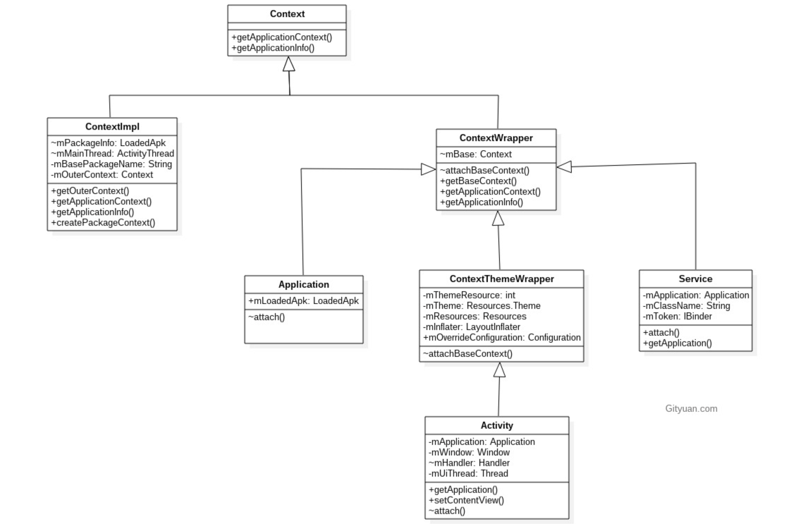
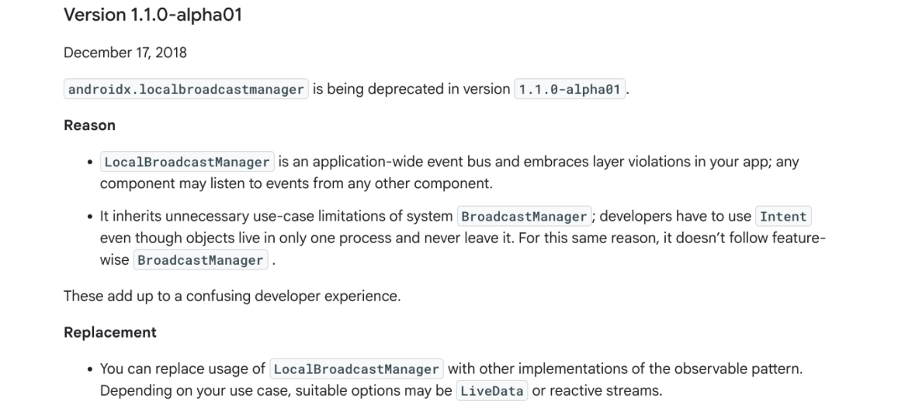

#### 什么是 Context？

Context 是 Android 中的一个抽象类，从字面上看，它代表了“上下文”；从功能上讲，它是 **App 与系统服务进行交互的桥梁**。如果没有 Context，App 的组件就无法访问系统资源，也无法与其它组件通信。

Context 的职责主要分为三类：

+ **资源访问**：Context 并不是简单的文件访问器，它连接了 PMS（Package Manager Service）来定位 App 的安装包，并结合系统全局配置（Configuration）来获取资源。比如你调用 `getString()`，Context 会根据系统当前的语言设置、屏幕密度，从系统资源库中精准匹配最合适的资源。
+ **组件通信**：通过 Context 启动 Activity、发送广播或启动服务，其本质是向系统核心服务 AMS（Activity Manager Service），发起 IPC（进程间通信）请求。App 并没有权限直接创建 Activity 实例，必须通过 Context 去告诉 AMS，再由系统调度并回调我们的生命周期方法。
+ **其它系统服务调用**：通过 `getSystemService()` 访问 ServiceManager，管理的各种全局单例服务。像是调用摄像头（CameraService）、管理通知（NotificationManager），还是获取位置（LocationManager），都是需要 Context 向 SystemServer 进程申请硬件操作权限和功能。

###### 另外我看到创建 View（`TextView myText = new TextView(this)`）、Toast（`Toast.makeText(this, "弹窗", Toast.LENGTH_SHORT).show()`）等也需要传 Context（`this`），这算哪个职责呢？

这些其实都算“资源访问” + “其它系统服务调用”，它们都需要通过 Context 获取去访问 Resources（应用启动前会通过 PMS 拿到资源地址）。之后 View、Dialog 的显示都需要通过经由 Context 通过 WMS 进行创建，还有像 Toast，需要经由 Context 通过 NMS 进行创建。

###### Conetxt 的实现类有哪些呢？



Context 是基类（抽象类），它的真正实现类是 ContextImpl（负责与系统服务 AMS、PMS 等进行 IPC 通信、访问资源文件、打开数据库等底层操作）。而 Activity、Service、Application 都直接或间接地继承自 ContextWrapper（装饰器模式，内部持有一个 mBase，即 ContextImpl，它像一个“壳”，通过 mBase.method() 转发所有请求，这样设计的目的是：允许在不改变底层实现的情况下，为 Activity 或 Service 增加特定的行为），这个装饰器内部持有 ContextImpl 的引用，将所有操作委派给它。

###### Application、Activity、Service 区别？

| 特性                     | Application                                      | Activity                                         | Service                                          |
| ------------------------ | ------------------------------------------------ | ------------------------------------------------ | ------------------------------------------------ |
| **生命周期**             | 与 App 进程同生共死（最长）                      | 与界面销毁同步（较短，从 onCreate 到 onDestroy） | 与后台任务同步（中等，从 onCreate 到 onDestroy） |
| **继承关系**             | ContextThemeWrapper -> ContextWrapper -> Context | ContextWrapper -> Context                        | ContextWrapper -> Context                        |
| **UI 能力**              | 弱                                               | 强（支持所有 UI 操作）                           | 弱                                               |
| **主题 (Theme)**         | 只有清单文件定义的全局主题                       | 支持动态切换局部主题                             | 不支持主题（无意义）                             |
| **Window Token**         | 无                                               | 有（与 WMS 交互的关键）                          | 无                                               |
| **获取Context方式**      | getApplicationContext()                          | this                                             | this                                             |
| **发送/注册广播**        | 可以                                             | 可以                                             | 可以                                             |
| **调用 ContentProvider** | 可以                                             | 可以                                             | 可以                                             |

###### Application 和 Service 的 UI 能力能干什么呢？

弹出系统级悬浮窗（录屏时的控制按钮、游戏助手悬浮窗等，需要获取权限）、Toast（非自定义，来自系统的）、Notification

###### “只有清单文件定义的全局主题”是什么意思？

```xml
<!-- AndroidManifest.xml -->
<application
    android:name=".MyApplication"
    android:theme="@style/AppTheme">  <!-- 这就是全局主题 -->
    <activity android:name=".MainActivity" />
</application>
```

这里的 android:theme 实际上是为整个 App 设置一个默认基调。Application 实例本身并不渲染 UI，所以它不需要主题。但是，当系统启动一个 Activity 时，如果这个 Activity 在清单文件中没有定义自己的 android:theme，系统就会去读取 `<application>` 标签下的主题作为兜底。

由于 Application 并不继承 ContextThemeWrapper，你不能在代码中动态调用 `applicationContext.setTheme(R.style.AnotherTheme)` 来改变全局 UI 样式（即便调了也无效，因为它没有处理主题的能力）。

###### 一个 App 运行时，到底有多少个 Context 实例？

**App 的 Context 总个数 = Activity 个数 + Service 个数 + 1**

+ Activity 个数：每启动一个 Activity，系统就会 new 一个 Activity 实例（带 UI 的 Context）。
+ Service 个数：每启动一个 Service，系统就会 new 一个 Service 实例（后台运行的 Context）。
+ 1 个 Application：整个 App 运行期间，无论你有多少个进程、页面、服务，同一个进程里永远只有一个全局的 Application 实例。

###### 四大组件都能是 Context 吗？

BroadcastReceiver（通过 `onReceive(Context context, Intent intent)` 获得）和 ContentProvider（通过 `getContext()` 方法获取到应用它所在的那个 Application Context）不是。主要问题，我觉的还是过度设计的问题，BroadcastReceiver 的职责非常单一仅仅是一个消息订阅/分发器，它不需要知道如何加载布局，也不需要维护复杂的环境状态。ContentProvider 也是同样的道理，仅仅是跨进程的数据共享。如果让两个职责纯粹的组件去继承拥有数十个方发，属于过度设计。

###### 为什么 Activity 可以弹出 Dialog 而 Application 不行？

Dialog 的显示依赖于一个 **Window Token**（窗口令牌），这个令牌是由 ActivityManagerService 在启动 Activity 时分配给该 Activity 的。Application 和 Service 没有对应的 UI 窗口环境，也就没有合法的 Token，因此强行弹出 Dialog 会抛出 WindowManager$BadTokenException。

###### 为什么 Activity 启动 Activity 不需要 Flag？

Activity 启动另一个 Activity 时，默认会加入到当前的任务栈（Task Stack）中。而 Application 不在任何任务栈里，所以它启动 Activity 必须明确指定 FLAG_ACTIVITY_NEW_TASK。

###### 内存泄漏风险

Context 主要分为 Application Context 和 Activity Context。Application 的生命周期贯穿整个进程，而 Activity 的生命周期仅限于当前的 UI 界面。在开发中，绝对不能在长生命周期的对象（如单例、静态变量、匿名内部类）中直接引用 Activity Context。否则，当 Activity 销毁时，由于被长生命周期对象持有，导致无法被 GC 回收，从而引发内存泄漏。在这种场景下，应该使用 `getApplicationContext()`。


接受系统广播：动态注册监听 + 静态注册

发送自定义广播：发送标准广播 + 发送有序广播


#### 本地广播

首先，该方法已废弃，但是老项目中还是会遇到的。

本地广播（Local Broadcast）是只在应用内部发送和接收的广播方式。它相比全局广播更安全（只在同一进程内发送和接收）、速度快开销小（不走 AMS，不使用 Binder/IPC 机制在进程间发送数据）。


TODO，本地广播底层


```java
// 声明接收器
private BroadcastReceiver receiver = new BroadcastReceiver() {
    @Override
    public void onReceive(Context context, Intent intent) {
        String data = intent.getStringExtra("msg");
        Log.d("LocalBroadcast", "收到本地广播: " + data);
    }
};

// 注册接收器
LocalBroadcastManager.getInstance(context).registerReceiver(receiver, new IntentFilter("ACTION_TEST"));

// 取消注册
LocalBroadcastManager.getInstance(context).unregisterReceiver(receiver);


// 发送本地广播
Intent intent = new Intent("ACTION_TEST");
intent.putExtra("msg", "Hello Local");
LocalBroadcastManager.getInstance(context).sendBroadcast(intent);
```

为什么废弃它呢？官方解释：



+ LocalBroadcastManager 相当于在整个 app 内部搞了一个“全局事件总线”，任何都地方可以发广播，任何地方也都可以接收广播，这违背了层级的概念。
+ LocalBroadcastManager 继承了 BroadcastManager 的没必要的限制，开发者不得不使用 Intent 来传递数据，但本地广播只在同一进程，完全可以直接传递对象。而且虽然它长得很像 BroadcastManager，但其实不具备 BroadcastManager 的很多功能。

可以使用 LiveData 来替代它。LiveData 和 LocalBroadcastManager 本质上都是一个进程里做“发布–订阅”，但不需要像 LocalBroadcastManager 那么繁琐，主需要 `liveData.setValue(...)` 和  `liveData.observe(...)` 即可实现。并且 LocalBroadcastManager 还要 register、unregister，否则会内存泄漏，而 LiveData 跟随 LifecycleOwner，界面销毁就自动停止观察。

