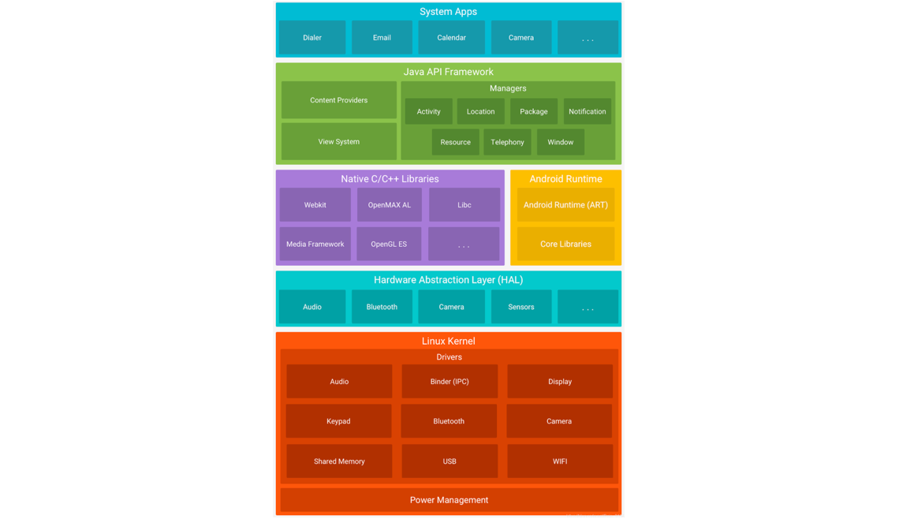
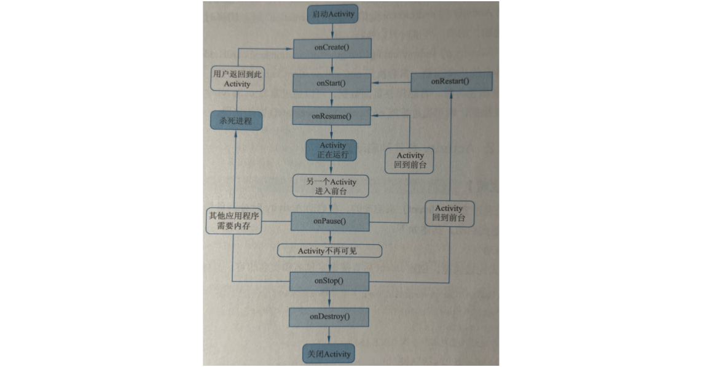
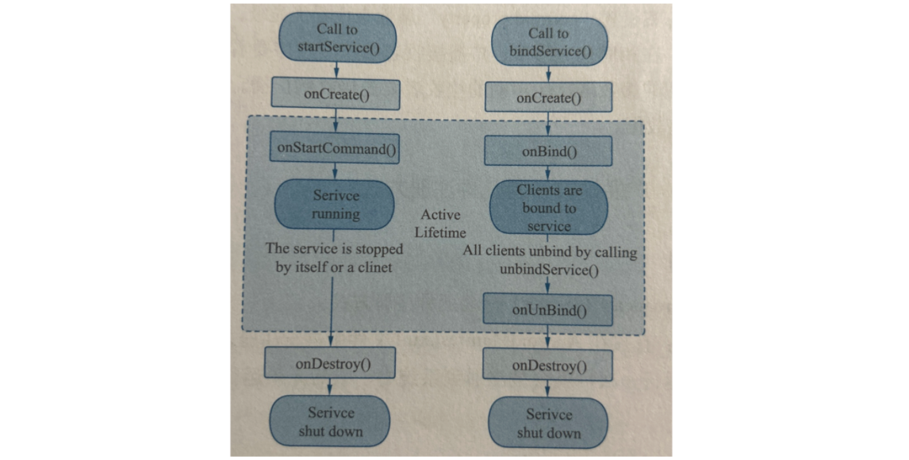

#### 简述 Android 系统架构



分为 4 层（下面的图感觉更准确）：

1）系统应用层（System Apps）

包含用户安装和使用的 App，如联系人、电话、设置、浏览器等。通过调用 Framework 提供的 API 来实现相应的功能。

2）Java 应用框架层（Java API Framework）

封装底层复杂逻辑，为 App 提供各类开发接口（API），控制应用的 UI、资源访问、组件管理等。

| 名称                     | 简述                                                         |
| ------------------------ | ------------------------------------------------------------ |
| **Activity Manager**     | 管理 Activity、Task、应用进程、应用生命周期等                |
| **Window Manager**       | 管理窗口的添加、更新、删除，负责显示 UI 组件（如 Dialog、Toast） |
| **Content Providers**    | 提供跨应用数据共享接口（如联系人、媒体库）                   |
| **View System**          | 提供 UI 控件的渲染系统，是布局与交互的基础                   |
| **Notification Manager** | 管理通知栏消息的发布、更新与取消                             |
| **Package Manager**      | 管理应用包信息，如安装、卸载、权限、签名等                   |
| **Telephony Manager**    | 提供设备通信功能，如获取 SIM 信息、网络状态、IMEI 等         |
| **Resource Manager**     | 管理资源访问，如字符串、图片、布局、样式等（`res/` 目录）    |
| **Location Manager**     | 提供定位服务，获取 GPS 或网络位置信息                        |
| **XMPP Service**         | 实现 XMPP（即时通信协议）服务，通常用于消息推送或 IM 通信框架（非标准 Android 系统服务，仅在某些定制系统中存在） |

3）核心类库层（系统库 Native C/C++ Libraries + 运行环境 Android Runtime）

提供底层功能实现，如音视频处理、数据库、图形渲染，侧重算法、高性能计算、硬件交互（间接，Linux Kernel 是直接）。

运行环境 ART，是一种类 JVM，是一种专为 Android 平台上的 Java 字节码执行的引擎。一些简单的区别，JVM 是面向服务器的，支持 Java SE 标准类库（Swing 在其中，Android 并不支持）；ART 是面向 Android 的，支持 Android 核心类库（如 graphics、media、sqlite）。

| 名称                | 简述                                          |
| ------------------- | --------------------------------------------- |
| **Surface Manager** | 管理屏幕上不同窗口/图层的合成与显示           |
| **Media Framework** | 处理音视频的录制、播放、解码等                |
| **SQLite**          | 内嵌关系型数据库，用于本地数据存储            |
| **OpenGL ES**       | 跨平台图形渲染接口，用于 2D/3D 绘图           |
| **FreeType**        | 字体引擎，用于文本字体的解析与渲染            |
| **WebKit**          | HTML/CSS/JS 渲染引擎，用于 WebView            |
| **SGL**             | Skia 图形库旧称，早期 Android 图形渲染引擎    |
| **SSL (OpenSSL)**   | 加密通信支持库，提供 HTTPS 等加密能力         |
| **libc (Bionic)**   | Android 定制的 C 运行库，支持内存管理、线程等 |

| 名称                      | 说明                                                         |
| ------------------------- | ------------------------------------------------------------ |
| **Android Runtime (ART)** | Android 5.0 之后替代 Dalvik，是现代 Android 的默认虚拟机。支持 AOT（预编译）、更高性能、更少内存开销。 |
| **Core Libraries**        | Java API 的实现（如 `java.lang.*`、`java.util.*`），Android app 编码时用到的标准类库都在这。 |

4）Linux 内核（Linux Kernel）

Android 基于 Linux 内核进行了修改与扩展，作为系统核心，负责统一管理 CPU、内存、进程线程、文件系统、网络访问等**系统资源**。并提供对各类**硬件设备**的驱动支持（Driver），通过 HAL 供上层调用，提供访问这些硬件能力。

HAL（Hardware Abstraction Layer），硬件抽象层，是位于 Framework 与 Driver（驱动）之间的一层标准接口，只负责定义接口逻辑由硬件层实现，作用是屏蔽不同硬件厂商的底层差异，提供统一访问硬件的方式。流程就是：`App ↔ Framework ↔ HAL ↔ Driver ↔ 硬件`。

另外，从上面看到，访问系统资源是不需要走 HAL 的，而访问硬件设备是需要的。这是因为访问系统资源是属于 Linux 的基础能力，所有平台、设备通用，不依赖硬件厂商；而访问硬件设备，由于各厂商设备不同，提供的 Driver 有所差异，HAL 作用就是屏蔽差异，相当于是适配器模式。

| 名称                    | 功能                                                 |
| ----------------------- | ---------------------------------------------------- |
| **Display Driver**      | 控制屏幕显示，包括亮度、分辨率、刷新率、帧缓冲管理等 |
| **Camera Driver**       | 控制摄像头采集图像、视频流，提供给上层 HAL 或应用    |
| **Bluetooth Driver**    | 控制蓝牙硬件模块，实现配对、数据传输等功能           |
| **Flash Memory Driver** | 控制 NAND/NOR 闪存，用于存储系统、App、数据等        |
| **Binder (IPC) Driver** | Android 特有的进程间通信机制，支持跨进程调用         |
| **USB Driver**          | 控制 USB 端口数据通信，可支持 OTG、ADB、MTP 等模式   |
| **Keypad Driver**       | 控制物理按键输入（如方向键、电源键、音量键）         |
| **WiFi Driver**         | 控制 Wi-Fi 模块，实现连接、扫描、数据收发等          |
| **Audio Driver**        | 控制音频输入输出（麦克风、扬声器、耳机）             |
| **Power Management**    | 控制电源相关功能，如休眠、唤醒、电池管理等           |

最后举个播放音频的例子：

+ App 调用 Framework 提供的API，如 `MediaPlayer.start()` 发起音频播放请求。
+ Framework 层通过 `AudioService` 等服务 ，使用 Binder 跨进程调用 Native 音频服务（如 `MediaPlayerService`）
+ Native 层通过 JNI 接口调用 `libaudio.so`、`libaudioflinger.so` 等库处理音频流，里面封装了音频相关操作，调用 HAL 提供的相关接口；
+ Linux Kernel 中的 Audio Driver 接管数据，控制芯片输出模拟信号至扬声器或耳机，最终发出声音；
+ 驱动控制实际音频芯片输出声音。

###### 应用层不能直接调用 Libraries 层吗？

主要就是隐藏复杂性，便于开发与维护，Framework 做了像权限校验、参数校验、错误捕捉等保护措施，避免底层的内存泄漏、崩溃、甚至系统稳定性问题。

###### 简写

APP 就是各种应用，通过调用 Framework 提供的各种 API，来实现相应的功能；Framework 层封装 Native 层复杂的逻辑；Libraries 层主要用 C/C++ 实现相应高性能的算法去操作硬件，以及 Android 运行环境 ART ；Linux Kernal 只要就是直接去操作硬件，上面还有 HAL 来定义接口，各种驱动在 Linux Kernal 进行实现。

#### 简述你对 Activity 生命周期的理解

Activity 生命周期方法有 7 个：

1）`onCreate(Bundle savedInstanceState)`

+ 时机：Activity 第一次被创建时调用。

+ 用途：初始化界面（`setContentView()`）；绑定事件、初始化成员变量；可通过 `savedInstanceState` 恢复状态（如横竖屏切换）。

2）`onStart()`

+ 时机：Activity 即将对用户可见时调用。
+ 用途：（与 `onStop()` 相对应）注册广播、传感器监听等（与界面相关但可不需焦点的逻辑）。

3）`onResume()`

- 时机：Activity 位于前台并可交互时调用。
- 用途：（与 `onPause()` 相对应）开始动画、播放视频等。

4）`onPause()`

- 时机：当 Activity 失去焦点，但还可见时会去调用，例如当前 Activity 去启动一个弹窗时会去调用。
- 用途：只是失去焦点，很可能再次回到 `onResume()`，所以仅仅释放轻量级资源，也就是马上可恢复的，主要是“暂停”类操作，比如暂停动画、暂停视频或音频播放。

5）`onStop()`

- 时机：当 Activity 完全不可见时调用（但对象仍保存在内存中）。
- 用途：很可能再次回到 `onStart()` ，所以释放中量级资源，主要是“省电省资源”类操作，比如关闭 GPS、蓝牙、位置等硬件，注销 BroadcastReceiver、ContentObserver 等。
- 释放 UI 不需要的资源（如相机、GPS）；停止后台任务。

6）`onDestroy()`

- 时机：Activity 被销毁前调用，也就是用户按返回键或者调用 `finish()`。注意，也有可能不会执行，比如系统因资源不足直接杀掉进程。
- 用途：释放重量级资源，彻底释放资源，防止内存泄漏。比如关闭数据库，关闭线程池等。

7）`onRestart()`

- 时机：比如一个 Activity 上点击跳转到另一个 Activity，然后按返回，此时会触发 `onRestart()`。
- 用途：很少使用。

#### Activity 生命周期方法调用顺序



1）当 Activity 启动时，依次执行 `onCreate() -> onStart() -> onResume()`。

2）当 Activity 退出时，依次执行 `onPause() -> onStop() -> onDestory()`。

3）当 Activity 执行到 `onPause()` 方法，即 Activity 失去焦点时，重新回到前台会执行 `onResume()` 方法

4）当执行到 `onStop()` 方法，即 Activity 不可见时，再次回到前台会执行 `onRestart()` 方法。

5）当 ActivityA 点击按钮，跳转到 ActivityB 时，如果 ActivityB 是普通的不透明 Activity，则 ActivityA 进入 `onStop()`。

6）当 ActivityA 点击按钮，跳转到 ActivityB 时，如果 ActivityB 是类似对话框样式，则 ActivityA 仅仅会进入 `onPause()`。

7）当在 Activity 按下 Home 键，此时该 Activity 会进入 `onStop()`。

8）图中“杀死进程”这条线的意思是，首先你所在的应用，也就是前台进程，是几乎不可能被杀死的，这里其实是说，你按下 Home 键，这个应用变为了后台进程，是有可能被杀掉的，再次进入这个应用就相当于重新打开。

#### 简述横竖屏切换时 Activity 的生命周期

```xml
<!-- 通过android:configChanges配置变更豁免 -->
<!-- 不只有orientation、screenSize，这只是横竖屏切换会涉及的，还有像fontScale（在系统设置中调整了默认字体）、locale（切换了系统语言）、uiMode（开启了夜间模式）-->
<activity
		android:name=".ChangeDirectionActivity"
		android:exported="true"
    android:configChanges="orientation|screenSize">
    <intent-filter>
    		<action android:name="android.intent.action.MAIN" />
        <category android:name="android.intent.category.LAUNCHER" />
    </intent-filter>
</activity>

<!-- 也可以通过下面的方式限制屏幕只能是竖屏 -->
<!-- android:screenOrientation="portrait" -->
```

1）不设置 Activity 的 `android:configChanges` 时，切横屏时会执行一次生命周期（触发 screenSize 配置），切竖屏时会执行两次生命周期（触发 orientation、screenSize 配置）。

```
onSaveInstanceState() -> onPause() -> onStop() -> onDestory() -> onCreate() -> onStart() -> onRestoreIntanceState() -> onReusme()
```

2）设置 Activity 的 `android:configChanges="orientation"` 时，切横屏、竖屏各自会触发一次。

3）设置 Activity 的 `android:configChanges="orientation|screenSize"` 时，切横屏、竖屏不会触发生命周期，只会执行 `onConfigurationChanged()` 方法（不走生命周期，且配置改变，才会执行 `onConfigurationChanged()`，上面的情况是不会执行的）。

```java
@Override
public void onConfigurationChanged(@NonNull Configuration newConfig) {
    super.onConfigurationChanged(newConfig);

    switch (newConfig.orientation) {
        case Configuration.ORIENTATION_PORTRAIT:
            Log.i("Test", "当前屏幕为竖屏方向");
            break;
        case Configuration.ORIENTATION_LANDSCAPE:
            Log.i("Test", "当前屏幕为横屏方向");
            break;
    }
}
```

###### 其他

另外，切换横竖屏时，若想保存页面数据，可以通过重写 `onSaveInstanceState(Bundle outState)` 方法实现；若想恢复数据，则可通过重写 `onRestoreInstanceState(Bundle savedInstanceState)` 方法实现。

```java
@Override
protected void onCreate(Bundle savedInstanceState) {
    ...
}

@Override
protected void onRestoreInstanceState(Bundle savedInstanceState) {
    super.onRestoreInstanceState(savedInstanceState);

    count = savedInstanceState.getInt(KEY_COUNT, 0);
    textView.setText("Count = " + count);
}

@Override
protected void onSaveInstanceState(Bundle outState) {
    super.onSaveInstanceState(outState);

    outState.putInt(KEY_COUNT, count);
}
```

首先 `onSaveInstanceState()` 什么时候会被调用呢？

+ 正常后台场景：Activity 进入后台 → 系统调用 `onSaveInstanceState()` 保存状态。用户再返回 → 不需要重建 Activity → 不会调用 `onCreate()` / `onRestoreInstanceState()`。
+ 后台进程被杀场景：Activity 进入后台 → 调用 `onSaveInstanceState()` 保存状态。后台进程被杀 → 用户再返回 → 系统重建 Activity → 调用 `onCreate()` + `onRestoreInstanceState()` 恢复状态。注意，`onSaveInstanceState()` 并不是在进程被杀之前调用的，而是在 Activity 进入后台时就已经调用了，如果资源特别紧张的情况下，直接杀死，是可能执行不到 `onSaveInstanceState()` 的。
+ 配置更改场景（横竖屏切换、语言、主题等）：Activity 因配置变更 → 调用 `onSaveInstanceState()`。系统销毁并重建 → 调用 `onCreate()` + `onRestoreInstanceState()`。

正常启动 Activity，不会走 `onRestoreInstanceState()`，因为没有保存过状态。如果之前调用过 `onSaveInstanceState()`， Bundle 里有值，重建时 `onRestoreInstanceState()` 才会被调用。

而 `onCreate()` 是必走的，所以如果使用 `onCreate()` 来恢复数据，一定要做非空判断。而 `onRestoreInstanceState()` 的 Bundle 参数一定不会是空值。

`onCreate()` 和 `onRestoreInstanceState()`，都可以恢复数据，但执行时机不同，比如和 UI 有关的可以放在 `onRestoreInstanceState()`。

###### 后台进程被杀场景

**重点！！！**

首先解释一下生命周期图片里“杀死进程”意味着什么？这里的“杀死进程”其实是指 `adb shell am kill <package-name>`，而不是 `adb shell am force-stop <package-name>`。

1）`adb shell am kill <package-name>`

意味着会终止应用的 Linux 进程，但会保留该应用的任务栈和已保存的状态（`onSaveInstanceState()`），之后你通过最近任务（Recents）或者系统图标（Launcher）回到应用时，系统会拿到 Bundle，执行 `onCreate(Bundle)` 和 `onRestoreInstanceState(Bundle)`  中进行恢复。

2）`adb shell am force-stop <package-name>`

这里意味着不仅仅杀死 Linux 进程，还会清除任务栈（Task），还会清除由系统服务维护的调度任务，比如 AlarmManager、JobScheduler、BroadcastReceiver、ContentProvider 等。再次启动应用相当于全新启动，不会重建之前的任务栈，也不会恢复有 `Bundle`。

3）最近任务“上滑”

而对于这种，是介于上面两者之间，会杀死 Linux 进程、清除任务栈，但不会关闭系统管理的一些服务。

#### Activity 有哪几种启动方式

通过 Intent 来启动，分为两种方式

1）显示启动

```java
// 1.直接设置相应Activity的class来启动新的Activity
Intent intent = new Intent(this, OtherActivity.class);
startActivity(intent)
  
// 2.或者通过设置包名和全类名来启动新的Activity
Intent intent = new Intent();
intent.setClassName("cn.itcast.activity", "cn.itcast.activity.OtherActivity");
startActivity(intent)
```

2）隐式启动

不显示指定组件的类名，而是通过 action 和其他匹配信息（如 category、data、type），来进行匹配。

```java
// 直接跳转到拨号界面
Intent intent = new Intent();
intent.setAction(Intent.ACTION_DIAL);
intent.setData(Uri.parse("tel://123456"));
startActivity(intent)
```

上面是调用系统的“电话” Activity，自己的 Activity 也可以在  manifest 中进行定义。其中必须有 action 和 category 两个标签，还可以有像 data（`setData()`）、type（`setType`）等类型。另外，一个 Activity 可以有多个 `<intent-filter>`，调用方只需有一个完全匹配成功，即可发动该 Activity。

```xml
<activity
		android:name=".OtherActivity"
		android:exported="true">
    <intent-filter>
        <action android:name="android.intent.action.CACULATE" />
        <category android:name="android.intent.category.DEFAULT" />
     </intent-filter>
</activity>
<!-- android:exported="true"：为true才可以被外部应用调用，为false只能内部跳转 -->
<!-- android.intent.category.DEFAULT：隐式Intent都需要这个 -->
<!-- android.intent.category.LAUNCHER：表示是主启动Activity，会出现在Launcher中 -->
```

```java
// 代码接收方（putExtra()更灵活；data这种只能传URI，URI就是用来标识资源<scheme>://<authority><path>?<query>）
// data这种感觉更适合外部的这种调用，因为必须匹配<intent-filter>才能调用
Uri data = getIntent().getData();
if (data != null) {
    String scheme = data.getScheme();                     // "tel"
    String schemeSpecific = data.getSchemeSpecificPart(); // "123456"
    String full = data.toString();                        // "tel://123456"
}
```

###### 总结

显式 Intent 要明确指定目标类，一般只能用于应用内部跳转。

隐式 Intent 不指定组件，依赖 action、category、data等的匹配 ，靠系统匹配，常用于跨应用调用，比如系统功能（调用相机、电话）。

#### Activity 的 4 种启动模式有哪些特点

1）standard 模式（默认）

每次启动都会新建一个实例，不管栈里有没有。

大部分场景都是。

2）singleTop 模式

如果目标 Activity 已经在栈顶，就复用，不会新建；否则新建一个。

比如浏览器的书签。

3）singleTask 模式

会先检查是否存在该实例，如果存在则把该 Activity 之上的其他 Activity 全部出栈；不存在则新建该 Activity。

比如 App 的主界面。

4）singleInstance 模式

该 Activity 独占一个任务栈。启动时，如果该 Activity 不存在，则创建新的任务栈，然后在创建该 Activity 实例；如果已经存在，系统会把该任务栈移到前台，从而显示改 Activity。

并且这个栈中只会有这一个 Activity，你再从这个 Activity 启动新的 ActivityB，ActivityB 不会进入这个独立栈，而是被放到原应的任务栈中，这是为了在不同程序中共享同一个 Activity 实例。

比如跳出电话界面。


实现方式：

```java
// 方式一：在xml中通过launchMode
<activity
		android:name=".OtherActivity"
		android:launchMode="singleInstance"/>

// 方式二：指定intent flag
Intent intent = new Intent(this, OtherActivity.class);
intent.addFlags(Intent.FLAG_ACTIVITY_SINGLE_TOP);
startActivity(intent);
```

| Manifest launchMode | Intent Flags 等效写法                                 |
| ------------------- | ----------------------------------------------------- |
| standard            | 无（默认）                                            |
| singleTop           | FLAG_ACTIVITY_SINGLE_TOP                              |
| singleTask          | FLAG_ACTIVITY_NEW_TASK \| FLAG_ACTIVITY_CLEAR_TOP     |
| singleInstance      | FLAG_ACTIVITY_NEW_TASK \| FLAG_ACTIVITY_MULTIPLE_TASK |

#### Activity 之间如何传递数据

Intent 不仅仅用于启动 Activity 与 Service，也用于不同 Activity 之间传递数据。

```java
// 基本类型
// 发送方
Intent intent = new Intent(this, ReceiveActivity.class);      
intent.putExtra("name", "赵云");
intent.putExtra("age", 12);
startActivity(intent);

// 接受方
Intent intent = getIntent();
String name = intent.getStringExtra("name");
int age = intent.getIntExtra("age", -1); // 第二个参数是默认值
```

```java
// 大量数据可以用Bundle
// 发送方
Bundle b1 = new Bundle();
b1.putString("name", "张飞");
b1.putInt("age", 25);
Bundle b2 = new Bundle();
b2.putString("name", "刘备");
b2.putInt("age", 18);
intent.putExtra("b1", b1);
intent.putExtra("b2", b2);
startActivity(intent);

// 接收方
Bundle b1 = intent.getBundleExtra("b1");
if (b1 != null) {
    String name1 = b1.getString("name");
    int age1 = b1.getInt("age", -1);
}
Bundle b2 = intent.getBundleExtra("b2");
if (b2 != null) {
    String name2 = b2.getString("name");
    int age2 = b2.getInt("age", -1);
}
```

```java
// 也可以序列化对象（需实现序列化接口Serializable或Parcelable）
// 发送方
Intent intent = new Intent(this, ReceiveActivity.class);
Person p = Person("张辽", 12);
intent.putExtra("person", p);

// 接收方
// 如果Person实现了Serializable
Intent intent = getIntent();
Person p = (Person) intent.getSerializableExtra("person");
// 如果Person实现了Parcelable
Intent intent = getIntent();
Person p = intent.getParcelableExtra("person");
```

#### Activity 之间如何进行数据回传

比如发微信朋友圈时，进入图库选择好照片后，会返回到发表状态页面并带回所选的图片信息。这种场景需要使用 `registerForActivityResult()`，该方法用于启动 Activity，并在当前 Activity 销毁时会返回一个结果给上一个 Activity，从而实现数据回传功能。

```java
// 在Activity01中开启Activity02
ActivityResultLauncher<Intent> launcher = registerForActivityResult(
  	// 替换以前的startActivityForResult()方式
    new ActivityResultContracts.StartActivityForResult(),
    result -> {
        // 判断Activity02状态码
        if (result.getResultCode() == 1) {
            Intent data = result.getData();
            if (data != null) {
                String string = data.getStringExtra("extra_data");
            }
        }
    }
);

// 调用时
Intent intent = new Intent(this, Activity02.class);
launcher.launch(intent);
```

```java
// 在Activity02中添加返回的数据
Intent intent = new Intent();
intent.putExtra("extra_data", "Hello Activity01");
// 这个1就是上面的状态码resulyCode
setResult(1, intent);
// 跳回原来的Activity（正常是在一个点击事件里发动）
finish();
```

###### startActivityForResult() 这种方式，和 startActivity() 跳过去，在跳回来并且传输数据，这两种方式有什么差别？

`startActivityForResult()` 跳转后， `finish()` 直接栈顶弹出 Activity02，还把数据传到了 Activity01。

`startActivity()` 跳转后，你想给 Activity01 传数据，只能继续 `startActivity()`，这样在栈里面 Activity02 上面右加上了 Activity01。 

#### Intent 与 PendingIntent 的区别

PendingIntent 是对 Intent 的包装，交给系统或其他应用在未来的某个时机代你执行，执行时仍用你的身份和权限（在 Android 里，每个应用都有一个 UID（用户ID）和与之绑定的权限集合）。主要区别：

+ Intent 在程序结束后就会终止，而 PendingIntent 在程序结束后依然有效。
+ Intent 在原 Task 中运行，而 PendingInent 在新的 Task 中运行。
+ Intent 是由自己代码调用立即执行的，PendingIntent 是交给系统或第三方延迟执行的。

一个例子，在 App 退出后，使用 WorkManager 生成 App 通知，用户点击后，利用 PendingIntent，跳到对应的 Activity。

```java
public class NotifyWorker extends Worker {

    public NotifyWorker(@NonNull Context context, @NonNull WorkerParameters params) {
        super(context, params);
    }

    @NonNull
    @Override
    public Result doWork() {
        Context context = getApplicationContext(); // 获取全局上下文

        // 1. 创建通知渠道（Android 8.0+ 必须，否则通知不会显示）
        if (Build.VERSION.SDK_INT >= Build.VERSION_CODES.O) {
            NotificationChannel channel = new NotificationChannel(
                    "work_channel",              // 渠道ID
                    "WorkManager 通知",           // 渠道名（设置里显示）
                    NotificationManager.IMPORTANCE_HIGH // 重要等级
            );
            NotificationManager manager = context.getSystemService(NotificationManager.class);
            manager.createNotificationChannel(channel);
        }

        // 2. 点击通知时跳转到 DetailActivity
        Intent intent = new Intent(context, DetailActivity.class);
        intent.putExtra("extra_data", "来自WorkManager的通知"); // 携带数据
        // 确保 Activity 从新任务栈启动，避免已有实例覆盖
        intent.setFlags(Intent.FLAG_ACTIVITY_NEW_TASK | Intent.FLAG_ACTIVITY_CLEAR_TOP);

        // 用 PendingIntent 封装 Intent，让系统以后触发
        PendingIntent pendingIntent = PendingIntent.getActivity(
                context,
                0,      // requestCode，用于区分不同 PendingIntent
                intent, // 要执行的 Intent
                PendingIntent.FLAG_IMMUTABLE // Android 12+ 要求指定可变/不可变
        );

        // 3. 构建通知
        NotificationCompat.Builder builder = new NotificationCompat.Builder(context, "work_channel")
                .setContentTitle("后台任务完成")   // 通知标题
                .setContentText("点击查看详情")    // 通知内容
                .setSmallIcon(R.drawable.ic_message) // 小图标，必须设置
                .setContentIntent(pendingIntent)     // 点击时触发 PendingIntent
                .setAutoCancel(true);                // 点击后自动清除通知

        // 4. 发送通知
        NotificationManagerCompat.from(context).notify(2001, builder.build());

        // 返回成功，告诉 WorkManager 执行完成
        return Result.success();
    }
}
```

```java
public class MainActivity extends AppCompatActivity {
    @Override
    protected void onCreate(Bundle savedInstanceState) {
        super.onCreate(savedInstanceState);
        setContentView(R.layout.activity_main);

        // 点击按钮时安排一个延迟执行的后台任务
        findViewById(R.id.btnStartWork).setOnClickListener(v -> {
            // 创建一次性任务，请求 30 秒后执行
            OneTimeWorkRequest request = new OneTimeWorkRequest.Builder(NotifyWorker.class)
                    .setInitialDelay(30, TimeUnit.SECONDS) // 延迟 30 秒
                    .build();

            // 把任务交给 WorkManager 调度
            WorkManager.getInstance(this).enqueue(request);

            Toast.makeText(this, "已设置30秒后发通知", Toast.LENGTH_SHORT).show();
        });
    }
}
```

```java
public class DetailActivity extends AppCompatActivity {
    @Override
    protected void onCreate(Bundle savedInstanceState) {
        super.onCreate(savedInstanceState);
        setContentView(R.layout.activity_detail);

        // 获取通知点击时传入的数据
        Intent intent = getIntent();
        String data = intent.getStringExtra("extra_data");

        // 显示在 TextView 中
        TextView tv = findViewById(R.id.textView);
        tv.setText("收到通知内容：" + data);
    }
}
```

上面是操作 Activity，还可以启动 Service、发广播等。

```java
// 1) 发广播（最常见，轻量） 
PendingIntent pendingIntent = PendingIntent.getBroadcast(context, 0, intent, flags);
// 2) 启动 Activity（弹出界面）
PendingIntent pendingIntent = PendingIntent.getActivity(context, 0, intent, flags);
// 3) 启动 Service（跑后台任务）
PendingIntent pendingIntent = PendingIntent.getService(context, 0, intent, flags);
```

#### 已调用多个 Activity 后如何安全退出

对于单一的 Activity，退出只需直接调用 `finish()`。但对于打开多个 Activity 后，如果想在最后打开的 Activity 中直接退出应用程序，这需要将每个 Activity 都关闭掉。

当然对于用户只需直接“上滑”就可以关闭。而对于 App 自己，比如用户点击了“退出登陆”，那么 App 就需要销毁所有的 Activity 回到登陆页。

1）利用 singleTop 实现。

```java
Intent intent = new Intent(this, MainActivity.class);
intent.setFlags(Intent.FLAG_ACTIVITY_CLEAR_TOP | Intent.FLAG_ACTIVITY_NEW_TASK);
startActivity(intent);
finish(); // 结束当前
```

2）记录打开的 Activity 并逐个关闭

定义一个工具类，用于统一管理 Activity

```java
public class ActivityCollector {
    // 存放所有已打开的 Activity
    private static final List<Activity> activities = new ArrayList<>();

    // 添加 Activity
    public static void addActivity(Activity activity) {
        activities.add(activity);
    }

    // 移除 Activity
    public static void removeActivity(Activity activity) {
        activities.remove(activity);
    }

    // 关闭所有 Activity
    public static void finishAll() {
        for (Activity activity : activities) {
            if (!activity.isFinishing()) {
                activity.finish();
            }
        }
        activities.clear(); // 清空集合
    }
}
```

抽取一个父类 BaseActivity

```java
public class BaseActivity extends AppCompatActivity {
    @Override
    protected void onCreate(Bundle savedInstanceState) {
        super.onCreate(savedInstanceState);
        // 在父类里自动记录
        ActivityCollector.addActivity(this);
    }

    @Override
    protected void onDestroy() {
        super.onDestroy();
        // Activity 销毁时从集合移除
        ActivityCollector.removeActivity(this);
    }
}
```

让所有 Activity 继承 BaseActivity

```java
public class MainActivity extends BaseActivity {
    @Override
    protected void onCreate(Bundle savedInstanceState) {
        super.onCreate(savedInstanceState);
        setContentView(R.layout.activity_main);
    }
}
```

在需要退出的地方调用，比如用户点“退出登录”时

```java
ActivityCollector.finishAll();
Intent intent = new Intent(this, LoginActivity.class);
startActivity(intent);
```

3）利用 `finishAffinity();` 实现，会清空任务栈直接回到桌面。

4）发送特定广播实现安全退出

定义退出广播 Action

```java
public class ExitApp {
    public static final String ACTION_EXIT_APP = "com.example.ACTION_EXIT_APP";
}
```

抽取到父类 BaseActivity

```java
public class BaseActivity extends AppCompatActivity {
    private BroadcastReceiver exitReceiver;

    @Override
    protected void onCreate(Bundle savedInstanceState) {
        super.onCreate(savedInstanceState);

        // 注册退出广播
        exitReceiver = new BroadcastReceiver() {
            @Override
            public void onReceive(Context context, Intent intent) {
                if (ExitApp.ACTION_EXIT_APP.equals(intent.getAction())) {
                    finish(); // 收到广播就关闭当前 Activity
                }
            }
        };

        IntentFilter filter = new IntentFilter();
        filter.addAction(ExitApp.ACTION_EXIT_APP);
        registerReceiver(exitReceiver, filter);
    }

    @Override
    protected void onDestroy() {
        super.onDestroy();
        if (exitReceiver != null) {
            unregisterReceiver(exitReceiver);
        }
    }
}
```

让所有 Activity 继承 BaseActivity

```java
public class MainActivity extends BaseActivity {
    @Override
    protected void onCreate(Bundle savedInstanceState) {
        super.onCreate(savedInstanceState);
        setContentView(R.layout.activity_main);
    }
}
```

在需要退出时发送广播，比如点击“退出登录”按钮

```java
Intent intent = new Intent(ExitApp.ACTION_EXIT_APP);
sendBroadcast(intent);
```

###### 总结

+ 利用 singleTop 实现：仅仅是退回到主页，比如点击“退出登陆”。

+ 记录打开的 Activity 并逐个关闭/发送特定广播实现安全退出：比如系统检测到异地登陆，强制退出 App。

+ 利用 `finishAffinity();` 实现：和上面比灵活性低一些，无法自定义一些行为。

#### 如何应对后台的 Activity 被系统回收

Activity 被系统回收的情况其实就是上文 `onSaveInstanceState()` 调用的情况。

解决方式就是实现 `onSaveInstanceState()`，来避免 Activity 被系统回收时，造成用户数据丢失。

#### Service 有几种启动方式

首先，Service 的特点：

+ 无界面，不像 Activity。
+ 适合执行需要长时间运行的任务。
+ 进程优先级高于普通后台任务，特别是前台服务。
+ 与 Activity 生命周期解耦，即使用户退出 Activity，Service 也能继续运行（取决于启动方式）。
+ 运行在应用进程的主线程中，所以不适合执行耗时任务。

**三种启动方式：**

**1）Started Service（非绑定型服务）**

启动方式：`startService(Intent)`

适用场景：一次性任务，例如：下载文件、上传日志。

生命周期：

- `onCreate()` → `onStartCommand()` → (运行中) → `onDestroy()`
- `onCreate()`：只会在首次创建执行一次。
- `onStartCommand(Intent intent, int flags, int startId)`：每次调用 `startService()`，都会触发此方法。它的返回值会决定服务被杀后是否重启？怎么重启？默认 `START_STICKY`，会重启（不保留 intent）；`START_NOT_STICKY` 不会重启；`START_REDELIVER_INTENT` 重启并重新传入原 intent（保留 intent 主要为了传递参数）。
- `onDestroy()`：服务停止时调用。
- （也可以实现 `onBind()` 和 `unBind()`，但用 `startService(Intent)` 不会执行）

特点：

- 独立于启动它的 Activity 存在，一旦服务开启就跟启动者没关系了，即使启动者退出，Service 依然在运行。
- 需要调用 `stopSelf()` 或者由外部调用 `stopService()` 停止，然后执行 `onDestory()`。
- 若资源不足时，则服务可能会被杀死；当资源足够时，服务又会被重新启动。具体取决于 `onStartCommand()` 的返回值。
- 启动者无法调用 Service 里面的方法。

```java
// 新建Service类
public class DownloadService extends Service {

    @Override
    public int onStartCommand(Intent intent, int flags, int startId) {
        // 模拟后台任务（子线程执行）
        new Thread(() -> {
            try {
                for (int i = 1; i <= 5; i++) {
                    Log.d("DownloadService", "下载进度: " + (i * 20) + "%");
                    Thread.sleep(1000);
                }
                Log.d("DownloadService", "下载完成");
                stopSelf(); // 任务完成后自行停止
            } catch (InterruptedException e) {
                e.printStackTrace();
            }
        }).start();
        
        // 返回 START_NOT_STICKY，表示被杀死后不重启
        return START_NOT_STICKY;
    }

    @Override
    public IBinder onBind(Intent intent) {
        return null; // Started Service 不用绑定，返回 null
    }
}

// 在AndroidManifest.xml注册
<service android:name=".DownloadService" />
  
// 在Activity中启动Service
Intent intent = new Intent(this, DownloadService.class);
startService(intent);
```

**2）Bound Service（绑定型服务）**

启动方式：`bindService(Intent, ServiceConnection, flags)`

适用场景：需要与客户端（Activity 或其他组件）交互，可以让外部调用 Service 的方法，例如：音乐播放器的播放控制。

生命周期：

- `onCreate()` → `onBind()` → (运行中) → `onUnbind()` → `onDestroy()`
- `onCreate()`：只会在首次创建执行一次。
- `onBind(Intent intent)`：在每个 Activity 首次绑定时调用一次。第二个 Activity 绑定直接走这里。
- `onUnbind(Intent intent)`：客户端解除绑定时调用。如果没有重写为返回 true，则下次调用时会重新从 `onCreate()` 执行；如果为 true，下次绑定会直接走 `onRebind()`。
- ~~`onRebind(Intent intent)`：如果之前 `onUnbind()` 返回 true，在所有客户端都解绑后，但 Service 还没执行 `onDestory()`，然后有新客户端绑定时会直接执行。~~
- `onDestroy()`：**所有**客户端都解绑后调用。

特点：

- 提供 Binder 接口提供给客户端，供调用其方法（客户端实现 ServiceConnection 接口，传到 `bindService()` 中，连接成功后，系统会回调 `onServiceConnected()` 方法，然后就可以使用里面传回来的 IBinder 调用 Service 方法的接口）。
- 启动者的生命周期和 Service 绑定在一起，当所有客户端解绑后（`unBind()` 或生命周期结束自动解绑），系统会销毁 Service。
- 与客户端生命周期绑定，不容易被杀死。

**3）Foreground Service（前台服务）**（算是非绑定型服务，区别就是，它是前台服务、不容易被杀死）

启动方式：`startForegroundService(Intent)` + `startForeground()`

适用场景：播放音乐、导航等需要通知栏现实的服务。

特点：

- 必须显示通知栏通知。
- 不同于非绑定型服务和绑定型服务，这个是运行在前台的服务。优先级相比另外两个运行在后台的 Service 的要高，几乎不会被系统回收。

###### 总结

绑定型服务，通过 `startService()` 启动，客户端不能调用里面的方法。生命周期与客户端解绑。若资源不足，服务可能被杀死；资源充足时，又会被重新启动。

非绑定型服务，通过 `bindService()` 启动，客户端可以调用里面的方法。多个组件可以绑定一个 Service，服务会与组件生命周期相关。当所有调用者接触绑定，Service 才会被销毁。

前台服务，算是非绑定型服务，区别就是，它是前台服务、不容易被杀死。

###### Service 为什么还是主线程，不能执行耗时任务还有什么意义？

它最大的价值在于生命周期与 Activity 无关，所以能在后台 长期、独立地执行任务。换句话说 Service 不是让你“开线程”的，而是让你的任务即使 Activity 死了也能继续跑。

一个例子：

+ 如果用 Activity 直接下载文件
  - 用户切到桌面，Activity 被系统销毁 → 下载中断。

+ 如果用 Service 下载文件

  - 启动 Service 后，Activity 可以随时退出。

  - 即使锁屏或切应用，Service 还在下载。

  - 下载完成后，可以通过广播/通知告诉用户。

###### 耗时很大的任务怎么处理？

耗时任务不能在 Activity、Service 中跑，可能会阻塞事件循环，几秒没响应的话，系统就会弹 ANR 对话框（应用无响应）。

耗时任务还是得开新线程去做，可以使用 RxJava 等。

#### 请简述服务的混合开启模式

指同时使用 `startService` 和 `bindService` 两种方式启动同一个服务。这种方式既可以让服务在后台长期运行，又能与调用组件建立绑定关系，以便进行交互。

#### 简述你对 Service 生命周期的理解



#### 广播有几种类型

Broadcast（广播）是一种用于在应用程序之间传输信息的机制，广播有两种类型：

1）无序广播

+ 通过 `sendBroadcast()` 方法来发送广播。
+ 异步发送，所有接收者几乎同时接收。

2）有序广播

+ 通过 `sendOrderedBroadcast()` 方法来发送广播。
+ 同步按优先级顺序依次传递，每次只有一个接收者接收。
+ 可以通过 intent-filter 的 `priority` 设置优先级，优先级高的接受者会先收到。并且可以调用 `abortBroadcast()` 进行拦截。
+ 有序广播之间可以互相传递数据。

#### 广播接收者有几种注册方式

1）静态注册

直接在 AndroidManifest.xml 文件中进行注册，系统中运行一次后，就会被注册到系统中。之后即使应用未运行，系统也会在收到对应广播时拉起应用进程，并创建该 `BroadcastReceiver` 来执行对应逻辑。

Android 8.0 后被禁止。

2）动态注册

通过 `registerReceiver()` 进行注册，只有在代码运行时，广播的接收者才生效。

#### ~~请简述对 EventBus 的理解~~

#### 简述对 ContentProvider 的理解

`ContentProvider` 是 Android 提供的**跨应用数据共享组件**，它内部封装了对底层数据（数据库、文件、网络等）的访问，通过统一的 URI 接口让不同应用读写数据，提供的方法有 query、insert、update、delete等。

外部需要访问对应数据时，通过 Context 提供的 `getContentResolver()` 方法绑定对应 URI 即可。

Android 已经为一些常见的数据，如系统相册、通讯录，提供了默认的 ContentProvider。

#### ContentProvider/ContentResolver/ContentObserver 有何区别

+ ContentProvider：数据提供者，封装数据访问，对外暴露统一的 `URI` 接口（读/写/更新/删除）。
+ ContentResolver：数据访问者的入口，应用通过它调用 `ContentProvider` 提供的接口。
+ ContentObserver：数据变化监听器，注册后可在数据发生变化时收到通知，通过 `notifyChange()` 对应 URI 实现。

#### 简述你对 Fragment 的理解

Fragment 是 Android 中一种**可复用的界面与逻辑模块**，它依附于 Activity，生命周期直接受其宿主 Activity 影响。它可以在运行时动态添加、移除、替换。

有两种加载方式：

+ 静态加载：直接在 Activity 的布局 XML 中直接写 `<fragment>` 标签。
+ 动态加载：在代码中使用 `FragmentManager` 操作事务，可以在运行时添加、替换、移除 Fragment。如果没有事务，直接执行多个操作可能导致 UI 处于不一致的中间状态，例如 Fragment A 被移除但 Fragment B 未成功添加。

#### ~~Fragment 如何向下兼容~~

#### 简述 Fragment 的生命周期

| 方法                  | 说明                                                         |
| --------------------- | ------------------------------------------------------------ |
| `onAttach(Context)`   | Fragment 与 Activity **绑定时**调用，可拿到 Context          |
| `onCreate(Bundle)`    | Fragment 被创建时调用（UI 不可见），可做初始化逻辑，和 Activity 的 onCreate 类似 |
| `onCreateView(...)`   | 在准备绘制 Fragment 界面时调用，**返回 Fragment 的视图**     |
| `onActivityCreated()` | Activity 的 `onCreate()` 执行完时调用                        |
| `onStart()`           | Fragment 对用户可见时调用                                    |
| `onResume()`          | Fragment 可交互时调用                                        |
| `onPause()`           | 进入后台，但仍可见时调用                                     |
| `onStop()`            | 完全不可见时调用                                             |
| `onDestroyView()`     | 在**移除** Fragment 相关视图层级时调用                       |
| `onDestroy()`         | 最终**清除** Fragment 状态时会调用                           |
| `onDetach()`          | Fragment 与 Activity **解绑**时调用                          |

#### Fragment 与 Activity 如何进行交互

1）在 Activity 中获取 Fragment 实例

动态加载时 Activity 会获得 Fragment 的实例；如果是静态加载，可以通过 `getFragmentManager().findFragmentById()` 获得对应的实例。

2）在 Fragment 中获取 Activity 实例

直接通过 `getActivity()` 方法得到当前绑定的 Activity 的实例，然后调用相应的方法。

```java
((MainActivity) getActivity()).doSomething();
```

3）ViewModel + LiveData

#### 简述你对 RecyclerView 控件的理解

RecyclerView 主要两个特点就是**视图复用**和**可插拔的布局管理器**。

+ 视图复用：只创建和绑定屏幕可见范围内的 item 视图，滑动时复用已离开屏幕的视图
+ 可插拔：布局方式、数据绑定、装饰、动画都通过接口定义，不固定实现，你可以随时替换成不同的实现类，或者自己写一个，从而灵活扩展功能。

| 类名                        | 说明                                                     |
| --------------------------- | -------------------------------------------------------- |
| RecyclerView.Adapter        | 负责数据和视图的绑定                                     |
| RecyclerView.ViewHolder     | 保存单个 Item 的 View 引用,                              |
| RecyclerView.LayoutManager  | 控制 Item 的布局方式和滚动逻辑（如线性、网格、瀑布流）。 |
| RecyclerView.ItemDecoration | 用于绘制额外的装饰效果（如分割线、边距、背景）。         |
| RecyclerView.ItemAnimator   | 控制 Item 增删、移动的动画效果。                         |

比起 ListView，支持多种 LayoutManager、不需手动实现视图复用、可扩展性强、功能更多、支持局部刷新。

#### 简述你对 WebView 控件的理解

#### WebView 与 JavaScript 如何进行交互

#### XML 解析的常见方式有哪些

#### 简述 JSON 数据的特点

#### 如何解析 JSON 数据

#### 如何使用 JsonReader 解析 JSON 字符串

#### 如何使用 SQL 语句操作 SQLite 数据库


