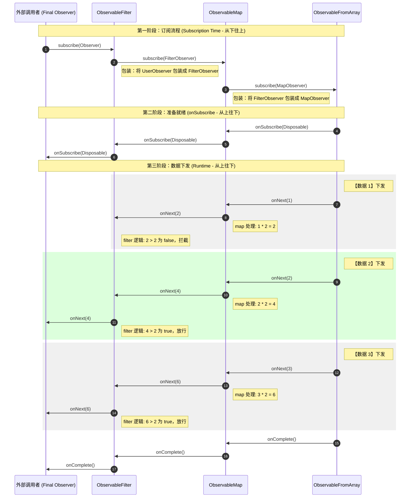

### 简介

RxJava 是 Android 中基于观察者模式的响应式异步事件处理库。核心特点如下：

+ 响应式编程：不同于命令式地手动控制执行顺序，它允许你声明"当某事件发生时做什么"，由框架驱动流程。也就是说当数据源发生变化时，下游会自动收到通知并作出反应，无需手动轮询或层层回调。
+ 异步操作：简化线程切换，轻松处理后台任务与 UI 更新。
+ 链式调用：通过操作符（`map()`、`filter()`、`flatMap()` 等）组合复杂逻辑，代码简洁。
+ 事件流管理：将数据/事件统一封装成流，集中处理。

核心角色：

+ Observable：俗称被订阅者，是事件的来源，接收订阅者 Observer 的订阅请求后，通过发射器 Emitter 向 Observer 发射数据。
+ Observer：俗称订阅者，通过调用 `subscribe()` 向 Observable 发起订阅，订阅建立时会获得一个 Disposable 用于管理订阅生命周期；此后 Observable 内部的 Emitter 会持续向 Observer 发射数据事件（`onNext()`、`onError()`、`onComplete()`）。
+ Emitter：俗称发射器，是 `Observable.create()` 回调中传入的参数对象。通过调用其 `onNext()`、`onError()`、`onComplete()` 等方法，将数据事件推送给已订阅的 Observer。
+ Consumer：它是 Observer 的轻量化变体，`subscribe()` 的重载方法允许传入独立的 Consumer 来分别处理 `onNext()`、`onError()`、`onComplete()`、`onSubscribe()` 事件，无需实现完整的 Observer 接口。
+ Disposable：俗称释放句柄，代表一个可被取消的订阅关系。通常在两个时机获得：一是 Observer 实现的回调方法 `onSubscribe(Disposable d)` 会传回来；二是调用 `subscribe()` 传入 Consumer 时作为返回值获得。通过调用 `dispose()` 可主动取消订阅，防止内存泄漏。

RxJava 原理可总结为：

- 被观察者（Observable）通过订阅（Subscribe）按顺序发送事件给观察者（Observer）
- 观察者（Observer）按顺序接收事件，并作出对应的响应动作。具体如下图：


从你调用 `.subscribe()` 到观察者（Observer）接收到数据，主要经历了三个阶段：组装期（Assembly Time）、订阅期（Subscription Time）和运行期（Runtime/Emission）

1）组装期

发生在你链式调用操作符的时候，比如 `map()`、`filter()`、`flatMap()` 等，此时 `.subscribe()` 还没有被调用。这个阶段没有数据流动，只是在构建一条“操作符链”。每个操作符会包装上游的 ObservableSource，形成一个嵌套结构。

```java
Observable<Integer> source = Observable.just(1, 2, 3)  // new ObservableFromArray<>([1,2,3])
    .map(i -> i * 2)       // new ObservableMap<>(ObservableFromArray, func)
    .filter(i -> i > 2);   // new ObservableFilter<>(ObservableMap, pred)


// ObservableFilter (step3)
//     ├── source → ObservableMap (step2)
//     │            ├── source → ObservableFromArray (step1)
//     │            │            └── values = [1, 2, 3]
//     │            └── mapper = i -> i * 2
//     └── predicate = i -> i > 2
```

2）订阅期

从调用 `.subscribe(observer)` 的那一刻开始。RxJava 会从下游向上游递归调用每个操作符的 `subscribeActual()` 方法（上游，数据的来源，靠近 `just()` 的方向）；下游，数据去的方向，靠近 `subscribe()` 的方向）。每一层操作符会创建一个中间 Observer，包装下游的 Observer，然后订阅上游。最终建立起一条完整的订阅链，数据通道被打通。

```
下游 Observer → filter的Observer → map的Observer → 源头
         ←          订阅方向（从下到上）          ←
```

```java
// ObservableMap的简化源码
public final class ObservableMap<T, U> extends AbstractObservableWithUpstream<T, U> {
    final Function<? super T, ? extends U> function;

    public ObservableMap(ObservableSource<T> source, Function<? super T, ? extends U> function) {
        super(source);           // 把上游存起来，source为ObservableFromArray
        this.function = function;
    }

    @Override
    public void subscribeActual(Observer<? super U> observer) {
        // 这里的observer是由“下游”传过来的（即Filter产生的FilterObserver）
        // source是“上游”（即 ObservableFromArray）
        // 下面这行的逻辑是：
        // 1.把“下游”传来的observer 包装成MapObserver
        // 2.调用“上游”的subscribe，把包装后的observer传给上游
        source.subscribe(new MapObserver<T, U>(observer, function));
    }
}

// AbstractObservableWithUpstream就是存一个source引用
abstract class AbstractObservableWithUpstream<T> extends Observable<T> {
    final ObservableSource<T> source;  // 上游引用

    AbstractObservableWithUpstream(ObservableSource<T> source) {
        this.source = source;
    }
}
```

3）运行期

订阅链建立完成后，源头开始从上游向下游发射数据。数据依次经过每个操作符的 `onNext()`、`onError()`、`onComplete()` 处理。这个阶段是真正的数据流动阶段。

```java
源头 → map.onNext() → filter.onNext() → Observer.onNext()
         →          数据方向（从上到下）          →
```



### 用法

RxJava 提供了 5 种响应式类型：Observable、Flowable、Single、Maybe、Completable。它们共享相同的响应式编程模型，但事件接口与用途各不相同，用于表达更明确的语义。

| 类型            | 发射数量 | 回调方法                               | 说明                         |
| --------------- | -------- | -------------------------------------- | ---------------------------- |
| **Observable**  | 0..N     | `onNext` / `onError` / `onComplete`    | 基础类型，标准事件流         |
| **Flowable**    | 0..N     | 同 Observable                          | 支持背压（Backpressure）控制 |
| **Single**      | 1        | `onSuccess` / `onError`                | 必定发射 1 个值或 1 个错误   |
| **Maybe**       | 0 或 1   | `onSuccess` / `onError` / `onComplete` | 可能有值，也可能无值完成     |
| **Completable** | 0        | `onComplete` / `onError`               | 不发射数据，只关心成功/失败  |

对于这四个回调方法，代表了不同的语义，主要区别如下：

| 方法                   | 含义                   | 调用次数           | 是否终止流 |
| ---------------------- | ---------------------- | ------------------ | ---------- |
| **onNext(T)**          | 发射一个数据           | 可调用多次（0..N） | 否         |
| **onSuccess(T)**       | 发射一个数据并正常结束 | 只调用 1 次        | 是         |
| **onError(Throwable)** | 发生错误，异常终止     | 只调用 1 次        | 是         |
| **onComplete()**       | 正常结束，没有更多数据 | 只调用 1 次        | 是         |

其中 `onComplete()`、`onError()`、`onSuccess()` 是终止信号，一旦发出，RxJava 框架会自动断开订阅关系。之后即使上游源码还在尝试调用 onNext，也会被框架直接丢弃，不会传递到下游。

下面是这些的使用例子：

```java
// Observable写法
Observable<Integer> observable = Observable.create(emitter -> {
    for (int i = 0; i < 3; i++) {
        emitter.onNext(i);
    }
    emitter.onComplete();
});

// Observable写法
Observer<Integer> observer = new Observer<Integer>() {
    private Disposable disposable;
    @Override
    public void onSubscribe(Disposable d) { disposable = d; }
    @Override
    public void onNext(Integer value) { Log.d("Rx", "onNext: " + value); }
    @Override
    public void onError(Throwable e) { Log.e("Rx", "onError: " + e.getMessage()); }
    @Override
    public void onComplete() { Log.d("Rx", "onComplete()"); }
};
observable.subscribe(observer);

// Consumer写法
Disposable disposable = observable.subscribe(
    value -> Log.d("Rx", "onNext: " + value),        // Consumer<Integer>
    error -> Log.e("Rx", "onError: " + error.getMessage()),  // Consumer<Throwable>
    () -> Log.d("Rx", "onComplete()")                // Action
);
```

```java
Single<String> single = Single.create(emitter -> {
    emitter.onSuccess("Login Success");
});

SingleObserver<String> observer = new SingleObserver<String>() {
    private Disposable disposable;
    @Override
    public void onSubscribe(Disposable d) { disposable = d; }
    @Override
    public void onSuccess(String value) { Log.d("Rx", "onSuccess: " + value); }
    @Override
    public void onError(Throwable e) { Log.e("Rx", "onError: " + e.getMessage()); }
};

single.subscribe(observer);
```

```java
Maybe<String> maybe = Maybe.create(emitter -> {
    boolean hasCache = true;
    if (hasCache) emitter.onSuccess("Cache User");
    else emitter.onComplete();
});

MaybeObserver<String> observer = new MaybeObserver<String>() {
    private Disposable disposable;
    @Override
    public void onSubscribe(Disposable d) { disposable = d; }
    @Override
    public void onSuccess(String value) { Log.d("Rx", "onSuccess: " + value); }
    @Override
    public void onComplete() { Log.d("Rx", "onComplete()"); }
    @Override
    public void onError(Throwable e) { Log.e("Rx", "onError: " + e.getMessage()); }
};

maybe.subscribe(observer);
```

```java
Completable completable = Completable.create(emitter -> {
    boolean ok = true;
    if (ok) emitter.onComplete();
    else emitter.onError(new Exception("Upload Failed"));
});

CompletableObserver observer = new CompletableObserver() {
    private Disposable disposable;
    @Override
    public void onSubscribe(Disposable d) { disposable = d; }
    @Override
    public void onComplete() { Log.d("Rx", "onComplete()"); }
    @Override
    public void onError(Throwable e) { Log.e("Rx", "onError: " + e.getMessage()); }
};

completable.subscribe(observer);
```

```java
// 背压（Backpressure）：下游处理不过来时，反向通知上游控制发射速率的机制。下游通过request(n)按自身处理能力索取数据，上游按需发射，避免数据堆积导致内存溢出
Flowable<Integer> flowable = Flowable.range(1, 100); // 发射1~100，内部已处理好背压
Subscriber<Integer> subscriber = new Subscriber<Integer>() {
    private Subscription subscription;
    @Override
    public void onSubscribe(Subscription s) {
        // Flowable搭配Subscriber接口，onSubscribe收到的是Subscription，用来cancel()取消订阅，以及发送请求request()
        // Observable搭配Observer接口，onSubscribe收到的是Disposable，只可以dispose()
        this.subscription = s;
        s.request(5); // 先请求5个，不是一次性全要
    }
    @Override
    public void onNext(Integer value) {
        Log.d("Rx", "处理数据: " + value);
        // 模拟耗时处理
        try { Thread.sleep(100); } catch (InterruptedException e) { e.printStackTrace(); }
        // 处理完一个再请求一个，实现背压控制
        subscription.request(1);
    }
    @Override
    public void onError(Throwable t) {
        Log.e("Rx", "onError: " + t.getMessage());
    }
    @Override
    public void onComplete() {
        Log.d("Rx", "onComplete()");
    }
};
flowable.subscribe(subscriber);
```

上面都是默认全在主线程中执行，下面是加入线程调度的方式，也是我们更常用的方式。

- `subscribeOn()`：指定上游（事件产生）线程。无论链中调用多少次，只有第一次生效。
- `observeOn()`：指定下游（事件接收）线程。每次调用都会生效，每指定一次就切换一次现场，所以链中多次 `observeOn()` 会按顺序依次切换线程。

```java
Single.just("Data")  // 数据源
    .subscribeOn(Schedulers.io())  // 发射线程
    .map(data -> process(data))  // 发射线程中的操作
    .observeOn(AndroidSchedulers.mainThread())  // 接收线程
    .subscribe(new SingleObserver<String>() {  // 接收线程的操作
        @Override
        public void onSubscribe(Disposable d) {
            Log.d("RxJava", "开始订阅");
        }

        @Override
        public void onSuccess(String s) {
            Log.d("RxJava", "接收到: " + s);
        }

        @Override
        public void onError(Throwable e) {
            Log.e("RxJava", "发生错误: " + e.getMessage());
        }
    });
```

对于指定的线程，又有这几种：

| 调度器                           | 线程池特点                                                   | 适用场景                                                     |
| -------------------------------- | ------------------------------------------------------------ | ------------------------------------------------------------ |
| `Schedulers.io()`                | 弹性线程池，按需创建线程，空闲 60 秒后回收，理论上线程数无上限（最大为 Int 最大值）。I/O 密集型任务大部分时间在等待，CPU 处于空闲状态，多开线程能提高并发效率。 | 网络请求、读写文件、数据库操作                               |
| `Schedulers.computation()`       | 固定线程池（启动时预创建），线程数 = CPU 核心数，空闲线程不回收。CPU 密集型任务会持续占用 CPU，开更多线程只会增加上下文切换开销，线程数与核心数一致能最大化利用性能并避免无谓的上下文切换；它仅限制自身调度器内的并发数，不影响应用中主线程或 I/O 线程的并存。 | 图片处理、数据加密、大量循环计算                             |
| ~~`Schedulers.newThread()`~~     | 每次创建新线程，没有线程池复用机制。                         | 不推荐，除非需要完全隔离的短时任务                           |
| `Schedulers.single()`            | 懒加载，首次使用时创建，之后一直存活。所有通过该调度器提交的任务，无论来自多少个 Observable，都共享同一个后台线程串行执行，保证多条流之间的执行顺序。 | 多个独立流需要保证顺序的操作                                 |
| `Schedulers.trampoline()`        | 不切线程，在当前线程排队。                                   | 测试场景，将异步操作同步化，仅验证业务逻辑正确性，避免线程切换增加测试复杂度 |
| `Schedulers.from(Executor)`      | 指定 Java 的 Executor（自定义线程池），任务提交后，由线程池按其自身的调度策略分配给工作线程执行（`io()`、`computation()` 底层也是一个 Executor）。 | 需要复用已有 Executor 或精细控制线程池参数                   |
| `AndroidSchedulers.mainThread()` | Android 主线程。                                             | 更新 UI、操作 View、显示 Toast                               |
| `AndroidSchedulers.from(Looper)` | 指定 Looper 对应的线程，通过 Handler 投递到该 Looper 的消息队列中，由 Looper 循环取出串行执行。 | 需要在特定 HandlerThread 上执行任务                          |

实际开发中用得最多的是 `io()` 和 `mainThread()` 的组合：

```java
observable
    .subscribeOn(Schedulers.io())           // 上游在 IO 线程执行
    .observeOn(AndroidSchedulers.mainThread()) // 下游在主线程执行
    .subscribe(...);
```

另外，还需要有对 Disposable 的管理机制。每次调用 `.subscribe()` 都会返回一个 Disposable 对象，用于控制订阅的生命周期，避免内存泄漏或多余的事件流。

+ 自动释放：当流发出终止信号（onComplete / onError / onSuccess）后，框架会自动调用 `dispose()` 断开订阅。只有 onNext 不会触发释放，因为流还在进行中。
+ 手动管理：
  + `dispose()`：主动取消订阅，终止事件流，后续事件不再传递。
  + `isDisposed()`：判断订阅是否已被取消。

```java
// 方式一：通过Observer的onSubscribe回调获得
observable.subscribe(new Observer<String>() {
    @Override
    public void onSubscribe(Disposable d) {
        // 这里拿到 Disposable
        disposable = d;
    }
    @Override public void onNext(String s) { }
    @Override public void onError(Throwable e) { }
    @Override public void onComplete() { }
});

// 方式二：通过subscribe(Consumer)返回值获得
Disposable disposable = observable.subscribe(
    s -> System.out.println(s),
    e -> e.printStackTrace()
);

// 在合适的时机（如onDestroy）取消订阅，防止内存泄漏
disposable.dispose();
```

更常用的方式是通过 CompositeDisposable 统一管理多个订阅，在页面销毁时一次性全部释放：

```java
CompositeDisposable compositeDisposable = new CompositeDisposable();
Disposable d1 = ...
Disposable d2 = ...
compositeDisposable.addAll(d1, d2);

// 生命周期结束时统一清理
compositeDisposable.clear(); // 可再次添加
// 或 
compositeDisposable.dispose(); // 永久释放
```

最后，说一下常用的创建 Observe 的方式：

```java
// 这里其实是一个Runnable，执行完自动会执行onComplete()，失败则会执行onError()
Completable.fromRunnable(() -> {
     // 发起底层请求
		mTopicManager.setData(key, data);
});
// 等价写法
Completable.create(emitter -> {
		try {
		    mTopicManager.setData(key, data);
        emitter.onComplete();
    } catch (Exception e) {
         emitter.onError(e);
    }
});

// 使用emitter的场景不能使用fromRunnable()，它会立即结束，触发onComplete()，最终触发dispose()
Observable.create(emitter -> {
		emitter.setCancellable(() -> removeObserver(key, emitter));  // 自己需要手动清楚外部引用；外部dispose()会触发这里的逻辑
		// 外部调用emitter
		mTopicManager.registerObserver(key, emitter);
});
```

### 操作符

#### 创建操作符

**1）just()**

可以将一个或多个对象转换成响应式流发送。对于 Observable 和 Flowable，最多接收 10 个参数按顺序发射；对于 Single 和 Maybe，只接收 1 个参数。

```java
Observable.just("Hello", "RxJava")
          .subscribe(s -> System.out.println(s));
```

**2）fromIterable() / fromArray()**

遍历集合或数组，拆分成一个个单独的事件发送。

```java
List<String> list = Arrays.asList("A", "B", "C");
Observable.fromIterable(list)
          .subscribe(System.out::println); // 依次输出 A, B, C
```

**3）create()**

万能创建符，可以手动控制什么时候调用 `onNext()`、`onError()` 或 `onComplete()`。

```java
Observable.create(emitter -> {
    try {
        emitter.onNext("数据1");
        emitter.onNext("数据2");
        emitter.onComplete(); // 必须手动结束
    } catch (Exception e) {
        emitter.onError(e);
    }
}).subscribe(System.out::println);
```

**4）timer()**

延时发送一个固定值 0L，然后 `onComplete()`。可以延时执行某个任务（比如 2 秒后关闭启动页）。

```java
// 2秒后发送一个0
Observable.timer(2, TimeUnit.SECONDS)
          .subscribe(v -> Log.d("Rx", "执行延迟任务"));
```

**5）interval()**

周期性发射一个从 0 开始递增的 Long 类型数字，0L、1L、2L、3L...。可以心跳检测、每 5 秒刷新一次数据、获取验证码倒计时。

```java
// 每隔 1 秒发一次：0, 1, 2, 3...
Observable.interval(1, TimeUnit.SECONDS)
          .subscribe(System.out::println);
```

**6）range()**

发送指定范围的整数序列。

```java
// 从1开始，发送5个数字：1、2、3、4、5
Observable.range(1, 5)
    .map(i -> i * i)
    .subscribe(i -> System.out.println(i));
```

**7）fromCallable() / fromRunnable() / fromAction()**

接受一个 Callable（有返回值），并把返回值发给观察者。

```java
Observable.fromCallable(() -> {
    return db.queryUser(); // 这里的逻辑直到订阅时才在指定线程执行
}).subscribeOn(Schedulers.io()).subscribe(user -> ...);
```

**8）error()**

创建一个不发送数据，直接触发 `onError()` 的流。

```java
Observable.error(new RuntimeException("参数错误"))
          .subscribe(data -> ..., e -> System.out.println(e.getMessage()));
```

-----

严格来说，Subject 不算"创建操作符"，它是一个独立的类。但它在功能上确实扮演了"数据源头"的角色，所以放在这里一起介绍。首先根据订阅者能收到哪些数据"这个差异，Subject 分为以下几种：

**1）PublishSubject**

观察者只能接收到订阅之后发射的数据。

```java
PublishSubject<String> subject = PublishSubject.create();
subject.onNext("A"); // 没人订阅，这波数据丢了
subject.subscribe(s -> System.out.println("收到: " + s));
subject.onNext("B"); // 收到: B
```

**2）BehaviorSubject**

观察者订阅时，会立即收到最近发送的一个数据，以及之后的所有数据。

```java
BehaviorSubject<String> subject = BehaviorSubject.createDefault("默认值");  // create()不带初始值，新订阅者不会立即收到任何数据，直到被观察者第一次调用onNext发出值为止
subject.onNext("最新的状态"); 
// 此时订阅，立刻收到“最新的状态”
subject.subscribe(s -> System.out.println("收到: " + s));
```

**3）ReplaySubject**

无论什么时候订阅，观察者都能收到所有（或指定数量）的历史数据。

```java
ReplaySubject<String> subject = ReplaySubject.create();
subject.onNext("第1步");
subject.onNext("第2步");
// 晚到的观察者
subject.subscribe(s -> System.out.println("补课: " + s)); // 依次收到 1, 2
```

它与 Observable 的核心区别如下：

| **维度**     | **Observable**                                               | **Subject**                                                  |
| ------------ | ------------------------------------------------------------ | ------------------------------------------------------------ |
| **角色**     | 单一角色，纯粹的数据源（被观察者）                           | 双重角色，可以是 Observer（接收数据），也可以是 Observable（分发数据） |
| **冷热属性** | 冷信号，只有当有观察者订阅时，数据才会开始生产和分发，也就是说才会执行 `create()` 内部的逻辑（单播）。但可通过 `share()` 等操作符转为热信号。 | 热信号，数据发射不依赖订阅，任何时候都可以发送数据，并且可以发送给多个订阅者（多播）。订阅者只能收到订阅之后的数据。可通过 ReplaySubject 来收到历史数据。 |
| **发射控制** | 发射逻辑封装在内部（如 `create()` 里的的 emitter），外部无法主动触发发射 | 可在任意位置手动调用 `subject.onNext(data)` 发射数据         |
| **广播能力** | 每个订阅者各自触发独立的数据流，不共享                       | 所有订阅者共享同一条数据流，每次 `onNext` 广播给当前所有订阅者 |
| **适合场景** | 单次异步任务，如 Retrofit 网络请求，每次订阅触发独立请求，各订阅者互不影响。一次性数据读取：如本地数据库或文件读取，读完后流即结束 | 多播场景，需要在多个订阅者之间实时同步同一份数据的场景。桥接底层回调，将 Listener、Callback 内部接入 Subject，让下游统一用响应式链处理 |

```java
// 创建时定义数据源，但不生产数据
Observable<String> cold = Observable.create(emitter -> {
    System.out.println(">>> 数据生产开始了！");
    emitter.onNext("A");
    emitter.onNext("B");
    emitter.onNext("C");
    emitter.onComplete();
});

// 第一次订阅，触发一次完整的数据生产
cold.subscribe(s -> System.out.println("订阅者1: " + s));
// >>> 数据生产开始了！
// 订阅者1: A
// 订阅者1: B
// 订阅者1: C

// 第二次订阅，又触发一次完整的数据生产，从头来
cold.subscribe(s -> System.out.println("订阅者2: " + s));
// >>> 数据生产开始了！
// 订阅者2: A
// 订阅者2: B
// 订阅者2: C
```

```java
PublishSubject<String> hot = PublishSubject.create();

// 还没人订阅就开始发射
hot.onNext("A");  // 没人接收，直接丢了

// 订阅者1来了
hot.subscribe(s -> System.out.println("订阅者1: " + s));
hot.onNext("B"); 
hot.onNext("C");

// 订阅者2来了
hot.subscribe(s -> System.out.println("订阅者2: " + s));
hot.onNext("D");
hot.onComplete();

// 最终结果：
// 订阅者1 收到：B, C, D
// 订阅者2 收到：D
```

那选择 Subject 还是 Observable 呢？核心取决于你的数据源是“被动的”还是“主动的“，可以问自己，需要手动在外部随时随地往这个流里塞数据吗？

- 需要：选 Subject，可以主动发射数据。
- 不需要：选 Observable，仅仅用来包装一段异步逻辑，订阅时才执行。

两者并不是非此即彼，最佳实践实践其实是“对内 Subject，对外 Observable”，内部用 Subject 保留手动发射能力，对外通过 `asObservable()` 暴露只读流，防止外部误调用 `onNext()` 破坏数据流的可控性。

下面以车机场景为例，提供一个最佳实践：

```java
/**
 * 车辆数据仓库 —— 统一管理CAN总线信号的读、写、监听
 * 
 * 架构思路：
 *   - Listener层：将底层CAN回调桥接为RxJava响应式流，通过BehaviorSubject缓存最新值并一点多播分发
 *   - Get层：对外暴露只读Observable，UI订阅即可拿到当前值 + 后续变化
 *   - Set层：写入CAN指令后监听回传确认，写后读验证，超时兜底
 */
public class VehicleRepository {
    // CAN总线写通道
    private final CanWriter canWriter;
    // CAN总线读通道
    private final CanReader canReader;
   
  
    // ==================== Subject层（内部状态缓存，不对外暴露） ====================
    /**
     * 空调温度状态缓存
     * 选用BehaviorSubject的原因：
     *   1.新订阅者能立即拿到当前温度（无需等下一次CAN帧推送）
     *   2.普通CAN信号频率≤100Hz，无需背压，Observable + BehaviorSubject足够
     */
    private final BehaviorSubject<Integer> tempSubject = BehaviorSubject.create();

    /**
     * 管理所有内部订阅的生命周期
     * Repository销毁时调用clear()，自动取消底层Listener注册，防止内存泄漏
     */
    private final CompositeDisposable disposables = new CompositeDisposable();

    public VehicleRepository(CanWriter writer, CanReader reader) {
        this.canWriter = writer;
        this.canReader = reader;
        initListener();
    }
  
    // ==================== Listener层：底层回调 → RxJava流 ====================
    /**
     * 初始化CAN总线监听，将命令式回调桥接为响应式数据流
     * 数据流向：
     *   CAN总线 → CanListener.onFrame() → emitter.onNext()
     *           → filter(按ID过滤) → parse(解析) → Subject缓存
     */
    private void initListener() {
        // 使用Observable.create桥接非Rx的Listener接口
        Observable<CanFrame> rawStream = Observable.create(emitter -> {
            CanListener listener = new CanListener() {
                @Override
                public void onFrame(CanFrame frame) {
                    // 每收到一帧都往下游发射
                    // 注：emitter内部已处理isDisposed判断，无需手动检查
                    emitter.onNext(frame);
                }

                @Override
                public void onError(int code) {
                    // CAN非致命错误只记录日志，不调用emitter.onError()
                    // 原因：onError会终止整个流，导致后续所有信号都收不到
                    Log.w("VehicleRepo", "CAN non-fatal error, code=" + code);
                }
            };

            // 注册底层监听器，开始接收CAN帧
            canReader.registerListener(listener);

            // 关键：当Rx订阅被取消时，自动注销底层Listener，防止泄漏
            emitter.setCancellable(() -> canReader.unregisterListener(listener));
        });

        // 按信号ID分发到对应的Subject
        // 这里只处理温度信号，其他信号（如车速、电量）同理，filter不同ID即可
        Disposable tempDisposable = rawStream
                .observeOn(Schedulers.io())          // 统一切到IO线程，CAN回调线程不确定
                .filter(f -> f.getId() == CanIds.TEMP_ID) // 只取温度帧
                .map(f -> parseTemp(f.getData()))    // 原始字节 → 温度整数值
                .subscribe(
                        tempSubject::onNext,          // 正常数据写入Subject缓存
                        e -> Log.e("VehicleRepo", "温度流异常", e) // 异常兜底，避免静默失败
                );

        // 保存Disposable，Repository销毁时统一清理
        disposables.add(tempDisposable);
    }

    // ==================== Get 层：对外暴露只读的状态观察流 ====================

    /**
     * 观察空调温度变化
     * 
     * 使用方式：
     *   repository.observeTemperature()
     *       .subscribe(temp -> tvTemp.setText(temp + "°C"));
     * 
     * 设计要点：
     *   - hide()：防止下游通过强转拿到 BehaviorSubject 后非法调用 onNext
     *   - distinctUntilChanged()：温度没变时不重复发射，避免 UI 无意义刷新
     *   - observeOn(mainThread)：UI 层默认在主线程消费
     */
    public Observable<Integer> observeTemperature() {
        return tempSubject
                .hide()                  // 封装Subject，只暴露Observable类型
                .distinctUntilChanged()  // 过滤连续重复值
                .observeOn(AndroidSchedulers.mainThread()); // 切回主线程供 UI 使用
    }

    // ==================== Set层：写命令 + 等待回传确认 ====================

    /**
     * 设置空调温度（写后读验证模式）
     * 
     * 执行流程：
     *   1. 向 CAN 总线写入目标温度指令
     *   2. 监听总线回传，等待温度实际变为目标值
     *   3. 500ms 内回传成功 → Completable.onComplete()
     *      500ms 内无回传  → TimeoutException
     *      CAN 写入失败    → RuntimeException
     * 
     * @param targetTemp 目标温度值
     * @return Completable 表示操作成功/失败（无发射值）
     */
    public Completable setTemperature(int targetTemp) {
        return Completable.defer(() -> {
            // ---- 第 1 步：执行写操作 ----
            // 用 defer 包裹，确保每次订阅时才执行写入（懒执行）
            boolean success = canWriter.write(CanIds.SET_TEMP_CMD, encode(targetTemp));
            if (!success) {
                return Completable.error(new RuntimeException("CAN Write Failed"));
            }

            // ---- 第 2 步：监听回传确认 ----
            return tempSubject
                    .skip(1)  // 跳过 BehaviorSubject 的缓存值！
                              // 原因：如果当前温度恰好 == targetTemp，不 skip 会立即命中返回
                              // skip(1) 确保只等待写入之后总线实际回传的新值
                    .filter(currentTemp -> currentTemp == targetTemp) // 匹配目标温度
                    .firstOrError()       // 只取第一个匹配值，转为 Single
                    .timeout(500, TimeUnit.MILLISECONDS) // 500ms 超时兜底
                    .ignoreElement();     // Single → Completable（不需要发射值，只关心完成）
        });
    }

    // ==================== 生命周期管理 ====================

    /**
     * 释放资源
     * 在 Repository 不再需要时调用（如 ViewModel.onCleared()）
     * 会同时：
     *   1. 取消 rawStream 订阅 → 触发 setCancellable → 注销底层 CAN Listener
     *   2. 清理所有内部 Disposable
     */
    public void dispose() {
        disposables.clear();
    }
}
```

在我们的代码中，有些地方并没有遵循这个最佳实践，而是通过手动保存 Observable 的 emitter 到列表，来实现类似 Subject 的效果。这本质上是重写了一个 PublishSubject，会潜在带来很多问题，比如线程安全，`isDisposed()` 检查与 `onNext()` 之间存在竞态窗口；Subject 支持的操作符也更多，自带 `distinctUntilChanged()`、`skip()`、`filter()` 等开箱即用。总之不要重复造轮子。

#### 转换操作符

**1）map**

对响应式流发射的每一条数据应用一个函数，进行相应逻辑处理。

```java
Observable.just(1, 2, 3, 4, 5)
    .map(integer -> integer * integer)
    .subscribe(result -> Log.d("RxJava", "平方结果: " + result));
```

**2）flatmap**

对数据源发射的每条数据应用一个函数，该函数必须返回一个新的响应式流，flatMap 在向下传递时，它会自动“拆箱一层”，避免 `Observable<Observable<T>>` 的嵌套问题。

```java
Observable.just("张三")  // Observable<String>
    .flatMap(name -> Observable.just(name + "的订单"))  // Observable<String + String>
    .subscribe(result -> Log.d("RxJava", result))  // Observable<String + String>
// 张三的订单1

// 如果用map：
Observable.just("张三")  // Observable<String>
    .map(name -> Observable.just(name + "的订单"))  // Observable<Observable<String + String>>
    .subscribe(result -> Log.d("RxJava", result))  // Observable<String + String>
// io.reactivex.rxjava3.internal.operators.observable.ObservableFromArray@xxxxx

// Observable<“张三”> + "的订单"不就崩了吗？
// 操作符自动将T从Observable<T>中取出交给lambda处理的过程。处理完成后，框架再将结果包回Observable往下传递
```

**3）concatMap**

与 flatMap 类似，但它保证顺序。它会等待前一个响应式流执行完成后，再处理下一个发射的数据。而对于 flatMap 涉及多个响应式流时，他们会并发的去处理，不保证顺序。

那上面的 map 保证顺序吗？保证的，因为用 map 时只可能会涉及到一个流。会顺序先处理完“1”，输出“平方结果:  1”；然后处理“2”...

```java
// 等张三的请求完成后，才发李四的请求，再发王五的
// 固定输出：张三的订单、李四的订单、王五的订单
Observable.just("张三", "李四", "王五")
    .concatMap(name -> fetchOrders(name)  // 模拟网络请求
            .subscribeOn(Schedulers.io()))
    .subscribe(result -> Log.d("RxJava", result));

// 三个请求同时发出，谁先返回谁先输出
// 可能输出：李四的订单、张三的订单、王五的订单
Observable.just("张三", "李四", "王五")
    .flatMap(name -> fetchOrders(name)  // 网络请求
            .subscribeOn(Schedulers.io()))
    .subscribe(result -> Log.d("RxJava", result));
```

**4）switchMap**

switchMap 和 flatMap 一样会创建内部流，但关键区别是：当外层流发射新元素时，会自动取消（unsubscribe）上一个还没完成的内部流，只订阅最新的。

```java
Observable.just("A", "AB", "ABC")
    .switchMap(keyword -> 
        Observable.just(keyword + "的结果")
                  .delay(100, TimeUnit.MILLISECONDS)  // 使用delay后，原本单线程排队的同步代码，变成了“多线程并发”的异步代码，会强制使用Schedulers.computation()
    )
    .subscribe(System.out::println);
// ABC的结果
```

#### 过滤操作符

**1）filter**

根据指定的逻辑过滤数据，只有符合条件的数据才会向下传递。

```java
Observable.just(1, 2, 3, 4, 5)
    .filter(integer -> integer >= 3) // 只有 >= 3 的数字能通过
    .subscribe(i -> Log.d("RxJava", "接收到: " + i)); 
```

**2）distinct**

过滤掉重复的数据（全局去重），整个流中相同的数据只发射一次。

```java
Observable.just(1, 2, 3, 2, 1, 4, 3)
    .distinct()
    .subscribe(System.out::println);
// 输出：1, 2, 3, 4
```

**3）distinctUntilChanged**

过滤掉连续重复的数据，只有当新发射的数据与上一个不同时，才发射。

```java
Observable.just(1, 1, 2, 2, 3, 1, 1, 4, 4, 4)
    .distinctUntilChanged()
    .subscribe(System.out::println);
// 输出：1, 2, 3, 1, 4
```

**4）debounce**

用来实现防抖，等一段时间没有新数据到来，才发射最后一个值。期间如果有新数据来，重新计时。

```java
// 防抖，300ms内没有新数据才发射
Observable.create(emitter -> {
    emitter.onNext("A");
    Thread.sleep(100);
    emitter.onNext("B");  // A 被丢弃
    Thread.sleep(400);
    emitter.onNext("C");  // B 被发射
    Thread.sleep(400);
    emitter.onComplete(); // C 被发射
})
.debounce(300, TimeUnit.MILLISECONDS)
.subscribe(System.out::println);
// 输出: B, C
```

**5）throttleFirst**

用来实现节流，在固定的时间窗口内，只发送第一条数据，忽略后续数据。

```java
Observable.create(emitter -> {
    emitter.onNext("A");     // 发射
    Thread.sleep(50);
    emitter.onNext("B");     // 丢弃
    Thread.sleep(50);
    emitter.onNext("C");     // 丢弃
    Thread.sleep(250);       // 窗口结束
    emitter.onNext("D");     // 发射
    emitter.onComplete();
})
.throttleFirst(300, TimeUnit.MILLISECONDS)
.subscribe(System.out::println);
```

**6）skip**

跳过前 n 个数据，比如可以忽略初始化时的第一个默认值。

```java
Observable.just(1, 2, 3, 4, 5)
    .skip(3)
    .subscribe(System.out::println);
// 输出：4, 5
```

**7）take**

只取前 n 个数据，取完后直接结束（onComplete）。

```java
Observable.just(1, 2, 3, 4, 5)
    .take(3)
    .subscribe(System.out::println);
// 输出：1, 2, 3
```

**8）sample**

在固定的时间间隔内，只取该间隔里最后一条发射的数据。适合高频数据源需要降频采样的场景。

```java
Observable.create(emitter -> {
    emitter.onNext("A");
    Thread.sleep(100);
    emitter.onNext("B");
    Thread.sleep(100);
    emitter.onNext("C");     // 第1个采样点 → 发射C
    Thread.sleep(150);
    emitter.onNext("D");
    Thread.sleep(100);
    emitter.onNext("E");     // 第2个采样点 → 发射E
    Thread.sleep(300);       // 第3个采样点 → 无数据，跳过
    emitter.onNext("F");
    Thread.sleep(100);
    emitter.onNext("G");     // 第4个采样点 → 发射G
    Thread.sleep(300);
    emitter.onComplete();
})
.sample(250, TimeUnit.MILLISECONDS)
.subscribe(System.out::println);
// 输出：C, E, G
```

#### 组合操作符

**1）zip**

将多个 Observable 发射的数据，按顺序一对一地组合在一起（第 1 个 Observable 的第 1 个数据与第 2 个 Observable 的第 1 个数据组合，以此类推），并根据提供的函数转换后发射。

```java
Observable.zip(
    api.getUserInfo(), // 请求1
    api.getCoupons(),  // 请求2
    (user, coupons) -> new HomeData(user, coupons) // 合并结果
).subscribeOn(Schedulers.io())
 .observeOn(AndroidSchedulers.mainThread())
 .subscribe(homeData -> { /* 刷新UI */ });
```

**2）combineLatest**

所有源都至少发射过一次数据后才会开始工作，之后任意一个流发射新值时，它会取出每个源最近一次发射的值进行组合，并将组合结果向下游发射。

```java
// 外部通过obsA.Next()触发，这里进行聚合
Observable.combineLatest(obsA, obsB, (valA, valB) -> {
    return valA.length() > 0 && valB.length() > 0; // 组合逻辑
}).subscribe(isBtnEnable -> button.setEnabled(isBtnEnable));
```

**3）merge**

将多个 Observable 合并成一个，并行执行，先到先得，交错发射。

```java
Observable.merge(sourceFromCache, sourceFromNetwork)
    .subscribe(data -> { /* 只要有数据就更新 */ });
```

**4）concat**

将多个 Observable 合并成一个，串行执行，先执行第一个，等第一个 onComplete 后，再执行第二个。前面的没结束，后面的永远不会开始。

```java
Observable.concat(
    readFromCache(),       // 先发射缓存（可能为空或旧数据）
    readFromNetwork()      // 缓存完成后，再请求网络拿最新数据
)
.subscribe(data -> show(data));
// 用户先看到缓存（秒开），随后被网络数据刷新
```

```
源A:  --A1----A2----->
源B:  ----B1----B2--->

merge:  --A1--B1--A2--B2-->   交错
concat: --A1----A2--B1----B2-->  先A后B
zip:    ------(A1,B1)--(A2,B2)-->  配对
```

**5）startwith**

在 Observable 发射数据之前，先发射一些特定的数据（或是另一个 Observable）。

```java
api.getData()
    .startWith(Arrays.asList("初始数据1", "初始数据2"))
    .subscribe(list -> { /* 先收到初始数据，后收到接口数据 */ });
```

#### 功能操作符

**1）do 生命周期系列**

```java
Observable.just(1, 2, 3)
    .doOnNext(n -> log("发射: " + n))
    .doOnComplete(() -> log("流完成"))
    .doOnError(e -> log("出错: " + e))
    .doOnSubscribe(d -> log("被订阅"))
    .doOnDispose(() -> log("被取消"))
    .doFinally(() -> log("最终执行，无论成功/失败/取消"))
    .subscribe(System.out::println);
```

**2）onErrorReturn**

当发生错误时，发射一个默认值并正常结束，而不是抛出错误，下游的 onError 不会再触发。

```java
// 出错时返回默认值
fetchData()
    .onErrorReturn(error -> "默认数据")
    .subscribe(data -> show(data));
```

**3）onErrorResumeNext**

在出错时切换到备用流继续发射。

```java
fetchData()
    .onErrorResumeNext(error -> fetchFromBackup())
    .subscribe(data -> show(data));
```

**4）retry**

发生错误时，让原始 Observable 重试 n 次。例如网络请求超时自动重试 3 次。

```java
flakyApiCall()
    .retry(3)                   // 最多重试3次
    .subscribe(
        data -> show(data),
        error -> showError(error)  // 3次都失败才走这里
    );
```

**5）timeout**

设置超时时间，如果在规定时间内没有发射数据，则抛出 TimeoutException。例如给网络请求强制设置 5 秒超时，防止长连接无限等待。

```java
slowApiCall()
    .timeout(3, TimeUnit.SECONDS)
    .subscribe(
        data -> show(data),
        error -> {
            if (error instanceof TimeoutException) {
                showTimeout();
            }
        }
    );
```

**6）delay**

让 Observable 里的所有数据都延时一段时间再发射，可以实现延时执行。

```java
Observable.just("Hello")
    .delay(2, TimeUnit.SECONDS)
    .subscribe(System.out::println);
```

**7）hide**

hide 会包装原始的 Observable，使得下游无法通过强制类型转换将其变回原来的对象。如果不使用 hide，外部拿到 Observable 后，可以通过 `(Subject)observable` 强转，然后手动调用 onNext 发送假数据。

```java
public class MyViewModel {
    private final PublishSubject<String> _data = PublishSubject.create();

    // 暴露给外部，使用hide()确保外部只能监听，不能发射数据
    public Observable<String> getData() {
        return _data.hide(); 
    }
}
```

**8）cache**

订阅上游一次，并将发射过的数据缓存起来。当有新的订阅者进来时，它会直接使用缓存的数据发送给新的订阅者，不会在向底层请求。

```java
Observable<String> cachedData = api.getData()
    .subscribeOn(Schedulers.io())
    .cache(); // 无论多少人订阅，网络请求只发一次

cachedData.subscribe(d -> Log.d("Rx", "订阅者1: " + d));
// 延迟一段时间后
cachedData.subscribe(d -> Log.d("Rx", "订阅者2直接从缓存拿: " + d));
```

**9）share**

将冷 Observable 转换为热 Observable，使多个订阅者共享同一个数据流，而不是每个订阅者各自触发一遍发射逻辑。本质上是 `publish().refCount()` 的简写。

```Java
// 不用share：每次订阅都重新执行发射逻辑（重新发一次网络请求）
Observable<String> source = Observable.create(emitter -> {
    System.out.println("执行网络请求...");
    emitter.onNext("服务器数据");
    emitter.onComplete();
});
source.subscribe(s -> System.out.println("A: " + s)); // 打印：执行网络请求...
source.subscribe(s -> System.out.println("B: " + s)); // 又打印：执行网络请求...  ← 重复了

// 用share：多个订阅者共享同一次发射
Observable<String> shared = source.share();
shared.subscribe(s -> System.out.println("A: " + s)); // 打印：执行网络请求...
shared.subscribe(s -> System.out.println("B: " + s)); // 不再打印"执行网络请求" ← 共享了
```

#### 条件操作符

**1）all**

判断 Observable 发射的所有数据是否都满足某个条件。

```java
Observable.just(1, 2, 3, 4)
    .all(integer -> integer < 5) // 是否所有数字都小于 5
    .subscribe(result -> Log.d("RxJava", "结果: " + result)); // true
```

**2）any**

判断 Observable 发射的数据中，是否至少有一个满足条件。

```java
Observable.just(1, 2, 3, 4)
    .any(integer -> integer > 3)  // 是否有任一数字大于 3
    .subscribe(result -> Log.d("RxJava", "结果: " + result));  // true
```

**3）defaultIfEmpty**

如果 Observable 正常结束且没有发射任何数据（直接 onComplete） ，则发射一个指定的默认值。

```java
api.getHistoryList() // 假设返回空流
    .defaultIfEmpty(new ArrayList<String>()) // 没数据就发个空集合
    .subscribe(list -> { /* list为null */ });
```

**4）switchIfEmpty**

如果 Observable 正常结束且没有发射任何数据（直接 onComplete），则切换到另一个备用 Observable 继续发射。

```java
api.getHistoryList()  // 假设返回空流
    .switchIfEmpty(api.getHistoryListFromBackup())  // 没数据就走备用接口
    .subscribe(list -> { /* list为备用接口返回的数据 */ });
```

**5）takeWhile**

条件成立就继续，不成立就停。

```java
Observable.just(1, 2, 3, 4, 5)
    .takeWhile(n -> n < 4)
    .subscribe(System.out::println);
// 输出：1, 2, 3
// 遇到4 → 条件不成立 → 停止，4不发射
```

**6）takeUntil**

条件成立就停。

```java
Observable.just(1, 2, 3, 4, 5)
    .takeUntil(n -> n > 3)
    .subscribe(System.out::println);
// 输出：1, 2, 3, 4
// 遇到4 → 条件成立 → 发射4后停止
```

