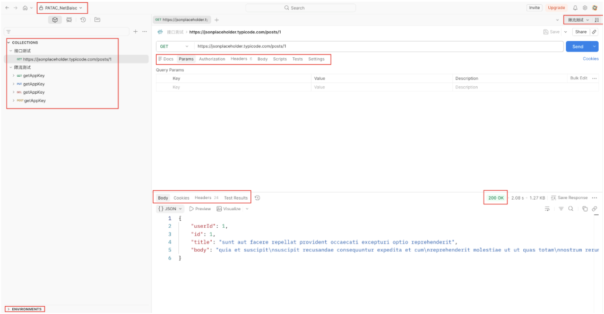
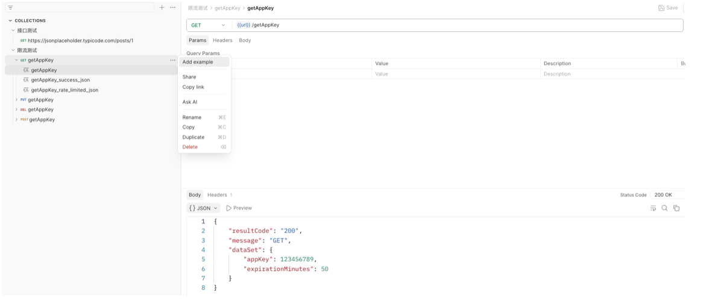

Postman 是一个 API 开发与测试工具，它其实主要是面向测试的，这里仅仅介绍下我平常会遇到的功能。

#### 接口调试

可以发送 HTTP 请求（GET、POST、PUT、DELETE 等），查看响应内容、状态码、响应头等，方便验证后端接口是否正常工作。使用起来也很简单，把地址输入进去就可以，可能还要配置 “Params”、“Headers” 等，然后发送请求就可以了，下方可以看到请求返回的结果。

在额外介绍下界面上的这些元素，左侧栏目：

+ WorkSpace：就是一个工作空间，也就是上面的“PATAC_NetBasic”，可以把这个 WorkSpace 分享给别人，一起使用、编辑。
+ Collections：类似于文件夹的概念。
+ Environments：可以定义多组环境配置，例如"生产环境"、"测试环境"，每组中设置同名变量，如 URL，在请求中通过 `{{url}}` 引用，即可根据右上角选择的环境（“限流测试”那里）自动切换对应的值，无需手动修改请求地址。

右侧栏目：

+ Docs：可以编写 API 文档。
+ Params：配置 Query 参数。
+ Authorization：设置请求的认证方式，如 OAuth 2.0、API Key 等。
+ Headers：配置请求头。
+ Body：配置请求体，比如 JSON、form-data、x-www-form-urlencoded 等。
+ Scripts：请求执行前运行的 JavaScript 脚本，可以用于动态生成签名、设置变量等。
+ Tests：响应返回后执行，用于编写断言验证接口是否正确，可以在下方的 “Tests Results” 看到断言的结果。
+ Settings：可以设置超时时间、SSL 证书等。

#### Mock Server

> https://www.youtube.com/watch?v=Ef3RvRpY9Co

Mock Server 存在的意义其实是为了，在后端接口还没开发好时，模拟接口返回预设数据，让前端/客户端能照常开发调试。

如何创建它呢，点击 “+” 创建 Mock Server，会得到一个专属的 HTTP 地址，然后点击 “Add example”，每个 Example 可以定义不同的 Status Code、Body，你在它的请求目录（“GET getAppKey”）发起请求时，可以设定不同的 Headers、Paramas，它会自动匹配调用哪个 Example。

上面图片里的例子，是我用来模拟“限流接口”测试的，也就是你非常频繁请求一个地址，这个地址就会抛 429，我的做法是在 “getAppKey_success_json” 和 "getAppKey_rate_limited_json" 定义号两种 Body 方便复制，然后每次在 “getAppKey” 进行手动切换。

