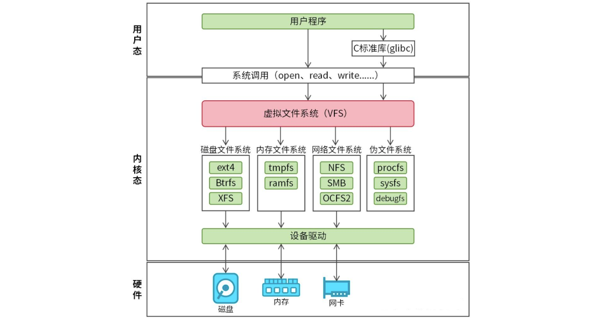
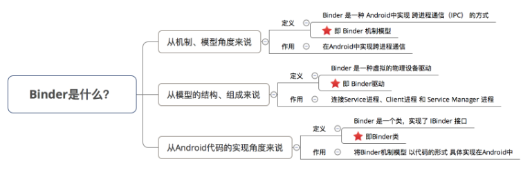
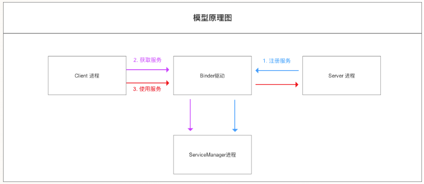

## Android 中的多进程模式

这里的多进程指单个应用内运行多个进程，而非不同应用之间的多进程。如何开启多进程？在 AndroidManifest.xml 中，通过 `android:process` 属性即可为四大组件（Activity、Service、Receiver、Provider）指定独立进程：

```xml
<!-- 主进程（没有指定process，运行在默认进程）：com.example.app -->
<activity android:name=".MainActivity" />

<!-- 私有进程：com.example.app:remote -->
<service android:name=".MusicService"
         android:process=":remote" />

<!-- 全局进程：com.example.another -->
<service android:name=".DownloadService"
         android:process="com.example.another" />
```

开启多进程后，系统会 `fork()` 出新的 Linux 进程，为每个进程分配独立的虚拟机实例，分配独立的内存地址空间。

首先，全局进程已经过时，当初设计这种不带 `:` 的全局进程名，目的是让 App A 和 App B 运行在同一个 Linux 进程里，共享内存数据。但在现代 Android 系统中，要实现跨 App 共享进程必须满足两个硬性前提，相同的签名和在 Manifest 根节点声明相同的 `android:sharedUserId`，后者已经被废弃（Android 的安全模型以 Linux UID 作为沙箱边界，实现数据、进程、资源和权限的隔离，而 sharedUserId 让多个应用共享同一个 UID，破坏了整个沙箱体系）。

而私有进程主要用在是“物理隔离”与“独立生命周期”，典型场景如下：

+ 崩溃隔离：将不可控的高危模块（WebView、Native 库）放到私有进程，崩溃只影响该进程，主进程不闪退。
+ 内存隔离：每个 Android 进程在系统底层都有一个严格的堆内存上限（通常 256MB ~ 512MB 左右），重度内存操作（长图渲染、视频转码）放到私有进程，会拥有独立 Heap 上限，即使 OOM 也不影响主进程，任务完成后可彻底释放内存。
+ 生命周期独立：轻量常驻服务（推送、长连接）放到私有进程，启动开销低、内存占用小，唤醒成本低，不拖累主进程。
+ 彻底资源释放：任务完成后直接 `System.exit(0)` 杀死私有进程，操作系统内核回收全部资源，解决难以解决的内存泄漏（比如第三方 SDK 内部单例无法释放）。

两个进程基于同一个应用怎么区分呢？

```java
public class MyApp extends Application {
    @Override
    public void onCreate() {
        super.onCreate();
        
        // 获取当前进程名
        String processName = getProcessName();
        
        if (processName.equals(getPackageName())) {
            // 主进程：初始化UI相关
            initImageLoader();
            initNetwork();
        } else if (processName.equals(getPackageName() + ":remote")) {
            // Remote进程：只初始化音乐播放相关
            initMusicEngine();
        }
    }
}
```

之后这两个进程进程进行通信，就需要用到 IPC 机制。

另外需要注意，多进程会造成很多问题，比如下面几个：

1）静态成员和单例模式完全失效

- 如果你在 A 进程修改了一个静态变量 Config.isDebug = true，在 B 进程中读取这个变量，它依然是初始值（比如 false）。
- 单例模式本质上也是基于静态变量。A 进程一个单例对象，B 进程一个单例对象，它们不是同一个实例，无法通过单例来共享数据。

这是因为 Android 的每一个进程都会被分配一个独立的虚拟机（VM），每个虚拟机都有自己独立的内存地址空间。

2）线程同步机制完全失效

+ 如果你在 A 进程对某个方法加了锁，B 进程依然可以同时访问这个方法（因为它是两个不同的虚拟机实例在跑）。

所有的同步锁（如 synchronized 关键字、ReentrantLock 等）都是基于 JVM 内部的对象锁或内存屏障，用范围仅限于当前的虚拟机（即当前进程）。

3）SharedPreferences 的可靠性下降

+ 如果 A 进程和 B 进程同时修改同一个 SP 文件，会导致数据覆盖或丢失。由于它不支持进程间同步，读到的数据也可能是旧的缓存数据。

4）Application 会多次创建

当一个组件运行在新的进程中时，系统需要为该进程启动一个新的虚拟机。启动虚拟机的过程包括：

1. 加载进程。
2. 创建该进程对应的 Application 实例。
3. 调用 Application.onCreate()。

所以一定要进行额外处理，如果不处理，会导致重复初始化（如 SDK、数据库、日志等），可能会导致严重问题（之前 Settings 应用里为了杜比音效开了一个进程，导致 Application 初始话了两回，从而导致里面的 SomeIp 注册了两回，导致不能使用）。

## IPC 基础概念介绍

IPC（Inter-Process Communication）指的是进程间通信，即在两个相互隔离的进程之间进行数据交换的过程。

虽然 Android 基于 Linux 内核，但它并未完全沿用 Linux 传统的通信方式（如命名管道、消息队列等），而是构建了一套以 Binder 为核心的通信体系。Binder 以其高效、安全的特性，成为了 Android 系统中最具代表性的 IPC 方案。此外，Android 也支持 Socket，常用于跨网络或设备内两个相对独立的进程间通信。

### Serializable 接口

Serializable 是 Java 提供的一个标记接口（接口内没有方法）。它的作用是告诉 JVM：这个类的对象是可以被序列化的。

+ 序列化（Serialization）是指将内存中的对象（具体来说是，对象的状态，类型信息和字段值）转换为字节流的过程，以便能够将该对象保存到文件、数据库，或者进行网络传输。

+ 反序列化（Deserialization）就是将字节流转换回对象的过程，以便构建原始对象。


在 Android 开发中，Serializable 主要用于以下三个地方：

+ Activity/Fragment 间的数据传递： 通过 Intent 或 Bundle 传递自定义对象。

  ```java
  Intent intent = new Intent(this, SecondActivity.class);
  User user = new User("Eric", 35);
  // user必须实现Serializable或Parcelable
  intent.putExtra("User", user);
  startActivity(intent);
  
  User user = (User) getIntent().getSerializableExtra("User");
  ```

+ 持久化存储：将对象保存到本地文件或数据库中。

+ 网络传输：可以用 Java 对象序列化的方式，但更流行的是 Json 序列化的方式。序列化方式不仅仅有 Java 对象序列化（Serializable），还有 Json 序列化、ProtoBuff 序列化等。

常规代码的实现：

1）实现 Serializable 接口。

```java
// Serializable是一个标记接口，没有任何方法，告诉JVM，该类的对象可以被序列化
public class Person implements Serializable {
    // 手动指定一个固定值，让系统不要自动计算，保证类的兼容
    private static final long serialVersionUID = 1L;
    private String name;
    private int age;

    // 省略构造方法、getters和setters
}
```

第二步，声明 ObjectOutputStream。

```java
// ObjectOutputStream：用于将对象转换为字节流，并写入到指定的输出流（如文件、网络流）中
// FileOutputStream：将数据写入到文件person.ser中，该文件保存序列化后的对象。
ObjectOutputStream out = new ObjectOutputStream(new FileOutputStream("person.ser"));
```

第三步，调用 ObjectOutputStream 的 writeObject 方法，将对象序列化并写入到输出流中。

```java
Person person = new Person("沉默王二", 18);
out.writeObject(person);
```

反序列化。反序列化出来的 newPerson 和原对象 Person内容一模一样，但它们在堆内存中的地址是不同的。

```java
ObjectInputStream in = new ObjectInputStream(new FileInputStream("person.ser"));
Person deserializedPerson = (Person) in.readObject();
System.out.println(deserializedPerson.getName()); // 输出: 沉默王二
System.out.println(deserializedPerson.getAge());  // 输出: 18
```

######  serialVersionUID

再说一下 `serialVersionUID` 的意义：

```java
public class User implements Serializable {
    private static final long serialVersionUID = 1L;
    
    private String name;
    private int age;
    private String email;  // 比如，新增字段
}
```

新增前：

```
User{name="张三", age=25}
serialVersionUID = 1L  ← 固定值
```

新增后：

```
serialVersionUID = 1L  ← 还是 1L，没变！
文件中的值: serialVersionUID = 1L  ← 匹配！
```

结果：

```java
User newUser = (User) in.readObject();
// name = "张三"  ✓
// age = 25      ✓
// email = null  ← 新字段为默认值，但程序没崩溃
```

如果不加：

```
系统重新计算：serialVersionUID = 9876543210L  ← 变了
文件中的值：serialVersionUID = 1234567890L  ← 旧版本
两者不匹配：InvalidClassException → 程序崩溃
```

这样做就是为了版本兼容（增删字段不影响），防止崩溃。

###### 为什么 int 不用序列化呢？

并不是 int 不用序列化，而是 int 本身就具备可序列化的属性，它是序列化过程中的最小原子单元，一个 int 在内存里永远固定占据 4 个字节（32位）。它的结构是透明的、标准的。JVM 根本不需要任何额外的“说明书”就可以直接把 int 转换成二进制。

###### 为啥不默认实现 Serializable 接口呢？多此一举？

+ 安全性：如果所有对象默认都是可序列化的，那么系统中的任何敏感信息（password）都可以轻而易举地被写到磁盘上或通过网络发送出去。通过让类实现 Serializable 接口，程序员实际上是在做一个显式声明：“我确认这个类的数据是可以被安全地导出并传输的。”
+ 技术可行性：并不是所有的 Java 对象都能被转换成字节流，比如 Thread、Socket 等（正常不会放在对象里）。
+ 性能：序列化涉及大量的反射（Reflection）操作，通过“按需开启”，降低性能影响。

### Parcelable 接口

Parcelable 是 Android 专属的序列化接口，专门用于在 Android 组件之间（如 Activity、Fragment、Service）高效传递对象。

当你在 Activity 之间传递数据或调用 AIDL 接口时，底层流程如下：

1. 用户态映射：进程 A 将对象通过 `writeToParcel()` 写入一块内存缓冲区。
2. 内核拷贝：Binder 驱动将这块数据从进程 A 的内核缓冲区拷贝（或映射）到进程 B 的内核缓冲区。
3. 还原对象：进程 B 调用 `CREATOR.createFromParcel`，根据二进制流重新“拼装”出一个新的对象实例。

```
用户态(进程A): User对象 -> writeToParcel() -> Parcel数据
                    ↓
内核态:          Binder驱动拷贝/映射
                    ↓
用户态(进程B): Parcel数据 -> CREATOR.createFromParcel() -> 新User对象
```

代码示例：

+ Parcelable：约定对象如何写入、如何重建
+ Parcel：存放扁平化数据的容器，支持基本类型、字符串、Parcelable 等。
+ CREATOR：对方进程从 Parcel 中读取数据，创建对象。

```java
public class User implements Parcelable {
    private String name;
    private int age;

    public User(String name, int age) {
        this.name = name;
        this.age = age;
    }


    // 反序列化构造函数，用于从Parcel中读取数据恢复出User对象
    // 顺序必须和写入时保持一致
    protected User(Parcel in) {
        name = in.readString();
        age = in.readInt();
    }

    // 将当前对象的字段写入到Parcel中
    // 写入顺序要与读取顺序一致，否则读取会出错或产生异常
    // flags由系统调用，自己不用不管
    @Override
    public void writeToParcel(@NonNull Parcel dest, int flags) {
        dest.writeString(name);
        dest.writeInt(age);
    }

    // 不太用，不用管，返回不同的值是为了处理文件描述符
    @Override
    public int describeContents() {
        return 0;
    }

    // CREATOR是系统用来构建Parcelable对象的工具
    public static final Creator<User> CREATOR = new Creator<User>() {
        // 从Parcel创建对象，调用上面的构造函数
        @Override
        public User createFromParcel(Parcel in) {
            return new User(in);
        }

        @Override
        public User[] newArray(int size) {
            return new User[size];
        }
    };
}
```

```java
Intent intent = new Intent(this, SecondActivity.class);
User user = new User("Eric", 35);
intent.putExtra("User", user);
startActivity(intent);
```

```java
User user = getIntent().getParcelableExtra("User");
```

在 Kotlin 中，实现 Parcelable 变得极其简单。只需要使用 `@Parcelize` 注解，编译器会自动帮你生成上述复杂的样板代码。

```kotlin
@Parcelize
class User(val name: String, val age: Int) : Parcelable
```

那么，Serializable 和 Parcelable 到底有什么区别？可以看它们的序列化与反序列化过程：

Serializable 序列化：

```
User 对象
  ↓
oos.writeObject(user)
  ↓
【反射获取类信息】提取全限定类名 "com.example.User" 与 serialVersionUID
  ↓
【反射扫描字段声明】提取字段清单与类型（字段名 "name"、"age" 及其数据类型）
  ↓
【写入元数据】把类名、版本号、字段清单完整打包写入 I/O 流
  ↓
【反射读取并写入字段值】
反射获取 name 值 ──> 转化为字节写入流
反射获取 age 值  ──> 转化为 4 字节写入流
  ↓
底层结果：包含完整类结构元数据 + 字段值的自描述 Java 字节流 (byte[])
```

Serializable 反序列化：

```
Java 字节流 (byte[])
  ↓
ois.readObject()
  ↓
【读取并校验元数据】解析流中的类名与 serialVersionUID，与本地 User.class 比对一致性
  ↓
【底层分配内存】JVM 绕过 User 构造函数，直接在内存开辟对象空间
  ↓
【反射填充字段数据】
从流中读取 name 字节 ──> 通过反射直接注入 user.name
从流中读取 age 字节  ──> 通过反射直接注入 user.age
  ↓
返回全新的 User 对象
```

Parcelable 序列化：

```
User 对象
  ↓
parcel.writeParcelable(user, 0)
  ↓
【系统写入元数据】JNI 写入当前类名全称："com.example.User"
  ↓
【开发者写入数据】回调 user.writeToParcel(dest, 0)
  ↓
JNI 写入：dest.writeString(name)  ──> Native 内存按 4 字节对齐追加字符字节
JNI 写入：dest.writeInt(age)       ──> Native 内存按 4 字节直接追加 32 位整型
  ↓
底层结果：C++ Native 缓冲区（连续无流式封装的裸二进制内存块）
```

Parcelable 反序列化：

```
目标进程接收到 Native Parcel 内存块
  ↓
parcel.readParcelable(classLoader)
  ↓
【读取类名】从 Parcel 中读取类名："com.example.User"
  ↓
【查找 CREATOR】通过 classLoader 加载类，反射获取静态成员 `CREATOR`（有系统缓存）
  ↓
【实例化】调用 CREATOR.createFromParcel(in)  ──> 开发者在此处显式 new User(in)
  ↓
【还原字段】
JNI 读取：in.readString()  ──> 从 Native 内存当前指针读取字符串
JNI 读取：in.readInt()     ──> 从 Native 内存当前指针读取 4 字节 int
  ↓
返回全新的 User 对象
```

| **维度**     | Serializable（I/O 流模型）                                   | Parcelable（内存缓冲区模型）                                 |
| ------------ | ------------------------------------------------------------ | ------------------------------------------------------------ |
| **底层形态** | 流式管道协议（Stream）                                       | 一块连续的裸内存（Buffer）                                   |
| **操作方式** | “打包发快递”： 必须经过一系列 Stream 管道类（`ObjectOutputStream` -> `ByteArrayOutputStream`），一层层包装协议头、魔数和元数据，中途不断生成临时的缓冲数组（`byte[]`）。 | “直接在黑板上填格子”： 底层就是一个 C++ 指针 `void* mData`。写数据就相当于 C 语言的内存直接赋值： `*(int*)(mData + offset) = 18; offset += 4;` 没有中间包装，没有多余流对象。 |
| **设计初衷** | 面向文件与网络： 数据可能断断续续到达，必须有流的协议头、断句标记和自描述信息，接收端才能知道怎么解析。 | 面向单机跨进程（IPC）： 目标就是把数据以最低开销填满一块内存，直接丢给内核 Binder 驱动拷贝，不需要任何协议封装。 |

+ Serializable：是带大量协议包装、走 I/O 管道层层转手的二进制字节流。会涉及反射，生成大量临时对象，加重 GC 负担。适用于持久化/网络。

+ Parcelable：是跳过所有中间管道，直接用指针往 Native 内存块里硬写的二进制裸数据。仅限 Android 运行时的组件间数据传递（包括进程内和进程间）。

###### flags

+ 0：参数传递，客户端 → 服务端（调用方法时传参）。
+ 1：返回值，服务端 → 客户端（方法执行后返回结果），比如可以立刻自毁 Native 资源，无需苦等 GC。

```
客户端（进程 A）                    服务端（进程 B）
      │                                │
      ├─ ① 调用方法 ─────────────────→│
      │   addUser(user)                │
      │   user 是【参数】              │
      │   flags = 0 ✅                 │
      │                                │
      │   ② 执行方法                   │
      │   User result = getUser()      │
      │                                │
      ├─ ③ 返回结果 ←─────────────────┤
      │   result 是【返回值】          │
      │   flags = 1 ✅                 │
```

```java
// AIDL 接口
interface IMyService {
    void addUser(in User user); // user 是参数
}
// 客户端调用
User user = new User("张三", 25);
myService.addUser(user);
// 系统内部：
// user.writeToParcel(parcel, 0) ← flags = 0（参数传递）


// AIDL 接口
interface IMyService {
    User getUser(); // User 是返回值
}
// 客户端调用
User result = myService.getUser();
// 系统内部（服务端）：
// User user = new User("李四", 30);
// reply.writeParcelable(user, 1) ← flags = 1（返回值）
// user.writeToParcel(reply, 1) ← 你的方法收到 flags = 1
```

###### describeContents()

`describeContents()` 是对象向系统报备是否持有文件描述符。返回 0 表示纯内存数据，返回 1 表示包含 FD（文件描述符），系统会通过内核机制在目标进程中创建合法的 FD 副本。（文件描述符（FD）是进程私有的资源索引，指向真实地址。同一个 FD 数字（如 3）在不同进程中指向完全不同的资源。直接传递 FD 数字，目标进程会误操作自己的同名索引，导致数据错乱或崩溃）

###### Parcelable 处理嵌套对象

```java
// 错误写法
protected User(Parcel in) {
    name = in.readString(); // String是系统类，没问题
    // 传入null，readParcelable会使用BootClassLoader
    book = in.readParcelable(null); 
}

// 正确写法
protected User(Parcel in) {
    name = in.readString();
    // 明确告诉Parcel，使用加载Book类的那个类加载器
    book = in.readParcelable(Book.class.getClassLoader());
}
```

这里会涉及类加载器的知识点，额外说一下。

在 Java/Android 中，每一个类都是由 ClassLoader 加载的。Android 中主要有两种常用的 ClassLoader：

+ BootClassLoader：负责加载 Android 系统框架层（Framework）的类（如 String、Integer、ArrayList 等）。
+ PathClassLoader：负责加载你自己的 App 里的类（如你写的 User、Book 等）。

Parcel 是 Android 系统库的类，它是由 BootClassLoader 加载的，你如果调用 `in.readParcelable(null)` 系统默认会使用 BootClassLoader 去尝试寻找类，这样就会找不到。

### mmap

###### 内存映射（mmap）

首先说一下它是什么：mmap（memory map）是 Linux 提供的一种内存映射机制，它将文件或设备映射到进程的虚拟地址空间，使得对文件的操作可以像操作内存一样通过指针读写来完成。

一般提到 mmap 我们都是指的磁盘文件系统的映射逻辑。传统读写需要内核态与用户态之间的数据拷贝，而 mmap 让用户空间直接访问内核页缓存中的页，省去了拷贝开销。

+ 传统 I/O 的 2 次拷贝：磁盘 $\rightarrow$ 内核缓冲区 $\rightarrow$ 用户缓冲区。
+ mmap I/O 的 1 次拷贝：数据从磁盘读到内核页缓存后，因为用户虚拟地址已经映射到这里了，进程可以直接读。数据不需要再从内核拷贝到用户空间。

mmap 分为两种：

+ 文件映射：它将虚拟内存连接到磁盘上的一个真实文件或内核设备文件。它调用时必须先 `open()` 一个文件，把它的 fd 传给 mmap。刚开始只分配虚拟地址。只有当你真正读取这段内存时，底层才会触发缺页异常（Page Fault），把磁盘文件内容加载到内核的页缓存（Page Cache）中。你对这段内存的改动，内核会在合适的时候异步刷回磁盘文件。
+ 匿名映射：这种形式的 mmap 背后没有对应的真实文件。它纯粹是为了向操作系统申请一块干净的、全零的物理内存。调用时传入的 fd 参数为 -1，并在标志位中指定 `MAP_ANONYMOUS`。它不涉及任何磁盘 I/O。当触发缺页中断时，内核直接在物理内存（RAM）里分一个干净的页面给它。

```c
// 获得文件描述符
int fd = open("/dev/binder", O_RDWR);
// 传入fd进行文件映射
void* mapped = mmap(NULL, 1016 * 1024, PROT_READ, MAP_PRIVATE, fd, 0);
```

另外还有一个核心标志位：

| 组合形式                        | 背后有无文件 | 修改是否影响文件/其他进程                                    | 典型核心用途                                                 |
| ------------------------------- | ------------ | ------------------------------------------------------------ | ------------------------------------------------------------ |
| **共享文件映射（MAP_SHARED）**  | 有           | 是（修改同步到磁盘，别人可见）                               | 传统的跨进程共享内存，用来高效传输大量文件数据。             |
| **私有文件映射（MAP_PRIVATE）** | 有           | 否（写时复制，把数据复制一份到该进程的独立私有内存里，不会同步回磁盘文件，其他进程看不到你的修改） | 加载动态链接库（`.so` 文件），多个 App 共享同一个 `.so` 文件的代码段，但各自的全局变量互不干扰。 |
| **共享匿名映射（MAP_SHARED）**  | 无           | 是（无文件，但父子进程间数据共享）                           | 因为没有文件 FD，它通常只能用于父子进程之间（父进程 `mmap` 后 `fork()` 出子进程，子进程天然继承父进程的 VMA 映射表） |
| **私有匿名映射（MAP_PRIVATE）** | 无           | 否（完全独立的纯内存空间）                                   | 常规的内存分配，如 `malloc` 申请大内存，或者进程的堆、栈区域 |

###### binder_mmap

上面介绍完了常说的磁盘文件系统的 mmap，下面介绍 binder_mmap。

首先 Linux 也有多态的概念，为特定的文件描述符（fd）提供了“专属实现”。在 Linux 内核里，mmap 系统调用其实是一个空壳子，整个过程其实是这样的：

+ 用户态：进程调用标准库的 mmap。

+ 系统调用层：VFS（Virtual File System，虚拟文件系统，它的工作就是根据 fd 找到对应的驱动）接收到请求。

  + 场景 A：`open("/text")`，VFS 发现 `/text` 位于磁盘分区上，由 ext4 驱动管辖。VFS 为这个 fd 关联了 ext4_file_operations。当你调 mmap 时，内核执行的是 ext4_file_mmap。

  + 场景 B：`open("/dev/binder")`，VFS 发现 `/dev/binder` 是一个字符设备，由 binder 驱动管辖。VFS 为这个 fd 关联了 binder_fops。当你调 mmap 时，内核执行的是 binder_mmap。

    

+ 识别设备：内核查看你传入的 binder_fd（文件描述符），发现它指向的是 `/dev/binder` 这个字符设备。

+ 分发请求：内核查找到 Binder 驱动注册的 file_operations 结构体。

  ```c
  // 在Linux内核开发中，每个驱动程序都会定义一张“功能清单”。
  // 对于Binder驱动来说，它的清单大概长这样：
  static const struct file_operations binder_fops = {
      .owner = THIS_MODULE,
      .open = binder_open,     // 当你open("/dev/binder")时执行这个
      .mmap = binder_mmap,     // 当你对binder_fd执行mmap时执行这个
      .unlocked_ioctl = binder_ioctl, // 当你执行ioctl时执行这个
      // ... 其他操作
  };
  ```

+ 执行实现：内核发现 Binder 驱动在这个结构体里注册了 `.mmap = binder_mmap`，于是就跳转到 Binder 驱动内部执行 binder_mmap 函数。

###### 什么是驱动？

上面提到的 `/dev/binder` 就是一个驱动程序（准确地说是驱动程序在用户空间的一个“入口”）。驱动程序（Device Driver）是连接操作系统内核与设备之间的“翻译官”。它的作用是，对于硬件（如硬盘、显卡、键盘）只懂电信号和寄存器指令；对于应用程序（如微信、游戏）只懂高级语言指令，驱动就是负责把应用程序的请求转换成硬件能懂的操作，反之亦然。比如 `/dev/tty` 串口、`/dev/fb0` 显卡。

通常驱动是为了操控硬件，但 Binder 是一个“虚拟设备驱动”，它没有对应的实体硬件。Android 把它写成驱动，主要是为了合法”进入内核空间（驱动程序运行在系统的内核空间，拥有最高权限，可以操作内存、硬件和 CPU 核心；普通的 App 运行在用户空间，不能直接碰硬件）。进程 A 无法直接访问进程 B 的内存，是 Linux 的安全机制，为了进程隔离。要打破这种隔离，必须找一个“中间人”。这个中间人必须有权限访问所有进程的内存。在系统中，只有内核有这个权限。所以把 Binder 写成驱动，就能名正言顺地运行在内核空间，帮两个进程搬运数据。

###### binder_mmap 和常说的磁盘文件系统的 mmap 有什么区别呢？

前提，先明确：

+ 一个进程空间分为用户空间、内核空间（Kernel），即把进程内用户和内核隔离开来。
+ 所有进程共用 1 个内核空间。
+ 进程间，用户空间的数据不可共享，所以用户空间 = 不可共享空间。
+ 进程间，内核空间的数据可共享，所以内核空间 = 可共享空间。

比如从进程 A 发送数据到进程 B，三种方式的过程：

1）传统 IPC 方式（如 Socket、管道、消息队列）（核心逻辑：内核作为中转站，数据在用户态和内核态之间搬运两次）

- 第一步（拷贝）：进程 A 调用 `write()`。内核通过 `copy_from_user()` 将数据从进程 A 的用户空间拷贝到内核缓存区。
- 第二步（中转）：内核通知进程 B。
- 第三步（拷贝）：进程 B 调用 `read()`。内核通过 `copy_to_user()` 将数据从内核缓存区拷贝到进程 B 的用户空间。
- 拷贝次数：2 次。
- 媒介：内核内存（通常是临时申请的 buffer）。
- 缺点：大数据量传输时，CPU 忙于搬运数据，效率低下。

2）标准文件 mmap 方式（用于读写磁盘文件）（核心逻辑：通过页表映射，让用户空间直接看到内核的页缓存）

- 准备阶段：进程 B 对文件 fd 调用 mmap。内核建立用户虚拟地址到内核页缓存（Page Cache）的映射。
- 第一步（拷贝/IO）：内核将数据从磁盘读取到内核页缓存（这是由磁盘驱动完成的一次 DMA/拷贝）。
- 第二步（无拷贝读取）：由于建立了映射，进程 B 此时可以直接通过指针读取数据。不需要执行 read()，也就没有了从内核到用户空间的拷贝。
- 拷贝次数：1 次（从磁盘到内核内存）。
- 媒介：磁盘 + 内核 Page Cache。
- 特点：主要解决了文件 I/O 的性能问题。但在两个进程间通信时，它通常需要一个真实的文件作为媒介。

3）Binder mmap 方式（Android 高效 IPC）（核心逻辑：内核通过“双重映射”，让发送方的拷贝动作直接把数据送到接收方的家门口）

- 准备阶段（关键）：
  1. 接收进程 B 打开 /dev/binder 并调用 mmap。
  2. Binder 驱动申请物理内存页。
  3. 双重映射：驱动将这块物理内存同时映射到进程 B 的用户空间和内核虚拟空间。
- 第一步（拷贝）：发送进程 A 调用 ioctl 发送数据。内核通过 copy_from_user 将数据从进程 A 的用户空间直接拷贝到内核里的那段映射虚拟地址。
- 第二步（无拷贝接收）：由于这块内核内存和进程 B 的用户空间映射的是同一物理页，数据刚刚拷贝进去，进程 B 立即就能在自己的用户空间看到了。
- 拷贝次数：1 次（从进程 A 用户空间到内核/进程 B 共享区）。
- 媒介：物理内存（RAM）。
- 优点：不需要磁盘参与，实现了内存级别的高速跨进程传输。

其实也就是，binder_mmap 和磁盘没有任何关系。

+ 标准 mmap：虚拟内存 $\rightarrow$ 物理内存 $\rightarrow$ 磁盘文件。

+ Binder mmap：虚拟内存 $\rightarrow$ 物理内存 $\rightarrow$ 没了（纯内存，没有磁盘文件）。

###### 为什么不直接用共享内存的方式？这样不就实现 0 次拷贝吗？

最大的问题是安全性上，如果两个进程共享一块内存且都有写权限，一个进程崩溃或恶意修改数据，可能会直接导致另一个进程也挂掉。而 mmap 这种方式，接收方是只读的。

### Binder

> https://blog.csdn.net/carson_ho/article/details/73560642



Binder 通信涉及四个核心角色：

+ Client（客户端）：发起远程调用的一方。通过 Binder 引用向服务端发送请求。
+ Server（服务端）：提供服务并处理请求的一方，通常把 Binder 对象注册出去。
+ ServiceManager：管理系统服务的注册与查询。客户端可以按服务名查询，获得对应的 Binder 引用。它本身也是一个特殊的 Binder 服务。
+ Binder 驱动：内核中的通信机制，负责传递事务数据、管理 Binder 对象引用，并把请求分发到目标进程。

典型流程是：

1. 服务端创建 Binder 服务，并向 ServiceManager 注册。
2. 客户端向 ServiceManager 查询服务，获得 Binder 引用。
3. 客户端通过该引用发起调用；请求经 Binder 驱动送到服务端。
4. 服务端处理请求，再通过驱动把结果返回给客户端。



用一个例子进行演示，客户端调用远程 Service，让它计算两个整数的和。

1）服务端：实现 Binder

```java
public class CalcService extends Service {
    // 接口描述符（Descriptor），客户端与服务端通过它校验接口身份
    // 一个Service可以对外提供多个Binder接口，每个接口通常都有自己的DESCRIPTOR，以避免将其他接口的请求按当前接口协议处理；同一个接口的多个方法共用一个DESCRIPTOR，靠事务码区分方法
    private static final String DESCRIPTOR = "com.example.app.ICalc";
    
    // 自定义业务方法的transaction code，从IBinder.FIRST_CALL_TRANSACTION（值为1）开始分配
    private static final int TRANSACTION_ADD = IBinder.FIRST_CALL_TRANSACTION;

    // 匿名内部类实现Binder，作为Service的通信端点
    private final IBinder binder = new Binder() {
        /**
         * 处理客户端发来的IPC请求
         * code：事务码；data：输入参数；reply：返回值；flags：调用标记（0，有返回值；FLAG_ONEWAY，不会有返回值，reply会被忽略）
         */
        @Override
        public boolean onTransact(int code, Parcel data, Parcel reply, int flags) throws RemoteException {
            // 处理Binder协议层的"查询接口描述符"请求。
            // 当底层框架、Native代码或调试工具调用getInterfaceDescriptor()时，会发送接口描述符，供查询方确认接口身份
            if (code == IBinder.INTERFACE_TRANSACTION) {
                reply.writeString(DESCRIPTOR);
                return true;
            }  
          
            // 处理自定义的add方法调用
            if (code == TRANSACTION_ADD) {
                // 校验接口描述符，确保data是发给本接口的Parcel
                data.enforceInterface(DESCRIPTOR);

                // 从Parcel中读取参数
                int a = data.readInt();
                int b = data.readInt();

                // 写入"无异常"标记，然后写入计算结果
                reply.writeNoException();
                reply.writeInt(a + b);
                return true; // 返回true表示已成功处理该code
            }

            // 未识别的code，交给父类处理（通常会返回false，触发客户端异常）
            return super.onTransact(code, data, reply, flags);
        }
    };

    @Override
    public IBinder onBind(Intent intent) {
        // 将Binder实例返回给客户端，客户端通过它发起IPC
        return binder;
    }
}
```

2）Manifest：让 Service 在独立进程运行

如果不设置 `android:process`，Service 默认与客户端处于同一进程；这时拿到的是本地 Binder 调用，不会经过真正的跨进程传输。

```xml
<service
    android:name=".CalcService"
    android:process=":remote"
    android:exported="false" />
```

3）客户端：绑定服务并发送事务

```java
public class CalcClient {
    private IBinder remoteBinder;
    private final Context context;

    // 用于在后台线程执行IPC调用，避免阻塞主线程
    private final ExecutorService executor = Executors.newSingleThreadExecutor();

    public CalcClient(Context context) {
        this.context = context.getApplicationContext();
    }

    // ServiceConnection监听绑定状态
    private final ServiceConnection connection = new ServiceConnection() {
        @Override
        public void onServiceConnected(ComponentName name, IBinder service) {
            remoteBinder = service;
            // 连接成功后，触发真正的调用
            doAdd(1, 2);
        }

        @Override
        public void onServiceDisconnected(ComponentName name) {
            remoteBinder = null;
        }
    };

    // 绑定服务
    public void bind() {
        // 如果不是一个工程，通过"com.example.remoteapp.CalcService"+setPackage()的方式
        Intent intent = new Intent(context, CalcService.class);
        context.bindService(intent, connection, Context.BIND_AUTO_CREATE);
    }

    // 解绑服务，防止内存泄漏
    public void unbind() {
        if (remoteBinder != null) {
            context.unbindService(connection);
            remoteBinder = null;
        }
        executor.shutdown();
    }

    // ============================================
    // 真正调用：在工作线程中执行IPC
    // ============================================
    public void doAdd(int a, int b) {
        if (remoteBinder == null) {
            Log.w("CalcClient", "Binder 尚未连接");
            return;
        }
        // transact()是同步阻塞调用，严禁在主线程执行
        executor.execute(() -> {
            try {
                int result = add(a, b);
                Log.d("CalcClient", a + " + " + b + " = " + result);
            } catch (RemoteException e) {
                Log.e("CalcClient", "IPC 调用失败", e);
            }
        });
    }

    // 底层IPC调用封装
    private int add(int a, int b) throws RemoteException {
        Parcel data = Parcel.obtain();
        Parcel reply = Parcel.obtain();

        try {
            // 写入接口Token，对应服务端enforceInterface()的校验
            data.writeInterfaceToken("com.example.app.ICalc");
            data.writeInt(a);
            data.writeInt(b);

            // 发送事务码TRANSACTION_ADD，同步等待服务端返回
            boolean handled = remoteBinder.transact(IBinder.FIRST_CALL_TRANSACTION, data, reply, 0);
            if (!handled) {
                throw new RemoteException("Unknown transaction");
            }

            // 读取服务端写入的异常信息（writeNoException/writeException）
            reply.readException();
            // 读取返回值
            return reply.readInt();
        } finally {
            reply.recycle();
            data.recycle();
        }
    }
}
```

4）在 Activity 中使用（完整生命周期示例）

```java
public class MainActivity extends AppCompatActivity {
    private CalcClient calcClient;

    @Override
    protected void onCreate(Bundle savedInstanceState) {
        super.onCreate(savedInstanceState);
        setContentView(R.layout.activity_main);
        
        calcClient = new CalcClient(this);
        calcClient.bind(); // 开始绑定
    }

    @Override
    protected void onDestroy() {
        super.onDestroy();
        calcClient.unbind(); // 解绑，释放资源
    }
}
```


> 当接口方法或参数类型增多后，手写 `onTransact` / `transact` 很容易出错，且维护成本极高。**AIDL 的价值正是自动生成这套 Stub/Proxy 模板代码**，让你专注于业务逻辑而非 IPC 协议细节。


1）声明接口

新建 `app/src/main/aidl/com/example/app/ICalc.aidl`：

```java
package com.example.app;

interface ICalc {
    int add(int a, int b);
}
```

AIDL 文件的包名和目录要对应。构建后会生成 `ICalc` 接口及其 `Stub`、`Proxy` 等代码。

2）服务端实现接口

```java
public class CalcService extends Service {
    private final ICalc.Stub binder = new ICalc.Stub() {
        @Override
        public int add(int a, int b) {
            return a + b;
        }
    };

    @Override
    public IBinder onBind(Intent intent) {
        return binder;
    }
}
```

在 `AndroidManifest.xml` 中注册服务，并让它运行在另一个进程：

```xml
<service
    android:name=".CalcService"
    android:process=":remote"
    android:exported="false" />
```

3）客户端绑定并调用

```java
private ICalc calc;

private final ServiceConnection connection = new ServiceConnection() {
    @Override
    public void onServiceConnected(ComponentName name, IBinder service) {
        calc = ICalc.Stub.asInterface(service);
    }

    @Override
    public void onServiceDisconnected(ComponentName name) {
        calc = null;
    }
};

private void bindCalcService() {
    Intent intent = new Intent(this, CalcService.class);
    bindService(intent, connection, Context.BIND_AUTO_CREATE);
}
```

连接成功后，在**工作线程**中调用：

```java
try {
    int result = calc.add(1, 2);
} catch (RemoteException e) {
    // 处理远程调用失败
}
```

`bindService()` 成功后要在适当时机调用 `unbindService(connection)`。

和手写 Binder 相比，关键差别是：你只声明 `ICalc.aidl` 并实现 `ICalc.Stub`；参数的 `Parcel` 编解码、事务码和客户端代理由 AIDL 生成。跨进程调用仍然走 Binder。


## Android中的 IPC 方式

### 使用 Bundle

### 使用文件共享

### 使用 Messenger（过时）

### 使用 AIDL

重点是服务端自己处理 `onTransact()`，客户端自己用 `Parcel` 打包参数并调用 `transact()`——这就是不使用 AIDL 时需要手写的部分。


下面是使用 **AIDL** 方式实现的完整版本。AIDL 的核心价值就是**自动生成 `Stub/Proxy`，让你不用再手写 `onTransact` 和 `transact`**。


1）AIDL 接口定义

文件路径：`app/src/main/aidl/com/example/app/ICalc.aidl`

```java
// ICalc.aidl
package com.example.app;

interface ICalc {
    int add(int a, int b);
}
```

编译后，AIDL 工具会自动生成 `ICalc.java`，包含：
- `ICalc` 接口（定义方法）
- `ICalc.Stub`（抽象类，服务端继承它）
- `ICalc.Stub.Proxy`（内部类，客户端代理，AIDL 自动生成）

2）服务端：继承 Stub

```java
public class CalcService extends Service {
    
    // 创建Stub实例（内部已经处理好了onTransact、DESCRIPTOR、INTERFACE_TRANSACTION等）
    private final ICalc.Stub binder = new ICalc.Stub() {
        @Override
        public int add(int a, int b) throws RemoteException {
            // 直接实现业务逻辑，不用关心Parcel、transact、code等底层细节
            return a + b;
        }
    };

    @Override
    public IBinder onBind(Intent intent) {
        return binder; // 返回Stub实例给客户端
    }
}
```

对比原生 Binder 的手写：省去了 `onTransact()`、`DESCRIPTOR`、`TRANSACTION_ADD`、`enforceInterface()`、`writeNoException()` 等所有模板代码。

3）客户端：使用 asInterface

```java
public class MainActivity extends AppCompatActivity {
    private ICalc calcService;  // AIDL生成的接口
    private ServiceConnection connection;

    @Override
    protected void onCreate(Bundle savedInstanceState) {
        super.onCreate(savedInstanceState);
        setContentView(R.layout.activity_main);

        connection = new ServiceConnection() {
            @Override
            public void onServiceConnected(ComponentName name, IBinder service) {
                // 关键：asInterface自动判断本地还是远程
                calcService = ICalc.Stub.asInterface(service);
                
                // 在后台线程执行 IPC（transact 是同步阻塞的）
                new Thread(() -> {
                    try {
                        int result = calcService.add(1, 2);
                        Log.d("AIDL", "1 + 2 = " + result);
                    } catch (RemoteException e) {
                        Log.e("AIDL", "调用失败", e);
                    }
                }).start();
            }

            @Override
            public void onServiceDisconnected(ComponentName name) {
                calcService = null;
            }
        };

        // 绑定远程Service
        Intent intent = new Intent(this, CalcService.class);
        bindService(intent, connection, Context.BIND_AUTO_CREATE);
    }

    @Override
    protected void onDestroy() {
        super.onDestroy();
        unbindService(connection);
    }
}
```

对比原生 Binder 的手写：省去了 `Parcel.obtain()`、`writeInterfaceToken()`、`transact()`、`readException()`、`readInt()`、`recycle()` 等。

4）Manifest 配置

```xml
<service
    android:name=".CalcService"
    android:process=":remote"
    android:exported="false" />
```

5）AIDL 自动生成的核心代码（了解即可）

AIDL 工具生成的 `ICalc.java` 大致长这样（简化版）：

```java
public interface ICalc extends android.os.IInterface {
    
    public int add(int a, int b) throws android.os.RemoteException;
    
    // ========== Stub：服务端继承 ==========
    public static abstract class Stub extends android.os.Binder implements ICalc {
        public static final String DESCRIPTOR = "com.example.app.ICalc";
        public static final int TRANSACTION_add = IBinder.FIRST_CALL_TRANSACTION + 0;
        
        public Stub() {
            this.attachInterface(this, DESCRIPTOR); // 注册到 Binder 框架
        }
        
        @Override
        public boolean onTransact(int code, Parcel data, Parcel reply, int flags) throws RemoteException {
            switch (code) {
                case INTERFACE_TRANSACTION:
                    reply.writeString(DESCRIPTOR);
                    return true;
                    
                case TRANSACTION_add:
                    data.enforceInterface(DESCRIPTOR);
                    int _arg0 = data.readInt();
                    int _arg1 = data.readInt();
                    int _result = this.add(_arg0, _arg1); // 调用本地实现
                    reply.writeNoException();
                    reply.writeInt(_result);
                    return true;
            }
            return super.onTransact(code, data, reply, flags);
        }
        
        // ========== Proxy：客户端代理 ==========
        private static class Proxy implements ICalc {
            private final IBinder mRemote;
            
            Proxy(IBinder remote) {
                mRemote = remote;
            }
            
            @Override
            public int add(int a, int b) throws RemoteException {
                Parcel _data = Parcel.obtain();
                Parcel _reply = Parcel.obtain();
                try {
                    _data.writeInterfaceToken(DESCRIPTOR);
                    _data.writeInt(a);
                    _data.writeInt(b);
                    mRemote.transact(Stub.TRANSACTION_add, _data, _reply, 0);
                    _reply.readException();
                    return _reply.readInt();
                } finally {
                    _reply.recycle();
                    _data.recycle();
                }
            }
        }
        
        // asInterface：自动判断本地/远程
        public static ICalc asInterface(IBinder obj) {
            if (obj == null) return null;
            IInterface iin = obj.queryLocalInterface(DESCRIPTOR);
            if (iin != null && iin instanceof ICalc) {
                return (ICalc) iin; // 本地直接调用
            }
            return new Proxy(obj);      // 远程走 IPC
        }
    }
}
```

---

## 6. 手写 vs AIDL 对比

| 维度                 | 手写 Binder                             | AIDL                   |
| -------------------- | --------------------------------------- | ---------------------- |
| **代码量**           | 多（手动处理 Parcel、code、transact）   | 少（只写业务逻辑）     |
| **DESCRIPTOR**       | 手动定义                                | AIDL 自动生成          |
| **TRANSACTION 编号** | 手动分配                                | AIDL 自动分配          |
| **onTransact**       | 手写 switch/if                          | AIDL 自动生成          |
| **Parcel 读写**      | 手写                                    | AIDL 自动生成          |
| **异常处理**         | 手写 `writeNoException`/`readException` | AIDL 自动生成          |
| **本地/远程优化**    | 手动实现                                | `asInterface` 自动判断 |
| **维护成本**         | 高（接口变更需改多处）                  | 低（改 AIDL 文件即可） |

---

## 7. 一句话总结

> **AIDL 的本质就是一个代码生成器**：你定义接口，AIDL 自动帮你生成 `Stub`（服务端模板）和 `Proxy`（客户端代理），屏蔽了所有 `Parcel` 序列化、`transact` IPC、`DESCRIPTOR` 校验等底层细节。


### 使用 ContentProvider

### 使用 Socket

## Binder 连接池

## 选用合适的 IPC 方式


