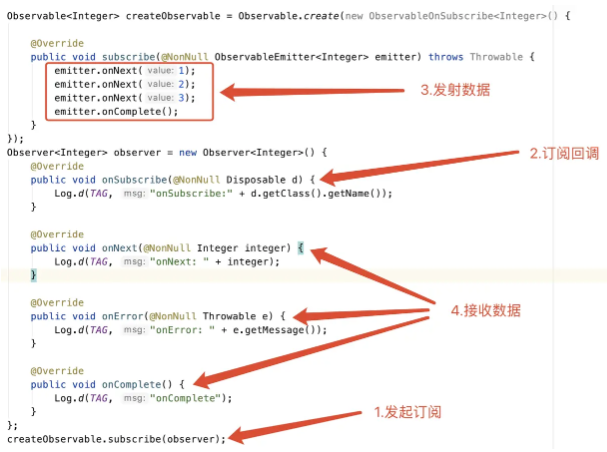
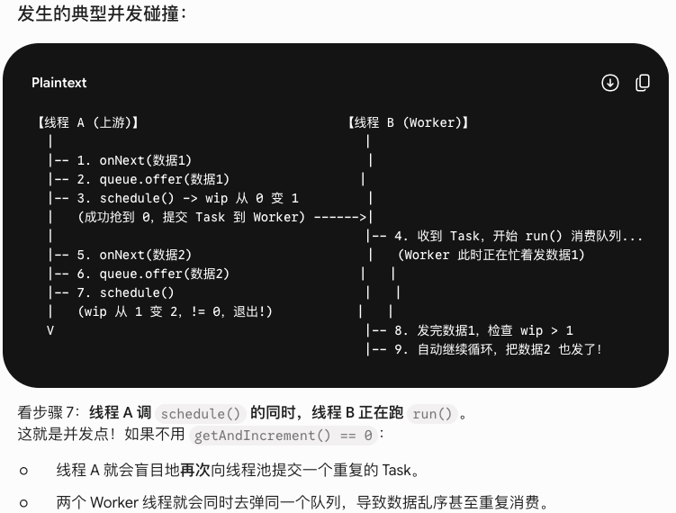

## 面试

> https://juejin.cn/post/6900870262062120967
>
> https://juejin.cn/post/6905725515521835015

#### RxJava怎么通过被订阅者传给订阅者的过程是什么样的?

“简介”里其实讲了 `just()` 的一个过程，下面讲一个更常用的 `create()` 的过程。



```java
createObservable
    .map(integer -> integer * 2)
    .subscribe(observer);
```

**1）组装期**

`Observable.create()` 源码：

```java
// Observable.java
// 直接new了一个ObservableCreate实例，把你的“逻辑”（ObservableOnSubscribe，即emitter -> { ... }）存进去
// RxJavaPlugins.onAssembly默认就是直接返回原对象，不做任何操作；RxJavaPlugins是RxJava提供的一个全局钩子系统，让你可以在关键节点插入自定义逻辑。onAssembly是其中一个钩子，给外部一个"拦截"的机会
public static <T> Observable<T> create(ObservableOnSubscribe<T> source) {
    ObjectHelper.requireNonNull(source, "source is null");
    return RxJavaPlugins.onAssembly(new ObservableCreate<T>(source));
}
```

```java
// ObservableCreate.java
public final class ObservableCreate<T> extends Observable<T> {
    final ObservableOnSubscribe<T> source;

    public ObservableCreate(ObservableOnSubscribe<T> source) {
        this.source = source;  // 将“逻辑”存起来
    }
}
```

`.map()` 源码：

```java
// Observable.java
// new ObservableMap(this, mapper)，this就是上游的ObservableCreate
public final <R> Observable<R> map(Function<? super T, ? extends R> mapper) {
    ObjectHelper.requireNonNull(mapper, "mapper is null");
    return RxJavaPlugins.onAssembly(new ObservableMap<T, R>(this, mapper));
}
```

```java
// ObservableMap.java
public final class ObservableMap<T, U> extends AbstractObservableWithUpstream<T, U> {
    final Function<? super T, ? extends U> function;

    ObservableMap(ObservableSource<T> source, Function<? super T, ? extends U> function) {
        super(source);           // 保存上游引用（即ObservableCreate）
        this.function = function; // 保存map的转换函数
    }
}
```

```java
// AbstractObservableWithUpstream.java
abstract class AbstractObservableWithUpstream<T, U> extends Observable<U> { 
    protected final ObservableSource<T> source; // 持有上游的引用 
}
```

到这一步，没有任何数据流动，只是在内存中建了一条链表：

```
ObservableMap
├── source → ObservableCreate
│              └── source → ObservableOnSubscribe（用户写的发射逻辑）
└── function → Function（用户写的转换逻辑）


Observable.create(source)
  → new ObservableCreate(source)        // 存住ObservableOnSubscribe
.map(mapper)
  → new ObservableMap(this, mapper)     // this+ObservableCreate
                                        // 存住source引用+Function引用
```

**2）订阅期**

`Observable.subscribe()` 入口源码：

```java
// Observable.java
@Override
public final void subscribe(Observer<? super T> observer) {
    ObjectHelper.requireNonNull(observer, "observer is null");
    try {
        observer = RxJavaPlugins.onSubscribe(this, observer);
        ObjectHelper.requireNonNull(observer, "Plugin returned null Observer");
        // subscribeActual是抽象方法，由子类实现
        subscribeActual(observer);  // 关键，多态分发到子类
    } catch (NullPointerException e) {
        throw e;
    } catch (Throwable e) {
        Exceptions.throwIfFatal(e);
        RxJavaPlugins.onError(e);
        NullPointerException npe = new NullPointerException("Actually not, but can't throw other exceptions due to RS");
        npe.initCause(e);
        throw npe;
    }
}
```

`ObservableMap.subscribeActual()` 源码：

```java
// ObservableMap.java
// 因为最外层是ObservableMap，所以先走这里
// 这里做了两件事：1）创建MapObserver包装下游observer；2）对上游ObservableCreate发起订阅
@Override
public void subscribeActual(Observer<? super U> t) {
    source.subscribe(new MapObserver<T, U>(t, function));
    //       ↑ 上游                           ↑ 把下游observer+function包装成MapObserver
}
```

上游 ObservableCreate 收到订阅：

```java
// ObservableCreate.java
@Override
protected void subscribeActual(Observer<? super T> observer) {
    CreateEmitter<T> parent = new CreateEmitter<T>(observer);  // 创建发射器
    observer.onSubscribe(parent);                              // 把Disposable交给下游
    try {
        source.subscribe(parent);                              // 把“逻辑”拿出来执行，传入发射器
    } catch (Throwable ex) {
        Exceptions.throwIfFatal(ex);
        parent.onError(ex);
    }
}

// 这里source就是你的“逻辑”
// new ObservableOnSubscribe<String>() {
//     @Override
//     public void subscribe(ObservableEmitter<String> emitter) throws Exception {
//         // 你的逻辑
//         emitter.onNext("hello");
//     }
// }
```

CreateEmitter 源码：

```java
// ObservableCreate.java 的内部类
static final class CreateEmitter<T>
    extends AtomicReference<Disposable>
    implements Disposable, ObservableEmitter<T> {

    final Observer<? super T> observer;  // 持有下游observer

    CreateEmitter(Observer<? super T> observer) {
        this.observer = observer;
    }

    @Override
    public void onNext(T t) {
        if (t == null) {
            onError(new NullPointerException("onNext called with null."));
            return;
        }
        if (!isDisposed()) {         // 运行期的关键守卫
            observer.onNext(t);      // 转发给下游observer
        }
    }

    @Override
    public void onError(Throwable t) {
        if (!tryOnError(t)) {
            RxJavaPlugins.onError(t); // 已disposed就交给全局错误处理
        }
    }

    @Override
    public void onComplete() {
        if (!isDisposed()) {
            try {
                observer.onComplete();
            } finally {
                dispose();  // 自动dispose，后续onNext不再传递
            }
        }
    }

    @Override
    public void dispose() {
        DisposableHelper.dispose(this);
    }

    @Override
    public boolean isDisposed() {
        return DisposableHelper.isDisposed(get());
    }
}
```

订阅期形成的 Observer 链：

```java
CreateEmitter（数据发射源头）
  ↓ downstream
MapObserver（持有 Function 引用）
  ↓ downstream
Observer（用户写的接收逻辑）
  
ObservableMap.subscribe(observer)
  → ObservableMap.subscribeActual()
    → 把observer包装成MapObserver（带mapper逻辑）
    → 调用this.source.subscribe(mapObserver)   // source就是ObservableCreate
      → ObservableCreate.subscribeActual(mapObserver)
        → 创建CreateEmitter(mapObserver)            // CreateEmitter实现了Disposable
        → 调用mapObserver.onSubscribe(emitter)       // Disposable从这里开始往外传
          → MapObserver.onSubscribe(disposable)
            → Observer.onSubscribe(disposable)      // ← 继续往外传，用户拿到Disposable
        → source.subscribe(emitter)              // 这里的source是ObservableOnSubscribe，即你的逻辑
```

**3）运行期**

你的 lambda 里调 `emitter.onNext(data)`，进入 `CreateEmitter.onNext()`：

```java
// CreateEmitter.onNext
if (!isDisposed()) {
    observer.onNext(t);   // 这里的observer是谁？如果中间有map操作符，这里的observer是MapObserver
}
```

`MapObserver.onNext()` 源码：

```java
// ObservableMap.java 的内部类
static final class MapObserver<T, U> extends BasicFuseableObserver<T, U> {
    final Function<? super T, ? extends U> mapper;

    MapObserver(Observer<? super U> actual, Function<? super T, ? extends U> mapper) {
        super(actual);      // actual是真正的下游observer
        this.mapper = mapper;
    }

    @Override
    public void onNext(T t) {
        if (done) return;
        U v;
        try {
            v = ObjectHelper.requireNonNull(mapper.apply(t), "The mapper function returned a null value.");
            //                   ↑ 执行你的map转换逻辑
        } catch (Throwable ex) {
            fail(ex);
            return;
        }
        actual.onNext(v);  // 转换后的数据交给下游observer
    }
}
```

完整数据流：

```
emitter.onNext(1)
  → MapObserver.onNext(1)
    → function.apply(1)  → 执行mapper
    → observer.onNext(2)  → 用户收到2

emitter.onComplete()
  → MapObserver.onComplete()
  → observer.onComplete()  // map不拦截，直接透传
```

**总结：**

| 阶段       | 发生了什么                                                   |
| ---------- | ------------------------------------------------------------ |
| **组装期** | 链式调用构建 Observable 树。`create()` → `new ObservableCreate(source)`；`.map()` → `new ObservableMap(this, function)`，`this` 指向前一层的 Observable。外层包住内层，层层嵌套，只存引用不执行。 |
| **订阅期** | `subscribe()` 触发最外层的 `subscribeActual()`，逐层向内调用。每一层做两件事：把下游 Observer 包装到自己的 Observer 里；对 `this.source`（内层 Observable）调用 `subscribe()`，把包装后的 Observer 传进去。 |
| **运行期** | 最内层 `ObservableOnSubscribe` 调用 `emitter.onNext()`，`CreateEmitter` 校验 `!isDisposed()` 后转发给下游。数据沿 Observer 链逐层流动，每个中间 Observer 在自己的 `onNext` 里执行操作符逻辑（变换/过滤），再传给下一层，最终到达用户的 Observer。 |

###### 回答方针

用 `createObservable.map(integer -> integer * 2).subscribe(observer);` 为例，分组装起、订阅期、运行期进行回答。

`subscribeActual()` 要强调；`Disposable` 别忘了说。

#### Observer 处理完 onComplete 后会还能 onNext 吗？

`onComplete()` 是用来控制不能发送数据的，也就是不能 `onNext()` 了，它主要通过调用 `dispose()` 方法是控制是否还能发送数据。包括 `onError()` 也是不能再发送 `onNext()` 数据了。

```java
@Override
public void onComplete() {
    if (!isDisposed()) {
        try {
            observer.onComplete();
        } finally {
            dispose();
        }
    }
}
```

`dispose()` 的本质就是一个原子布尔开关（用 AtomicReference 实现，null -> 开，DISPOSED -> 关）。`onComplete()`/`onError()` 终结事件和外部取消订阅，殊途同归，都是把这个开关关上，关上后所有 `onNext()` 都被静默丢弃。用 AtomicReference + CAS 而不是普通 boolean，是为了线程安全，多线程并发 `dispose()` 只会有一个成功。

#### RxJava 中 map、flatMap、concatMap 的区别，你还用过其他哪些操作符？

...

#### Maybe、Observer、Single、Flowable、Completable 几种观察者的区别，以及他们在什么场景用？

...

如果只想发一条数据，或者不发数据就用 Maybe，如果想法多条数据或者不发数据就用 Observable，如果只发一条数据或者失败就用 Single，如果想用背压策略使用 Flowable，如果不发数据就用 Completable。

#### RxJava 切换线程是怎么回事？

**1）subscribeOn**

当调用 `observable.subscribeOn(Schedulers.io())` 时，RxJava 创建了一个 ObservableSubscribeOn，它把上游的 source（原始 Observable）和你指定的 Scheduler（IO 线程池）一起包装起来。当下游发起订阅时（调用 `subscribe()`），最终会进入 subscribeActual 方法。这个方法做了两件事：

+ 先在当前线程，调用 `observer.onSubscribe(parent)`，把 Disposable 交给下游（这样下游随时可以取消订阅）。
+ 然后切换线程：通过 `scheduler.scheduleDirect()` 把一个任务丢进 IO 线程池。

```java
// 简化后的源码实现
public final class ObservableSubscribeOn<T> extends AbstractObservableWithUpstream<T, T> {
    final Scheduler scheduler;

    public ObservableSubscribeOn(ObservableSource<T> source, Scheduler scheduler) {
        super(source); // source是上游的Observable
        this.scheduler = scheduler;  // 指定了线程池
    }

    @Override
    public void subscribeActual(final Observer<? super T> observer) {
        final SubscribeOnObserver<T> parent = new SubscribeOnObserver<T>(observer);
        observer.onSubscribe(parent);

        // 通过调度器分发一个“订阅任务”，scheduleDirect会把这个任务丢进线程池执行
        parent.setDisposable(scheduler.scheduleDirect(new SubscribeTask(parent)));
    }
  
    final class SubscribeTask implements Runnable {
        private final SubscribeOnObserver<T> parent;

        SubscribeTask(SubscribeOnObserver<T> parent) {
            this.parent = parent;
        }

        @Override
        public void run() {
            // 调用上游source的subscribe，让上游的逻辑在该Scheduler中执行
            source.subscribe(parent);
        }
    }
}
```

**2）observeOn**

调用 `observeOn` 会将上游包装为 `ObservableObserveOn`。当下游订阅时，`subscribeActual` 会创建一个 `Worker` 线程，并将下游与 `Worker` 包装成 `ObserveOnObserver` 让上游订阅。

数据传递分为两步：

1. 缓存数据（上游线程）：上游触发 `onNext()` 时，数据先入队列 `queue.offer()`，随后调用 `schedule()`。利用 `getAndIncrement() == 0` 保证同一时间仅提交一个排空任务到 `Worker`。
2. 切线程排空（Worker 线程）：`Worker` 执行 `drainNormal()` 双层循环——内层不断从队列 `poll()` 数据交付给下游；队列为空时，外层通过 `addAndGet(-missed)` 清算 WIP 计数，归零则退出 `Worker`，未归零则继续循环排空新入队的数据。

```java
// 简化后的源码实现
public final class ObservableObserveOn<T> extends AbstractObservableWithUpstream<T, T> {
    final Scheduler scheduler;
    final int bufferSize; // 默认128

    @Override
    protected void subscribeActual(Observer<? super T> observer) {
        // 创建Worker（调度器里的具体工作线程）
        Scheduler.Worker worker = scheduler.createWorker();

        // 将上游、Worker、观察者包装成ObserveOnObserver
        source.subscribe(new ObserveOnObserver<T>(observer, worker, delayError, bufferSize));
    }
}
```

```java
// ObservableObserveOn.java -> ObserveOnObserver内部类
@Override
public void onNext(T t) {
    if (done) return;
    // 将数据存入SPSC队列（Single Producer Single Consumer，高效无锁队列）
    if (sourceMode != QueueDisposable.ASYNC) {
        // 当上游发送数据时，observeOn不会立即将数据传递给下游，而是先将其缓存到队列中
        queue.offer(t);
    }
    // 触发调度
    schedule();
}

// schedule()通过原子递增保证只有一个线程负责启动排空循环
void schedule() {
    if (getAndIncrement() == 0) {
        worker.schedule(this);  // ObserveOnObserver自身实现了Runnable
    }
}
```

```java
@Override
public void run() {
    // 数据的实际传递发生在run()方法通过drain循环不断从队列取出元素并交付给下游
    drainNormal();
}

void drainNormal() {
    int missed = 1; // 标记当前准备清理的WIP批次数
    final SimpleQueue<T> q = queue;
    final Observer<? super T> a = downstream;

    // 外层循环：负责重置/扣减WIP计数
    for (;;) {

        // 内层循环：尽全力把当前队列里的数据一次性排空
        for (;;) {
            T v;
            try {
                v = q.poll(); // 从队列取数据
            } catch (Throwable ex) { ... }

            if (v == null) {
                break; // 队列暂时空了，跳出内层循环
            }

            a.onNext(v); // 交付给下游
        }

        // 扣减WIP
        // 把处理完的missed批次减掉；如果返回值==0，说明期间没有新数据进来，可以安心退出
        missed = addAndGet(-missed); 
        if (missed == 0) {
            break; // WIP终于归零，Worker线程正式安全退出！
        }
        
        // 如果missed!=0，说明刚才内层循环跑完的瞬间，上游又进数据了，
        // 外层for(;;) 不会退出，直接继续跑内层循环把新数据也清空！
    }
}
```

额外说明下 `getAndIncrement() == 0` 的意义，它是实现无锁并发的核心。

+ 等于 0：说明当前没有任务在运行/排队。当前线程成功抢到执行权，负责调用 `worker.schedule(this)` 提交任务。
+ 大于 0：说明已经有线程在排队或执行该任务了。当前线程只需递增计数，无需重复提交任务到线程池，避免了资源浪费和并发冲突。

当运行中的线程（`run()` 方法）处理完一批数据后，会配合 `decrementAndGet()` 检查 WIP 计数：

- 如果计数还没减到 0，说明在自己执行期间又有新数据来了（即其他线程触发了 `schedule()` 并使 `wip > 0`）。
- 此时运行中的线程会自动继续循环（Drain Loop）处理新数据，直到计数归零。

上游不是本身就是单线程在执行吗（只是指定了一个线程池，但执行时仅仅是一个固定的线程）。哪来的并发？

RxJava 有极其严格的串行契约，任何 Observable 在同一时刻，只能有一个线程调用 `onNext()`。`schedule()` 会被并发触发，不是因为上游并发调用 `onNext()`，但“上游推送”和“Worker 消费”是在两个线程并发执行的。`getAndIncrement()` 解决的是上游与 Worker 之间的跨线程调度碰撞，防止向线程池重复提交任务。



#### RxJava 的 subscribeOn 只有第一次生效？

```java
source                   // (1) 数据源
  .subscribeOn(workerA)  // (2) 第一次 subscribeOn
  .subscribeOn(workerB)  // (3) 第二次 subscribeOn
  .subscribe(observer);  // (4) 终端订阅
```

执行流程如下：

1. (4) 订阅 (3)：在当前线程（比如 Main）调用 (3) 的 subscribeActual。
2. (3) 调度到 workerB：(3) 会把之后上游的任务丢进 workerB。
3. 在 workerB 线程中，订阅 (2)：此时 (2) 的 subscribeActual 被触发。
4. (2) 调度到 workerA：(2) 会把之后上游的的任务丢进 workerA。
5. 在 workerA 线程中，订阅 (1)：上游的的任务最终会在 workerA 中执行。

其实每个 subscribeOn 都生效了（都发生了线程切换），但离 source 最近的那个决定了最终执行线程。

#### RxJava 的 observeOn 多次调用哪个有效？

每一次调用都有效。

```java
Observable.just("Data") 
    
    .observeOn(Schedulers.io())           // 切换到 IO 线程
    .map(data -> processInIO(data))       //  -> 在 IO 线程执行

    .observeOn(Schedulers.computation())  // 再次切换到 Computation 线程
    .map(data -> processInComp(data))     //  -> 在 Computation 线程执行

    .observeOn(AndroidSchedulers.mainThread()) // 再次切换到主线程
    .subscribe(observer);                 //  -> 在主线程回调 onNext
```


为什么 observeOn 可以多次切换？

因为 observeOn 作用于 onNext（发射期）。

- 数据从上往下流，每经过一个 observeOn，它就会把数据放入一个新的队列，并交给一个新的 Worker 去发送。
- 这就像接力比赛：第一棒跑完，把棒（数据）交给第二棒所在的休息室（队列）。第二棒（新线程）从休息室出来接着跑，直到遇到第三个休息室。


为什么 observeOn 的位置很重要？

从源码逻辑可以看到：

1. **代码位置之后生效**：只有在 observeOn 之后的 onNext、onComplete、onError 才会走 drainNormal() 逻辑。
2. **性能开销**：因为它涉及到了队列存储（Queue）和线程上下文切换，所以比 subscribeOn 稍微重一点点。
3. **背压控制（Buffer）**：注意源码中的 bufferSize。如果上游发得太快，下游处理太慢，observeOn 内部的队列会缓存数据。在 RxJava 2/3 的 Flowable 中，这里就是处理背压（Backpressure）的关键点。


#### RxJava1.0、RxJava2.0、RxJava3.0 有什么区别？

| 特性                 | RxJava 1.x         | RxJava 2.x                     | RxJava 3.x           |
| -------------------- | ------------------ | ------------------------------ | -------------------- |
| **Reactive Streams** | 不支持             | 原生支持                       | 原生支持             |
| **背压支持**         | Observable（混乱） | Flowable（专用）               | Flowable             |
| **空值发射**         | 允许               | 禁止                           | 禁止                 |
| **取消订阅接口**     | Subscription       | Disposable                     | Disposable           |
| **Java 版本**        | Java 6+            | Java 6+                        | Java 8+              |
| **包名**             | rx                 | io.reactivex                   | io.reactivex.rxjava3 |
| **升级兼容性**       | 基石版本           | 破坏性重构（无法直接升级 1.x） | 可从 2.x 平滑平移    |

“Reactive Streams”：它是一项面向 JVM 的异步流式处理规范（不是库），定义了统一的接口契约，核心目标是解决异步非阻塞环境下的背压（Backpressure） 问题。该规范由 Netflix、Pivotal、Lightbend 等公司联合发起，旨在终结各家响应式库各自为政、互不兼容的局面。基于同一规范，不同库之间可以无缝桥接——例如 RxJava 的 Flowable 可直接被 Spring WebFlux（Project Reactor）消费，无需额外适配。

”空值发射“：禁止 `null` 是为了遵守 Reactive Streams 规范，避免“数据为空”与“值是 null”的语义混淆，同时防止底层并发队列因 null 无法准确判断状态而崩溃（底层并发队列，如 `Queue.poll()` 以 null 作为“队列为空”的哨兵值。若允许数据为 null，将无法区分是“队列空了”还是“取出了 null 数据”，从而导致并发状态机崩溃）。如确实需要传 null，可以使用 Optional 来实现。

”取消订阅接口“：将原来 Subscription 的"取消"和"背压"两项职责拆分：Disposable 专管资源释放，Subscription 专管背压控制，和上面的“背压支持”呼应。

#### doOnSubscribe 是怎么做到监听中间的 observable 的线程？


#### doOnNext 是怎么做到监听每一次 observeOn 线程的切换，以及 map 的 apply 方法的线程有谁控制？


#### 如果不指定 observer 的线程，也就是只设置 subscribeOn，而不设置 observeOn，那 observer 的线程是什么样的？


#### 背压是什么，以及 Flowable 怎么能控制背压？


#### dispose 是如何解决线程安全问题的？

看 AI STUDIO


其实这里的 `CreateEmitter`它是一个`AtomicReference<Disposable>`原子类包装Disposable的实现类，而我们`dispose`方法正是将该原子类添加了常量的`DISPOSED`，而在onNext方法中通过判断`isDisposed`是否为false才能继续发送数据。而`isDisposed`什么时候为false呢？当`AtomicReference<Disposable>`中的包装对象不是`DISPOSED`。

DisposableHelper 源码：

```java
public enum DisposableHelper implements Disposable {
    DISPOSED;  // 唯一实例，作为"已dispose"的标记

    // 判断是否已dispose
    public static boolean isDisposed(Disposable d) {
        return d == DISPOSED;  // 就是引用比较
    }

    // 执行dispose
    public static boolean dispose(AtomicReference<Disposable> field) {
        Disposable current = field.get();
        Disposable d = DISPOSED;
        if (current != d) {
            // 当前不是DISPOSED，才执行交换
            current = field.getAndSet(d);  // 原子操作：把DISPOSED放进去，拿到旧值
            if (current != d) {
                // 旧值确实不是DISPOSED（防止并发竞争）
                if (current != null) {
                    current.dispose();  // 如果旧的Disposable有dispose逻辑，也执行
                }
                return true;   // 首次dispose成功
            }
        }
        return false;  // 已经dispose过了
    }

    // 带校验的set
    public static boolean set(AtomicReference<Disposable> field, Disposable d) {
        for (;;) {
            Disposable current = field.get();
            if (current == DISPOSED) {
                if (d != null) {
                    d.dispose();  // 已dispose状态，新来的直接丢弃
                }
                return false;
            }
            if (field.compareAndSet(current, d)) {
                return true;
            }
        }
    }
}
```


CreateEmitter 源码：

```java
static final class CreateEmitter<T> 
    extends AtomicReference<Disposable>  // 继承原子引用，自身就是那个field
    implements Disposable, ObservableEmitter<T> {

    final Observer<? super T> observer;

    CreateEmitter(Observer<? super T> observer) {
        this.observer = observer;
    }

    @Override
    public void onNext(T t) {
        if (!isDisposed()) {       // 检查：AtomicReference里的值是不是DISPOSED
            observer.onNext(t);
        }
    }

    @Override
    public void onComplete() {
        if (!isDisposed()) {
            try {
                observer.onComplete();  // 先通知下游"流结束了"
            } finally {
                dispose();              // 再标记为DISPOSED，阻止后续事件
            }
        }
    }

    @Override
    public void onError(Throwable t) {
        if (!tryOnError(t)) {
            RxJavaPlugins.onError(t);
        }
    }

    @Override
    public boolean tryOnError(Throwable t) {
        if (!isDisposed()) {
            try {
                observer.onError(t);
            } finally {
                dispose();      // 和onComplete一样，终结后dispose
            }
            return true;
        }
        return false;           // 已dispose，静默丢弃
    }

    @Override
    public void dispose() {
        DisposableHelper.dispose(this);  // this就是AtomicReference<Disposable>，把DISPOSED写进去
    }

    @Override
    public boolean isDisposed() {
        return DisposableHelper.isDisposed(get());  // get()从AtomicReference取当前值，和DISPOSED做==比较
    }
}
```


RxJava 的官方文档和设计规范指出：dispose 是一种**信号**，它并不保证数据下发会像切断物理电路一样“瞬间绝对消失”。在多线程异步环境下，允许极短时间内有残余数据流入。

### 特殊情况：ObserveOn 的处理

如果你使用了 .observeOn(AndroidSchedulers.mainThread())，情况会有所不同：

ObserveOnObserver 内部维护了一个**待处理队列 (Queue)**。

1. 当你在子线程调用 onNext 时，它只是把数据丢进队列。
2. 当主线程从队列里取出数据准备交给 observer.onNext 之前，它会**再次检查**一次 isDisposed 状态。
3. 由于 onNext 和 dispose 的检查在主线程循环中是串行的，这大大降低了（但依然不能完全消除）残余数据的发生概率。


RxJavaPlugins 是 RxJava 提供的一个全局钩子系统，让你可以在关键节点插入自定义逻辑。onAssembly 是其中一个钩子。

如何GC掉


#### subscribeOn 位置

subscribeOn 放在链中任何位置效果相同，它决定的是上游数据源在哪个线程执行。observeOn 决定的是下游在哪个线程执行。如何区分哪里是上游、哪里是下游呢？observeOn 以上为上游，以下为下游。

下方几个例子的执行效果完全相同。

```java
Single.just("Data")
      .map(process)
      .subscribeOn(Schedulers.io())
      .observeOn(mainThread())
      .subscribe(observer);

Single.just("Data")
      .subscribeOn(Schedulers.io()) 
      .map(process)
      .observeOn(mainThread())
      .subscribe(observer);

// 举个例子
Single.just("Data")
      .map(process)
      .observeOn(mainThread())
      .subscribeOn(Schedulers.io()) 
      .subscribe(observer);


Single.just("Data")
      .subscribeOn(Schedulers.computation())
      .map(process)
      .subscribeOn(Schedulers.io())
      .observeOn(mainThread())
      .subscribe(observer);


Single.just("Data")
      .map(process)
      .subscribeOn(Schedulers.io())
      .observeOn(mainThread())
      .map(process)
      .observeOn(mainThread())
      .subscribe(observer);
```

1. 下游调用 `subscribe()` 发起订阅。
2. 向上传递，最先碰到了最下方的 `subscribeOn(io())`。
3. `subscribeOn` 立即发挥作用：它把“向上继续订阅”的动作丢进了 IO 线程。
4. 接下来，在 IO 线程 中向上依次订阅 `observeOn` $\rightarrow$ `map` $\rightarrow$ `Single.just`。
5. 最顶部的 `Single.just` 在 IO 线程 被激活，开始发射数据。
6. `map` 在 IO 线程 接收数据并完成转换。
7. 数据传到 `observeOn`，被拦截并切到主线程发给下游。


