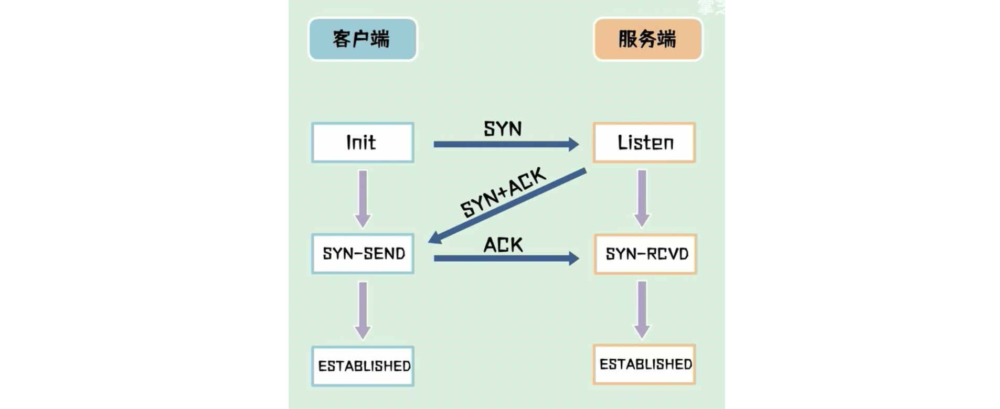
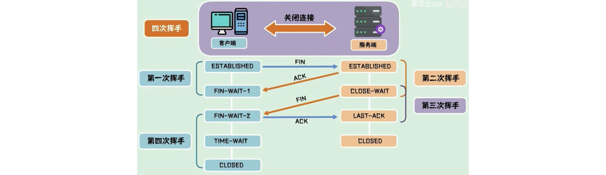
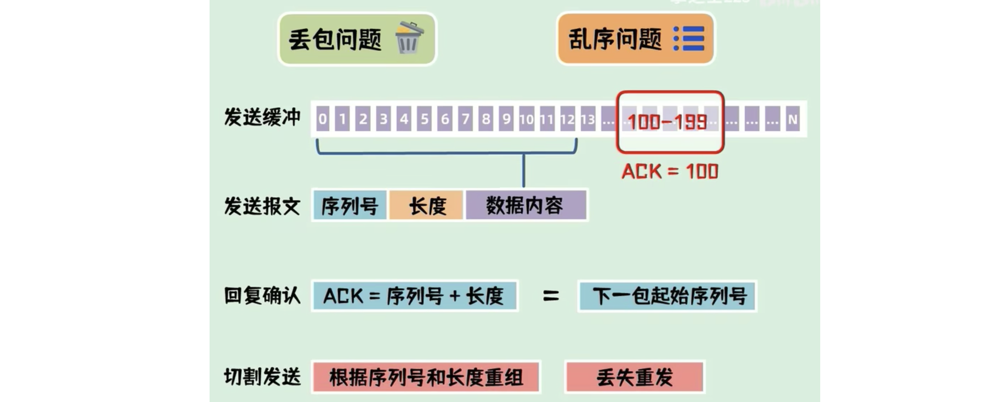
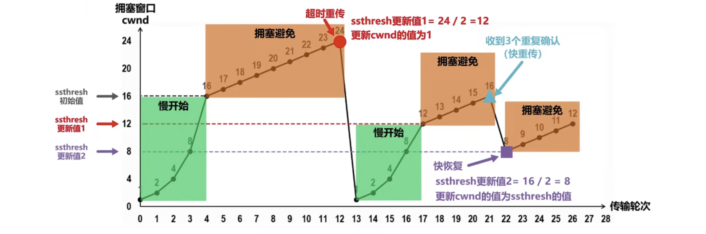

#### 为什么要进行三次握手？两次握手可以吗?

**为了在不可靠的信道上建立可靠的连接**。

第一次：发送 SYN 包，**请求建立连接**；（SYN 标志位为 1，客户端的初始序列号）

第二次：**如果服务端同意**，回复一个 SYN + ACK 包；（客户端的初始化序号 +1 作为确认号，SYN、ACK 标志位设为 1）

第三次：客户端收到后，回复一个 ACK 包。（服务端的初始化序号 +1 作为确认号）

A：我要跟你通信？ 

B：收到，可以通信。 

A：好的。

*（ACK 标志是告诉对方“我收到了你的数据”，而确认号则指明“我已经确认接收到的序号是 xxx）*

#### 为什么要有第三次握手？

为了防止，**已经失效的报文，又传到服务端而引起错误**。比如 SYN1 发生了意外，停了下来；客户端又发了个 SYN2，SYN2 正常，两面建立起连接；这时候 SYN1 又恢复了，传到了服务端，服务端以为要建立两个连接，而其实只有一个；这样的话有第三次握手，就可以告诉服务端，只有一个连接。

而且也可以证明客户端也有接受能力，因为第一次握手只能证明客户端有发送能力，服务端第二次握手可以证明它的发送和接受能力

#### 第二次为什么要传 ACK + SYN？

ACK：**确认收到**，“我收到了”。

SYN：**发起连接请求**，也就是“我同意了”。

#### 为什么要四次挥手？

**确保双方在没有遗漏数据的情况下安全地关闭连接**。

第一次：客户端发 FIN 包，表示要**关闭连接**。自己进入了中止等待状态（FIN_WAIT）。

第二次：服务端收到后，发送 ACK 包，表示自己进入关闭等待状态（CLOSE_WAIT）（不能直接断开，因为服务端可能还有没发送完的）。服务端此时还可以发送未发送的数据，客户端也可以接受。

第三次：**待服务端发送完之后**，发送一个 FIN 包，表示服务端准备关闭连接。

第四次：客户端收到后，回复 ACK 包，表示确认收到，进入**超时等待状态**，时间到后，关闭连接。而服务端收到 ACK 包就立马关闭。

客户端在 等待状态（TIME_WAIT） 等待 2MSL 后，自动进入关闭状态，至此客户端也完成连接的关闭。

A：呼叫B，我要跟你断开。 

B：知道了，等一下我还有话没说完 

B：我说完了，可以断开了 

A：好的

*（**说的时候用客户端和服务端**）*

#### 为什么不能把服务端发送的 ACK 和 FIN 合并起来，变成三次挥手？

因为服务端收到客户端断开连接的请求时，可能还有一些数据没有发完，这时**先回复 ACK，表示接收到了断开连接的请求**。等到数据发完之后再发 FIN，断开服务端到客户端的数据传送。

#### 为什么 TCP 需要第四次挥手？三次挥手不行吗？

为了确保服务端收到了 FIN，如果没有收到服务端会继续发送 FIN。**避免服务端误以为客户端仍在等待数据**。

#### 如何处理丢包问题，如何处理乱序问题？

TCP 会把**要发送的报文排列放在缓冲区里**。发送数据时，取一部分组成发送报文，在其 **TCP 协议头部**，**会附带序列号和长度**。接收端收到数据后，需要回复确认报文。确认报文中的 **ACK** = 序列号 + 长度，也就是下一个报文的起始序列号。这样**一问一答的方式**能够使发送端确认已发送的数据是否成功被接收，如果丢失了某些数据，接收端可以要求发送端重传。

*（ACK是标志位，但它这个报文就是 ACK 报文）*

#### 为什么第四次挥手客户端需要等待 2*MSL（报文段最长寿命）时间后才进入 CLOSED 状态？

MSL（Maximum Segment Lifetime）是一个片段在**网络中最大的存活时间**，2MSL 就是一个发送和一个回复所需的最大时间。如果直到 2MSL，Client 都**没有再次收到 FIN**，那么 Client **推断 ACK 已经被成功接收**，则结束 TCP 连接。

#### TCP 如何保证传输的可靠性？

+ **确认机制**：避免丢包。（上一题）
+ **校验和**：TCP 包含校验和字段，用于验证数据在传输过程中的**完整性**。（检测数据在传输中是否出错）
+ **超时重传**：当发送方发送数据之后，它启动一个定时器，等待目的端确认收到这个报文段。如果发送端在合理的往返时延（RTT）内未收到 **ACK** 确认消息，那么对应的数据包就被假设为已丢失并进行重传。（RTT < 2MSL）
+ **流量控制**：作用于接收者的，**避免“发送方”的数据填满“接收方”的缓存**。
+ **拥塞控制**：作用于网络的，**避免“发送方”的数据填满整个网络**；常用的方法就是：1 ）慢开始、拥塞避免；2 ）快重传、快恢复。

**流量控制：**

发送方和接收方在内核各自都有一个缓冲区，发送缓冲区和接收缓冲区上都各有一个窗口，发送方的窗口表示可发送的最大数据量，接收方的窗口表示可接收的最大数据量。

发送方有了发送窗口后，那么发送方可以不用等待已发送数据的确认报文，就可以继续发送下一批数据，提高了发送的速率。

接收方有了接收窗口后，可以实现流量控制，把接收方的接收窗口告诉给发送方，让发送方按自己的接收情况来发送数据，避免发送方发送的数据过快，导致接收方处理不过来。

###### 简化：

接收方通过发送一个窗口大小（接收缓存的空间）来告知发送方，控制数据的发送速率，防止接收方缓冲区**溢出**，保证传输的稳定性。

**拥塞控制：**

1）慢开始

慢开始是 TCP 拥塞控制的一个初始阶段，目的是通过逐步增加发送的数据量来避免一开始就向网络发送大量数据，导致网络过载。

2）拥塞避免

当慢开始的窗口大小增长到一定的阈值 ssthresh 后，TCP 就会转入拥塞避免阶段。

3）快重传

快重传是为了应对数据包丢失的情况，特别是当网络拥塞发生时。TCP 使用快重传机制，快速重传丢失的数据包，而不是等待超时事件的发生。

快重传基于重复的 ACK 来判断数据包丢失。**当接收方收到一个乱序的包**（即期望的下一个包丢失时），**会发送一个重复的 ACK 给发送方**。**如果发送方收到三个相同的重复 ACK**（即数据包丢失的确认），**它会立即重传丢失的数据包**，而无需等待超时。**这减少了丢包后的等待时间**，并使得网络在丢包情况下迅速恢复。

4）快恢复

快恢复是配合快重传机制使用的，**在快重传发生后，网络已经失去了一个数据包，可能发生了网络拥塞**（也有可能只是因为网络波动而丢包）。**TCP 需要适当减小发送速率，防止继续引发更严重的丢包或拥塞**。

当发送方收到三个重复的 ACK 后，触发快重传机制，立即重传丢失的数据包。在快重传后，TCP 不会立即将 cwnd 重置为 1（这是慢开始的初始值）。相反，它会将 ssthresh 设置为当前 cwnd 的一半，并将 cwnd 设置为 ssthresh 值。然后，cwnd 会继续增长，但在增加过程中每次只增加一个大小。这样，网络的恢复过程变得更快，同时避免了再次发生严重的拥塞。

###### 简化：

（这里的窗口大小是发送方）

1）慢启动：连接开始时，TCP 会从较小的发送窗口开始，逐步增加发送速率，直到达到 ssthresh。

2）拥塞避免：窗口大小将变成1个1个扩大，直到触发**超时重传**，并更新 ssthresh（取最大值的1/2）。

3）快速重传与快速恢复：当发送方收到**三个相同的重复 ACK**，说明丢包了，发送方会立即重传丢失的数据包，**减少了丢包后的等待时间**。传完后，会进行快速恢复，也就是窗口大小调整为当前的一半，并更新 ssthresh（当前值的一半）。

#### TCP 和 UDP 的区别？

|                  | TCP                                                          | UDP                                              |
| ---------------- | ------------------------------------------------------------ | ------------------------------------------------ |
| 是否**面向连接** | 是（需要先建立连接）                                         | 否                                               |
| 是否**可靠传输** | 是                                                           | 否                                               |
| **传输形式**     | 字节流（也就是一个完整的用户消息被拆分成多个 TCP 报文进行传输，为了更可靠） | 数据报文段（一整个都放在一个报文里）             |
| **传输效率**     | 慢                                                           | 快                                               |
| ~~所需资源~~     | 多                                                           | 少                                               |
| 应用场景         | 稳定通信，速度要求较低。比如**文件传输**，邮件传输           | 及时通信，可靠性要求不高，**语音通话**，域名转换 |

#### TCP 头部有哪些字段？

标记为：SYN、ACK、FIN...，序列号（确保有序），校验和（保证可靠），**源端口号**，**目的端口号**...

（HTTP 记录的是 URL）

#### 第一次握手丢包会怎样？

如果第一次握手丢包了，**达到超时重传的时机的话**，会进行重传 SYN 报文，**如果重传次数达到最大次数**，还是没有收到第二次握手的话，客户端就会断开链接了。

*（除了第四次握手是 2MSL，剩下都是RTT，也就是超时重传）*

#### 如果第二次握手丢包会怎样？

如果 ACK 丢了，它是对第一次握手的确认报文，就会导致客户端长时间没有收到“收到了”的信号， 而触发超时重传 SYN 报文。

如果 SYN 丢了，服务端没能发起连接请求，相当于**没有同意**，于是**服务端**这边会触发超时重传机制，重传 SYN-ACK 报文。

如果都丢了，两边互相重传。

#### 如果第三次握手丢包会怎样？

相当于服务端收不到客户端的确认，会触发超时重传机制，重传 SYN-ACK 报文。

#### TIME_WAIT 过多有什么危害？

客户端会占用端口，消耗资源。

#### 产生大量 TIME_WAIT 状态的原因是什么？

谁关闭谁就就会有 TIME_WAIT。使用**短连接**时，发完一个请求立马关闭，浪费时间，导致对方一致等。

（超时重传，达到最大次数，断开连接，这个过程用改不会有TIME_WAIT，会直接关闭）

#### 如果 server 发送 FIN 之后，因为 client 挂掉了，收不到回应，会发生什么？

超时重传，断开连接。

#### 如果客户端宕机重启，收到了 server 的 FIN，会发生什么？

之前的 TCP 连接状态（如序列号、窗口大小等）都会丢失，无法识别，会发送 RST 报文，server 收到后会断开连接。

*（会发送一个特别的报文，server 收到后会断开连接）*

#### UDP 怎么改造变为可靠传输？

按照 TCP 协议怎么实现可靠传输的方式，在应用层实现一遍就好了。

我会在**应用层**实现，“数据确认与重传”、“校验和”、“超时重传”、“流量控制”、“拥塞控制”。

*（为什么不在网络层？应用层你能写代码？网络层这么写）*

#### TCP 的延迟应答和累计应答是什么？

接收端收到数据后，延迟一段时间再发送确认（ACK），通常是为了合并多个 ACK，减少网络负担。（这里的 ACk 是下次传送的位置）

接收端每次发送的 ACK 确认的是最新顺序接收到的数据包，意味着 ACK 表示接收了所有小于等于该序号的数据。

