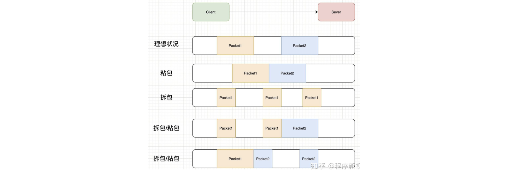
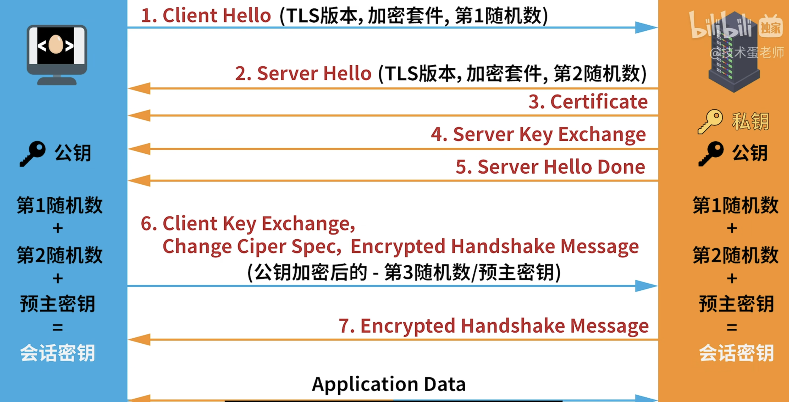

#### 如何实现流量控制的？

把接收方的接收窗口告诉给发送方，让发送方按自己的接收情况来发送数据。

#### 实现一个高并发、低延迟的直播或视频服务

通过 CDN 缓解源站服务器的压力，将直播流或视频内容分发到离用户更近的边缘节点。

#### 你觉得 URL 有长度限制吗？限制为多少？为什么？

有限制，依赖于浏览器、服务器（Nginx 最多 4096 个字符）。

推荐最大长度为 2,000 个字符，以保证兼容性和性能。（占用别的线程的资源）

#### 客户端向服务端的 IP 地址发送数据，服务端如何确定应该把数据传递给谁 or 操作系统做了什么事情能够把数据映射到对应的应用？

**四元组**（源IP、源端口、目标 IP、目标端口）。

客户端会使用自己的**源 IP **和**源端口**，向服务端的**目标 IP **和**目标端口**发送数据。

服务端的操作系统会监听指定的**目标端口**，收到后，通过**端口映射表**传递给**绑定该端口的应用程序**。

```
80 → HTTP Server
22 → SSH Server
3306 → MySQL
```

#### 如何解决 DNS 污染？

1）客户端，手动更换 DNS 服务器。

2）直接用 IP 请求。

#### 为什么域名要解析成 IP，不能直接通过域名找吗？

域名是为了方便人类记忆和使用而设计的，域名是互联网资源的逻辑名称，而 IP 地址是实际的网络地址。

#### TCP 黏包

TCP 黏包是**发送的多个数据包在接收端合并的现象**，因为 TCP 是**流式协议**，**没有边界**（UDP 是报文，有边界）。

接收端无法正确区分每个消息的开始和结束，**导致解析错误**。

解决方式：

1）每个消息固定长度，接收方按长度读取，不足长度的需进行填充；

2）在消息间加特殊字符（如 \n），接收方按分隔符拆分；

3）消息前加长度字段，接收方先读长度再读数据。



#### 当前视频是 TCP 还是 UDP？

直播：UDP。

YouTube：TCP，用户可以缓冲。

#### TCP 有 TCP 的分段，IP 层有 IP 分片，这两个有什么区别？现在用的是哪个？

TCP 分段是为了**当发生丢包时，只需要重传一小部分**。每个段可以单独确认和重传，确保数据的可靠传输。

IP 分片是为了满足网络链路支持的**最大传输单元**，**不同网络的 MTU 可能不同**。

应该尽量避免 IP 分片，当 IP 层对数据包进行分片后，**只要有一个分片丢失，就需要重传整个数据包**。由于 IP 层本身**没有超时重传机制**，依赖于传输层进行重传时，会导致所有分片都需重传一遍，这大大增加了网络开销和传输延迟。

（一个 TCP 报文段 ≈ 一个 IP 数据报（在无分片情况下））

#### 网络问题如何排查

1）查看日志

+ 寻找相应报错的日志，定位问题。

2）检查服务连通性

+ 用 ping 测试服务器到依赖服务（如数据库、缓存）的网络是否通，例如 `ping redis_host`。
+ 用 telnet 检查端口是否开放，比如 `telnet db_host 3306`。

3）测试接口

+ 用 curl 调用API，检查响应时间和状态，例如 `curl -v http://api.example.com`。
+ 测试 DNS 解析（`nslookup domain.com`）。

4）检查服务器状态

+ 检查带宽：流量超出网络接口或服务商限制，可能导致响应慢或丢包，使用 iftop 查看；
+ 检查 CPU 使用率：服务响应慢，请求排队，用 top 查看。
+ 检查内存占用： OOM、GC，`free -m` 查看

#### TCP 关闭连接后需要释放哪些资源

1）Socket 描述符。

2）服务器或客户端占用的本地端口会被释放，尤其是TIME_WAIT状态结束后，避免端口耗尽。

（文件描述符是操作系统分配给打开的文件、管道或网络连接的一个非负整数，用于**标识和管理这些资源**。它是用户程序与内核交互的“句柄”，**通过文件描述符可以进行读写、关闭等操作**。在Linux中，所有I/O操作（包括**文件、网络、设备**）都**抽象为文件**，文件描述符是统一的标识。比如，0是标准输入，1是标准输出，2是标准错误）

#### HTTPS

> https://blog.csdn.net/m0_59598029/article/details/135173059

**对称加密**：加密算法是公开的，靠的是秘钥来加密数据，使用一个秘钥加密，必须使用相同的秘钥才解密。

**明文 + 加密算法 + 私钥 => 密文；密文 + 解密算法 + 私钥 => 明文**

特点：**加密和解密使用同一个密钥**。

优点：速度快，适合加密大数据。

缺点：**密钥必须共享给对方，但网络传输可能被拦截**（如明文发送1被窃听）。

（可以双方“口头”约定，避免传输，但适合这种的场景很少；密钥丢了就会被破解，加密算法不是特别重要，能被破解的，主要就是密钥）


**非对称加密**：加密和解密使用不同的秘钥，一把公开的公钥，一把私有的私钥。公钥加密的信息只有私钥才能解密，私钥加密的信息只有公钥才能解密。

**明文 + 加密算法 + 公钥 => 密文； 密文 + 解密算法 + 私钥 => 明文**

特点：**使用一对密钥，公钥加密的数据只能用私钥解密，反之亦然。**

优点：安全性高。

缺点：计算慢，适合加密小数据。会遇到**中间人攻击**。


**中间人攻击**：

Tom 把公钥发给 Jerry 时，Spike 拦截并替换成自己的公钥。Jerry 用 Spike 的公钥（误以为是 Tom 的）加密消息。Jerry 把密文发给 Tom，但被 Spike 截获，用自己的私钥解密，拿到了传输的内容。

解决办法：**通过证书中心（CA）验证公钥可信度**。

Tom 向 CA 申请证书，提交自己的公钥和身份信息。CA 验证 Tom 身份后，用 CA 的私钥对 Tom 的公钥和身份信息签名，生成数字证书。证书内容：Tom 的公钥 + Tom 的身份 + CA 的签名。

Tom 把数字证书（而非裸公钥）发给 Jerry。Spike无法伪造证书，因为他没有CA的私钥。

Jerry收到证书后，用 CA 的公钥（预置在操作系统或浏览器中）验证证书签名。确认签名有效，证明公钥确实来自 Tom 且未被篡改。Jerry 再用证书中的公钥加密消息。

**TLS 握手的流程（SSL 大部分应用不太支持了）**：

客户端：支持的 TLS 版本 + 加密算法 + 第一随机数

服务端：选定的 TLS 版本 + 选定的加密算法 + 第二随机数 + 证书（含公钥）

客户端：预主密钥（用服务端公钥加密，并且会通过 CA 认证）（非对称加密）

双方用（第一随机数 + 第二随机数 + 预主密钥）生成会话密钥（对称加密）

完成握手


